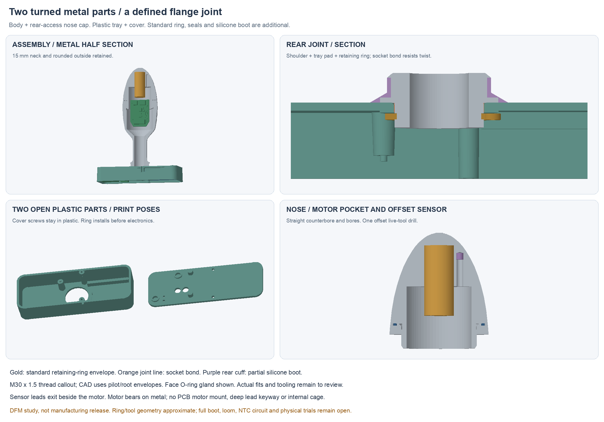

# Buttplug Compass

For AJ and other collaborators: start with [the checkpoint handoff](COLLABORATION.md).
It distinguishes the saved CAD from the newer keyed-collar/nut/locking proposals.

Current direction: **[manufacturing design proposal](developer-docs/docs/prototype-build-handoff.md)**
and **[native mechanical study](hardware/cad/manufacturing-layout/README.md)**.

Four main mechanical pieces: CNC-turned body, CNC-turned motor/thermistor cap,
open flange tray and rear cover. The 15 mm neck remains. A separate silicone
boot and standard insulation/foam replace the former multi-piece scaffold.
Battery selection and the human-owned product BOM remain open.

The cap has an integral motor pocket and a potted tip thermistor. The body
PCB is foam-supported in the cap as a prewired module; flange tails connect
only after it is threaded into the body. A turned shoulder/spigot and standard retaining ring capture the flange tray;
a bonded socket resists torque and a silicone cuff covers the wet-side joint.
The cover screws now close plastic only. See the [DFM review](hardware/cad/manufacturing-layout/DFM.md)
for machining sources, tool/setup candidates and tolerance budgets.

**Status:** mechanical DFM study, not a build/tooling release. The old P1 fit
kit is superseded. NTC circuit/firmware, PCB mounting features, cap thread/seal
detail, loom, boot/buttons, charger magnets and physical validation remain open.
No fabrication, powered operation, seal or wear result is claimed.

| Purpose | Source |
| --- | --- |
| Current design and remaining work | [Proposal](developer-docs/docs/prototype-build-handoff.md) |
| Native CAD, four STEP parts and two plastic study STLs | [Manufacturing layout](hardware/cad/manufacturing-layout/README.md) |
| Proposed assembly | [Assembly guide](assembly-docs/assembly-guide.md) |
| Prior circuit/routed-board reference | [R35F project](hardware/pcb/pack-pigtail-r35/candidate-f/system-r35.kicad_pro) |
| Existing bench code and compatibility limits | [Firmware](developer-docs/docs/firmware.md) |
| Requirements | [PRD](developer-docs/docs/prd.md) |
| Human-owned BOM | [hardware/bom.csv](hardware/bom.csv) |

Keep the seven current developer pages updated in place. Use Git history and
[targeted archived studies](developer-docs/docs/archive/index.md) for earlier work.
No auto-commit or publication. See [developer site setup](developer-docs/README.md).

Forked from [researchanddesire/rad-project-template](https://github.com/researchanddesire/rad-project-template).
Repository: `researchanddesire/buttplug`; the local folder keeps its earlier name.
Publication and licenses remain pending. See [LICENSE](LICENSE).
