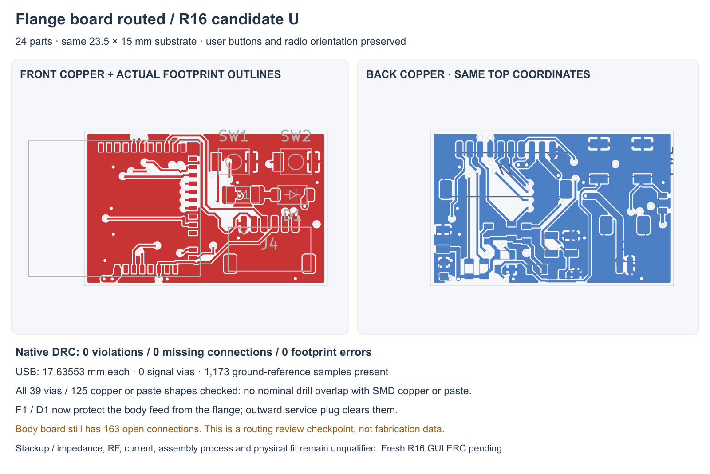

---
search:
  exclude: true
---

# Body power placement and charging input R16

1 November 2026. **Candidate U** continues the one-piece body, larger front cap,
separate body/flange boards and 15 mm neck. The [fuller R13F nose](simple-assembly-r13.md)
already removes the inward scoop Lucy pointed out. This revision changes internal
electronics, keeping that exterior fixed. The complete prototype proposal remains
unfinished.

## Functional placement

R12's body placement packed the parts, but several regulator capacitors and
feedback parts were 15–25 mm from their ICs. R16 reuses the existing R2 local
TPS63070 placement pattern for both body regulators. The motion/guard/logic
bypasses are also placed beside their ICs. This follows the manufacturer's
[local power-layout guidance](https://www.ti.com/lit/ds/symlink/tps63070.pdf);
placement alone does not qualify switching loops, grounding, thermal behavior or
the still-unrouted body board.

The substrate stays tapered 14→18 mm, Y26–54, four layers and 1 mm thick. Body
parts drop from 67 to 65 because F1 and D1 move to the flange beside the dock input.
That puts those input components before the body cable. Flange parts rise from
22 to 24. J6/J7 pin2 changes from `DOCK_5V` to the protected `VBUS_CHG` node.
Original circuit nodes, values, driver flags and NC declarations are preserved.

Thirteen non-divider resistors change from 0603 to proposed TNPW0402 candidates,
with the same resistance and precision targets. The candidate range/ordering
format comes from the [Vishay TNPW data sheet](https://www.vishay.com/docs/28758/tnpw_e3.pdf).
The larger regulator feedback parts stay in their original packages. Nominal
schematic resistance/function labels remain intact; candidate MPNs are recorded
on the PCB and in review notes. Generic lands, stencil, power/thermal use and
availability still need review.

J2 changes to a proposed [Molex 504050-0491 Pico-Lock header](https://www.molex.com/en-us/products/part-detail/5040500491),
retaining the same four-pin protected-pack/dual-NTC interface. The study uses a
2.3 mm height allowance and nominal mating probe; a controlled installed mate,
wire exit, current and tolerance review is still needed. **Battery selection
remains OPEN.** No part is added to the human-owned BOM.

## Routed flange

J4 faces outward again so its service plug clears the new input parts. The USB
pair was rebuilt and remains entirely on F.Cu: 17.63553225/17.63553391 mm,
0.2 mm wide, with zero signal vias. Discrete checks find all 1,173 center/edge
samples over filled In1 GND. These samples do not establish impedance or complete
reference geometry. No signal track uses In1.

The final charging-power escape follows an actual native geometry screen. Six
0.6 mm In2 tracks close the remaining input gap; all three input nets use 0.6 mm
track widths. This is not a current or temperature qualification. Earlier failed
escapes, the stopped router trial and all native findings remain preserved.

Candidate U has native zero DRC violations, missing connections and footprint
findings on the flange. All 119 electrical pad entries match fresh native flange
XML, with fourteen explicit NC pins kept netless. All 39 through vias are checked
against 125 native copper/paste shapes with no drill overlaps. Hole filling,
tenting, stencil and assembly process acceptance remain open.

## Circuit and mechanical checks

The 13-sheet source audit compares actual symbol/wire/NC/label/junction atoms,
allowing only fourteen declared candidate field changes, the F1/D1 sheet-context
move and two header-label changes. Cached symbol definitions stay unchanged.
Fresh native full-device XML contains the same 94 components and 338
pin/net/function/type nodes. All original 318 nodes remain unchanged; only J6/J7
pin2 changes among the twenty later header nodes. This is circuit conservation,
not a fresh GUI ERC run; R14's saved ERC is preserved source evidence.

The body has native zero placement/footprint findings but still **163 missing
connections**. The actual pad maps of all 89 main footprints match the declared
partition. The saved PCB files supply conservative part/Fab height envelopes;
they are not controlled maximum component models.

Read-only R13F context screening has 5,805 new-vs-fixed/new primary pairs with no
primary intersections. Four nominal mate intersections remain: J2 against the
carrier and keeper, and J3/J5 against the keeper. Those openings must be designed
and the loading/retention checked again. The R13 native CAD is not updated with
these poses. Existing fixed-pair evidence remains scoped to R13; the screen does
not establish continuous loading, wires, tolerance, strength or physical fit.

## Next prototype work

Route and review the body power/logic circuits, revise the carrier/keeper around
the real plugs, and define the supported interboard harness and flange attachment.
Local switch operation, the stationary tip/thermal interface, exact pack/parts,
materials/seals and a practical complete first-build plan remain unfinished.
The 24-hour battery target and wear-duration request are not validated by these
digital checks. No procurement, fabrication or physical result is claimed.

Native sources, exact reports and preserved attempts live in
`hardware/pcb/route-r16/`. The human BOM and earlier native design checkpoints
remain unchanged.
