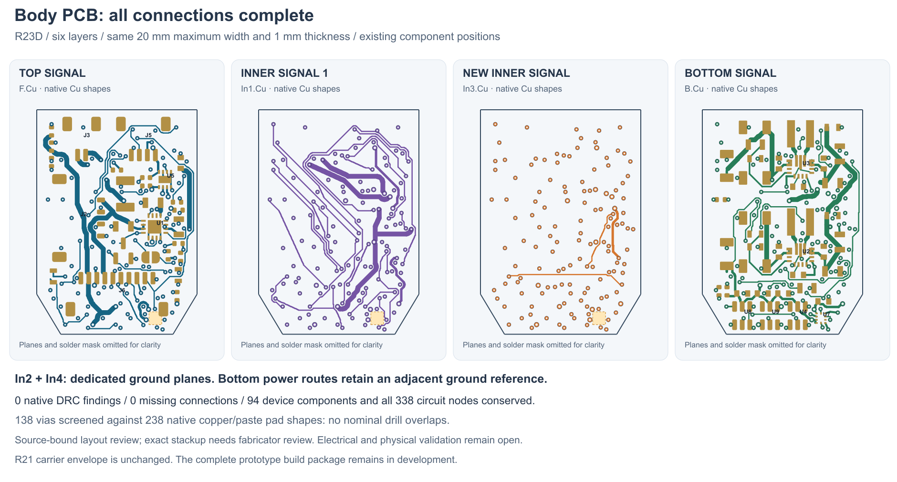

---
search:
  exclude: true
---

# Completed body routing: R23D

1 November 2026. The body PCB now has **zero native DRC findings, zero
unconnected pads and zero footprint findings**. R23D preserves the 14-to-20 mm
tapered outline, 28 mm length, nominal 1 mm thickness and component poses.
The complete prototype proposal remains unfinished.

The body uses six copper layers: F signal, In1 signal, In2 ground, In3 signal,
In4 ground and B signal. The saved nominal dielectric sequence is
0.1 / 0.1 / 0.44 / 0.1 / 0.1 mm; outer copper is 35 µm and inner copper 17.5 µm,
with 10 µm mask on each side. The total is 1 mm. The bottom power routes have
an adjacent In4 ground plane separated by 0.1 mm. This is a provisional
fabricator-review stackup, not an approved manufacturing specification.

The flange remains the byte-identical routed R16U four-layer board. All 94
device components, 338 pin/net/function/type nodes and 13 complete schematic
sheets are conserved, with recorded filename/process/package differences.
All 89 main-board part/pad records and component poses match the prior
inspection. The body has 2,458 track/via records including 138 vias. A native
screen against 238 copper/paste pad shapes found no drill overlaps.

The saved copper audit accounts for the original 362 protected seed records:
353 remain unchanged, two have declared ground rework replacements and seven
unused records were explicitly retired. Both ground planes pass the recorded
1,260 local bottom-power reference samples, with no signal tracks on either
plane. These are scoped geometry and circuit-conservation checks; they do not
establish electrical operation, full return-path integrity, EMC or heat limits.

## Source and retained attempts

Native project, schematic, board and reports:
`hardware/pcb/stackup-r23/candidate-d/`. Body SHA-256:
`19f0c9b20d4b6e6c43636076531297af3eab12effb196b8ce46c807de477491b`.
`body/native-drc.json`, `saved-stackup-review.json`,
`saved-body-copper-audit.json`, `circuit-conservation.json` and
`drill-paste-inventory.json` bind the checks to saved source bytes.

A creates the six-layer seed from the checked R19W four-layer trial. Its
metadata filename error was repaired explicitly without changing native copper.
B adds the remaining 87 route records, reaching zero unconnected pads with
nine unused-via warnings. C stopped on a KiCad library-cache failure during a
second in-process DRC. D starts from B, removes the nine unused vias and two
native-reported dangling tracks, and adds nine same-layer junctions. It runs
each native DRC in a fresh child process and finishes with zero findings.
The first stackup-review indexing error and corrected review are preserved.

## Mechanical and build boundaries

Current board envelopes match the preserved R21C component/substrate geometry
in `hardware/design/pcb-integration-r21-bindings/r23-candidate-d-envelopes.json`.
This binds nominal dimensions only. **Lucy rejected R21's shared PCB/motor
keeper:** the next mechanical design needs a motor mount coupled to the metal
shell and independent PCB support. No completed motor load path is claimed.

Semi-flex and a rotated flange PCB are now allowed; see the
[R24 comparison](flange-orientation-r24.md). These need their own native
design and checks if adopted. Fresh GUI ERC, supplier stackup review, current
CAM/assembly exports, actual wires/flex, controls, flange retention, stationary
tip support, seals, candidate parts/process and the practical build plan remain
open. Battery selection remains OPEN; the human-owned BOM is unchanged.
