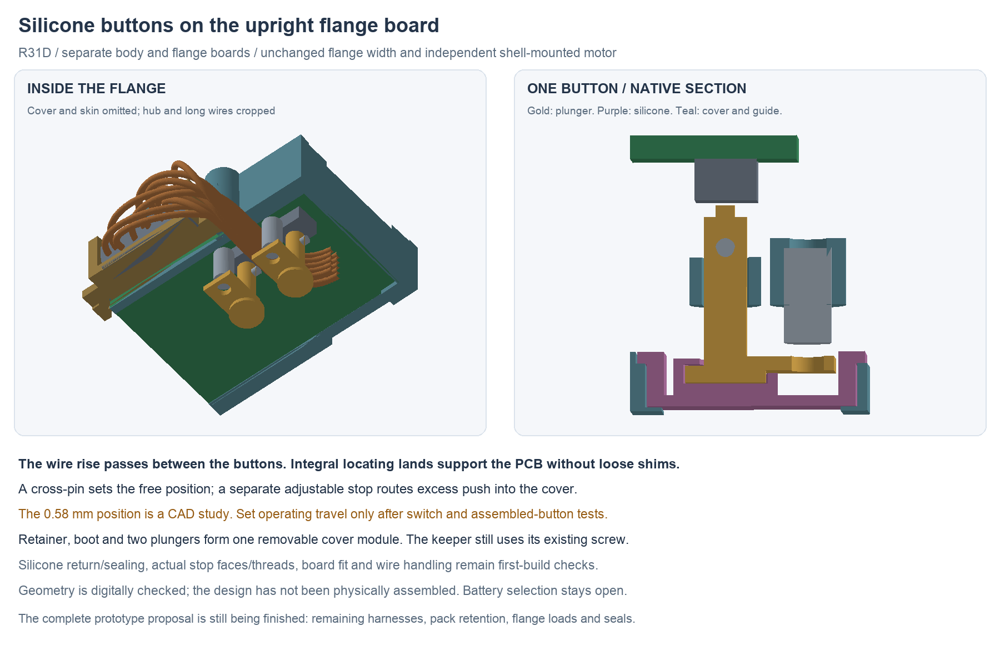

---
search:
  exclude: true
---

# Silicone button cassette R31

R31 develops the power and mode controls on the existing upright flange board.
It retains the one-piece body, 15 mm neck, independent shell-mounted motor,
board poses and outer flange width. Two guided insulating plungers reach the
existing B3U switches through a removable cover module. The interboard wire
rise passes between the buttons. This is a prototype mechanism for bench
calibration, not an established operating-travel or sealing specification.

## Sources and mechanism

The editable native source is
`hardware/cad/buttons-r31/candidate-d/ButtonsR31.FCStd`.
Its adjacent `ButtonsR31-review.FCStd` is a display copy with the construction
objects and exterior skins hidden; it retains the native editable history.
`geometry-report.json`, `saved-review.json` and `assembly-screen.json` bind
the geometry and finite checks. The R28S native circuits and boards are unchanged;
the human-owned BOM remains header-only and the battery choice remains open.

Each plunger has a Ø0.8 mm tip, Ø1.8 mm guided stem and transverse home pin.
A silicone cup captures its head for return. A separate arm contacts an
adjustable M2 stop, directing excess push into the cover rather than the PCB.
The two stops are independently adjustable during bench calibration. A flush
bezel retains the continuous silicone lid with two countersunk screws. The
installed lid is recessed 0.2 mm from the cover surface; this is geometry,
not accidental-press protection or a cleaning/comfort result.

The SW2 guide is Ø3 mm outside with a Ø2 mm bore; its stop boss is Ø3.2 mm
outside with a nominal Ø1.6 mm tap pilot. These smaller bosses let the wire
bank clear the keeper's approach. Their nominal walls are 0.5/0.8 mm; material,
finish, tapping and button-load tests must establish whether they are usable.
The SW1 guide/stop bosses remain Ø3.8/4 mm.

Integral cradle lands register the board with 0.05 mm total nominal play,
replacing the loose shim idea. They contact 0.20 mm FR4 edge bands. A read-only
native-board review includes front/back pads, tracks, via annuli, saved filled
zones with holes, paste and conservative drill envelopes. All 14 contact
projections clear those features; the smallest nominal surface-conductor gap
is 0.1005 mm. Fit these lands to the received board before setting the buttons.
This does not establish board-edge finish, interchangeability or deflection
under switch loads.

## Travel and stop limits

The [OMRON B3U reference](https://omronfs.omron.com/en_US/ecb/products/pdf/en-b3u.pdf)
gives pretravel and height variation, but no numeric allowable overtravel.
Pretravel is not a total-stroke limit. From height and pretravel alone, the
current geometry gives a free gap of 0.2375–0.4875 mm and a switching-travel
range of 0.2875–0.8375 mm, before board seating, soldering and deformation.
The nominal 0.58 mm CAD stop therefore cannot be applied to every assembly.
The geometric adjustment range is 0.05–0.95 mm; it is not an approved range
of switch compression.

Before operating the prototype, obtain controlled switch travel/load data or
characterize sacrificial switch-and-boot coupons, including return and cycling.
Use that result to define a permitted stop range, then calibrate each assembled
button with electrical continuity and measured displacement/force. If closure,
release and a protective stop cannot coexist within that range, revise the
mechanism or switch before energizing the motor. The first-build procedure is
in `assembly-docs/buttons-r31.md`.

The M2 cylinders are fastener allowance envelopes, not complete screw profiles.
The plunger bears on the screw's **socket-end annular face**, around its Ø1.4 mm
calibration hole. A generic set screw is not automatically suitable:
[Accu's M2×4 reference](https://www.accu.co.uk/api/product-datasheet?id=152431)
specifies a 0.9 mm socket and end chamfers, but does not control the socket-end
flat diameter needed here. The prototype interface requires an inspected or
custom flat annular face with at least Ø1.9 mm outside diameter and no projecting
drive burr; confirm the mating arm and available bearing area under load.
Stop-thread locking, drift and plastic compatibility remain to qualify.

The countersunk screw reference is
[Accu SIK-M1.6-5-A2](https://www.accu.co.uk/api/product-datasheet?id=65874):
nominal head Ø3 mm, 0.96 mm head length and 90° +2°/−0° cone. CAD reserves
Ø3.2 mm and 1 mm head depth with a Ø3.4 mm seat entrance. Inspect the actual
head/transition and tap/drive fit before assembly; catalog stock, finished
contact suitability and torque are not established. The PDFs and source
hashes are retained in the R31 package. No fastener has been added to the BOM.

## What the geometry checks mean

The R31 report separates unexpected intersections from the intentional
press-fit pin and unmodeled screw/pilot thread interfaces. Rigid press studies
omit the deforming silicone and record entry into the own-switch conservative
height box; they do not simulate actuator compression. The complete rear
module, keeper, loose-end hub closure and populated-board slide each have
listed installation poses. These are finite checks, not continuous or physical
assembly acceptance.

`calibration-access-review.json` supplements the initial short shaft checks
with six full Ø1.3 mm shafts reaching the stop faces at the 0.05, 0.58 and
0.95 mm geometric settings, with the boot/bezel absent. Actual socket/key
engagement and hand access remain separate; these settings do not approve
switch compression.

The wire plan reroutes only the flange extension, rise and loops, preserving
the body/neck prefix and ten pin/net mappings. Every stored Bézier/circle path
is compared after reopening and recomputing the native file. Fresh full-plan
curvature and separation guards replace the old R29 route results. The R30
loose-end assembly stage remains the starting order: close the hubs before
forming and terminating the flange loops. Finished cut lengths and actual
egress, forming, cure/adhesion and service movement still need first-build work.

Candidate A's 33 rest clashes, B's keeper/wire clash and C's keeper-approach
clashes remain preserved. D moves the rise 0.6 mm toward SW2 and reduces those
two local bosses. It also widens the cup's upper exit locally; the screw boss
and all source keeper material below Z8.6 remain. The 0.40 mm upper rim is a
local prototype geometry, not an accepted wall-strength rating.

The complete prototype proposal still needs the remaining harnesses, pack/NTC
retention, flange load/compliance and seal details, and a consolidated build
package. No physical prototype, wear-duration or sleep-use acceptance is
claimed by these files.
