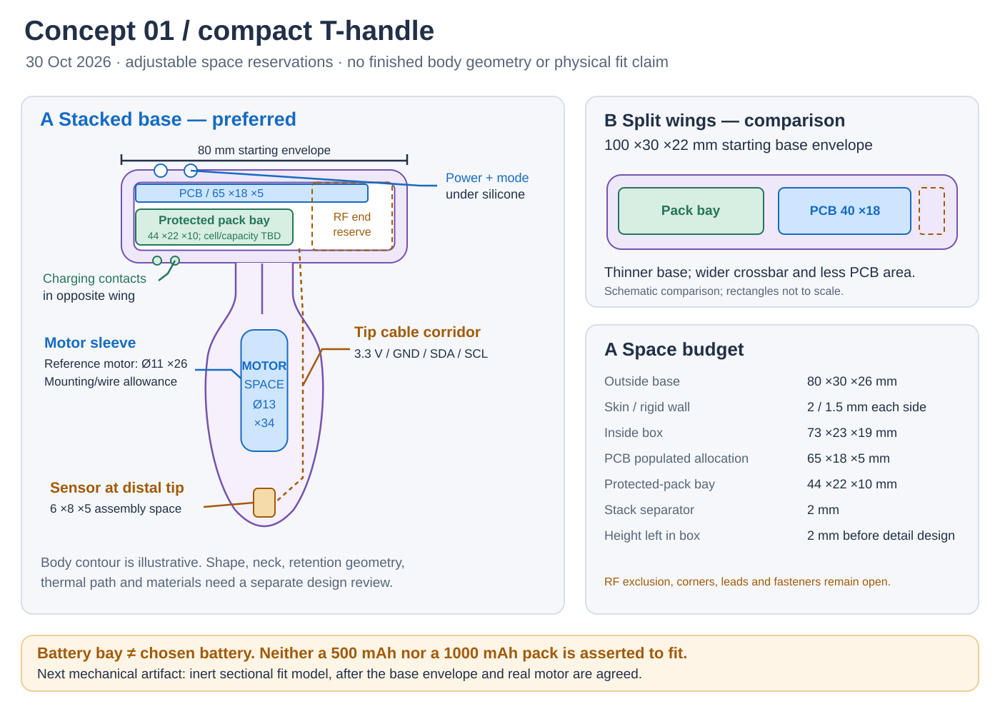
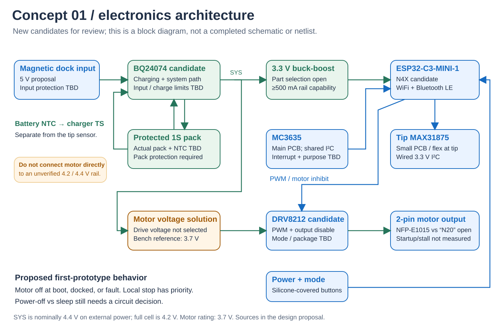
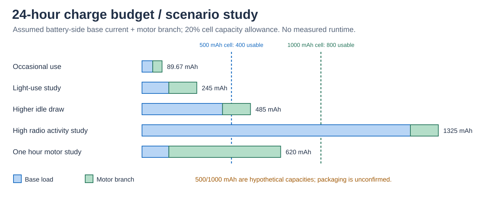

---
search:
  exclude: true
---

# Concept 01: Compact T-Handle

**Mechanical layout superseded by [Concept 02](design-proposal-v2.md).** Lucy selected a T-shaped board following the toy's XY silhouette, including a body tongue. The rectangular PCB and preferred base stack below are retained as the prior study. Electronics candidates and power scenarios remain proposals.

30 October 2026. The first design pass optimizes for a **compact T-handle**, as selected by Lucy. The concept uses a stacked battery/PCB cartridge in the base, an axial motor in the body and a small wired temperature-sensor assembly at the tip.

This advances the [PRD](../prd.md) into a packaging and electrical proposal. Dimensions, new part candidates and behavior below are proposed for review. The screenshot remains the historical schematic input; it is not a completed implementation of this concept.

## Internal layout



**A — stacked base is the preferred route.** Put the protected pouch pack below the main PCB, with a separate cradle and PCB shelf. A rigid core carries handling loads around the pack bay and through the neck; the cell does not carry structural loads. Keep the radio antenna at an outer end, away from the cell and charging magnets. Separate the charging/driver heat sources from the pack as the board placement develops.

**B — split wings is the fallback.** Put battery and PCB side by side. This reduces stack height and separates warm components from the pack, but widens the base and reduces available PCB area.

| Reservation | A: stacked base | B: split wings | Status |
| --- | --- | --- | --- |
| Outside base, width × depth × height | 80 ×30 ×26 mm | 100 ×30 ×22 mm | Sketch starting points, not accepted product dimensions. |
| Populated PCB allocation | 65 ×18 ×5 mm | 40 ×18 ×5 mm | No placement/routing completed. A extends toward the RF end. |
| Protected-pack bay | 44 ×22 ×10 mm | Same | Includes protection, tabs and lead exit. Actual cell must fit with its supplier clearances. |
| Silicone skin allowance | 2 mm each side | Same | Molding, button force and vibration transmission will determine thickness. |
| Rigid wall allowance | 1.5 mm each side | Same | Structural concept only; no material or load validation. |
| Battery/PCB separation | 2 mm | Side-by-side gap: 3 mm | Preliminary spacing, not a validated thermal or swelling allowance. |
| Motor sleeve reservation | Ø13 ×34 mm | Same | Space for the Ø11 ×26 mm reference motor and provisional mounting/lead exit. |
| Tip assembly reservation | 6 ×8 ×5 mm | Same | Sensor, decoupling, attachment and strain relief still to fit. |

Subtracting skin and rigid-wall allowances leaves a nominal **73 ×23 ×19 mm** rectangular interior in A. The 10 mm pack bay, 2 mm separator and 5 mm populated PCB stack use 17 mm of height, leaving 2 mm in the box model. Rounded ends, fasteners, lead bends, assembly clearance, pack swelling and local antenna exclusion have not been fitted. The pack and PCB rectangles fitting this box does not establish physical fit.

The body contour in the drawing is illustrative. Finished body dimensions, neck, retention geometry, material suitability and cleaning/sealing details remain a separate design task. The older ≤25 mm circular-PCB note is an unresolved legacy input; this proposed base PCB is rectangular.

The motor gets its own sleeve and a parallel wire corridor. The tip sensor needs a defined thermal path through the silicone and separation from motor heat. Both buttons and both charging contacts stay on the base. Anchor the contacts into the internal carrier with a designed sealing interface; a hole through silicone alone is not an assembly design.

## Electronics proposal



| Block | Proposed direction | Why / remaining work |
| --- | --- | --- |
| Controller/radio | ESP32-C3-MINI-1-N4X module | Replaces the draft's bare chip plus unfinished RF network with a module containing the clock/RF/antenna. The module is 13.2 ×16.6 ×2.4 mm; the current datasheet recommends N4X. Confirm antenna placement and actual radio performance in the assembly. [Espressif datasheet](https://documentation.espressif.com/esp32-c3-mini-1_datasheet_en.html) |
| Charger/power path | BQ24074 candidate | Replaces the simple MCP73831 charging block with a system power path, charge/input-current configuration and battery NTC input. Program limits after choosing the cell and thermal arrangement. [TI datasheet](https://www.ti.com/lit/ds/symlink/bq24074.pdf) |
| Cell protection | Protected 1S pack, exact pack open | Pack-level overcharge, overdischarge, overcurrent and short-circuit protection need documented thresholds. Charger functions do not replace the discharge-protection requirement. |
| Logic supply | Low-quiescent-current 3.3 V buck-boost, part open | A 1S cell crosses the logic voltage during discharge. Reserve at least 500 mA supply capability per the [Espressif design guidance](https://docs.espressif.com/projects/esp-hardware-design-guidelines/en/latest/esp32c3/schematic-checklist.html); this is rail capability, not assumed average draw. |
| Motor driver | DRV8212 candidate | PWM bridge with compatible logic and internal protection. Its 4 A peak headline is not a continuous-current rating or the motor's required current. Exact package, mode, decoupling and thermal capability need review. [TI datasheet](https://www.ti.com/lit/ds/symlink/drv8212.pdf) |
| Tip temperature | Retain MAX31875 as provisional | This is a local digital sensor, so place the sensing IC on a small tip PCB/flex and wire power, ground, SDA and SCL back to the controller. The battery charger needs its own pack NTC. [Analog Devices](https://www.analog.com/en/products/max31875.html) |
| Motion | Retain MC3635 as provisional | Start with shared I²C plus its interrupt, then confirm axis orientation and the intended motion feature. [MEMSIC datasheet](https://www.memsic.com/Public/Uploads/uploadfile/files/20220119/MC3635Datasheet.pdf) |

**Resolve motor voltage before connecting its power branch.** The manufacturer lists 3.7 V rated and 450 mA maximum rated current. That does not establish permissible 4.2 V pulses from a full cell. BQ24074 SYS regulates nominally to 4.4 V with input power available. Direct battery/SYS drive remains unconfirmed, and reducing average PWM duty does not demonstrate that overvoltage pulses are allowed. The first characterization uses a current-limited bench supply at the published 3.7 V reference. Obtain the motor voltage/startup/stall information before selecting direct drive or a regulated motor rail. [Motor listing](https://nfpshop.com/product/nfp-e1015-encapsulated-vibration-motor-with-metal-cover-7g-vibration-force), [BQ24074 comparison table](https://www.ti.com/lit/ds/symlink/bq24074.pdf).

This introduces three new part candidates, not three confirmed BOM entries. The canonical product BOM remains header-only.

## Interface plan

| Interface | Proposed connections | Decisions before schematic freeze |
| --- | --- | --- |
| Dock | CHG_IN and GND, two external contacts | 5 V source proposal; polarity, current limit, ESD, magnetic alignment, wet-contact behavior and sealing. |
| Battery | Protected PACK+ and PACK− connector | Actual pack and connector polarity; add a separate battery NTC connection. |
| Tip sensor | 3V3, GND, SDA, SCL | Cable length/routing, decoupling, pull-ups, rise time and behavior with motor running. |
| Motor | Bridge OUT1 and OUT2 | Two-pin breakout; neither lead is assumed to be permanently grounded. |
| Local controls | Two silicone-actuated buttons | Momentary vs latching, travel, force, false activation and power-off behavior. |
| Motion | Main-PCB I²C + INT | Purpose, orientation, sampling and interrupt use. |
| Programming | Internal USB Serial/JTAG service pads plus boot/reset access | Retain service access during development without adding an exterior USB port to the concept. |

An initial GPIO budget is 12 signals: buttons (2), I²C (2), accelerometer interrupt (1), motor controls (2), battery voltage sense (1), charger status/power-good (2) and USB data (2). This is a budget, not a pin assignment. Verify module pin availability, strapping, sleep wake inputs and ADC functions before allocating pins. Service/status signals can be reduced if necessary. Motor enable defaults need hardware treatment as well as firmware.

## Proposed operating behavior

| State | Motor | Control behavior to implement |
| --- | --- | --- |
| Boot/reset | Off | Hardware defaults keep outputs disabled before firmware starts. |
| Awake/idle | Off | Advertise/connect according to the agreed radio policy; read sensors. |
| Active | Bounded PWM | Local stop has priority. Validate command freshness and all required sensor/power conditions. |
| Docked/charging | Inhibited for prototype 1 | Use charger power-good in the inhibit design; firmware alone is not the whole circuit. |
| Fault | Off | Define battery-low, sensor failure, stale command and recovery behavior; no automatic restart proposal. |
| Sleep/off | Off | Decide software sleep versus true electrical cutoff. They have different storage-current behavior. |

These are proposed design requirements, not implemented behavior. Mode patterns, command timeout, thermal limits/response and power-button timing are not assigned arbitrary numerical values in this pass. The battery NTC and tip sensor serve different purposes; one does not substitute for the other.

## Battery budget: what 24 hours requires



The editable study uses a 3.7 V nominal battery, the motor's 450 mA rated-current reference at 3.7 V, an assumed 90% motor-supply efficiency and an assumed 80% usable cell capacity. Base current is an assumed average **at the battery**, including logic conversion loss and standby loads, but excluding the motor branch. These values are inputs for comparison, not predicted component consumption.

| Scenario | Assumed base current | Motor time / 24 h | Battery charge / 24 h | Required nameplate capacity with allowance |
| --- | --- | --- | --- | --- |
| Occasional use | 2 mA | 5 min | 89.67 mAh | 112.08 mAh |
| Light-use study | 5 mA | 15 min | 245 mAh | 306.25 mAh |
| Higher idle draw | 15 mA | 15 min | 485 mAh | 606.25 mAh |
| High radio activity study | 50 mA | 15 min | 1,325 mAh | 1,656.25 mAh |
| One hour motor study | 5 mA | 60 min | 620 mAh | 775 mAh |

For example, the light-use study spends 120 mAh on the base electronics and 125 mAh on the motor branch. In this arithmetic, a hypothetical 500 mAh cell has 400 mAh usable and covers that profile; it does not cover the 15 mA-base case. Neither 500 mAh nor 1000 mAh is asserted to fit the pack bay. Radio policy and measured idle draw may be more useful size levers than choosing a larger cell.

The model is nominal-voltage energy arithmetic. It does not establish startup/stall current, temperature behavior, low-battery cutoff, discharge-curve effects or physical runtime. Motor current is not assumed linear with PWM duty.

## First prototype sequence

1. **Fit the inert cartridge.** Choose the base envelope and obtain the actual motor/pack drawings. Build an open sectional carrier with dummy masses. Check tabs, lead bends, antenna space, button travel and contact retention before any overmold.
2. **Characterize the motor separately.** From the 3.7 V reference and an appropriately current-limited bench setup, record startup, running behavior and temperature. Get manufacturer guidance for allowable voltage and fault/stall characterization before final driver/rail sizing.
3. **Prove power and sensing on the bench.** Start with development boards and a representative tip harness. Verify logic power, charging/load path, protected pack behavior, dock inhibit and motor interference on sensor/radio operation.
4. **Measure the thermal/mechanical assembly.** With representative silicone and no human contact, measure tip-sensor lag and motor heat bias, vibration transmission and button force. Use those results to set geometry and behavior requirements.
5. **Draw the native schematic.** Import Lucy and Gaby's editable KiCad project if available; otherwise start a new design from this reviewed block/interface plan. Assign pins, calculate components and complete ERC before PCB layout.

The next decisions are whether the starting 80 ×30 ×26 mm base is acceptable, which actual motor is intended and what “light use” means. Native CAD/PCB layout follows those inputs; this pass provides the editable concept and calculations needed to choose them.

## Sources and reproducibility

Mechanical inputs: `hardware/cad/concepts/layout-v1.json`; editable vector: `hardware/cad/concepts/layout-v1.svg`.

Power inputs/results: `hardware/design/power-scenarios-v1.json` and `hardware/design/concept-results-v1.json`. Electrical vector: `hardware/pcb/concepts/architecture-v1.svg`. Vector drawings are schematic illustrations, not CAD solids or board layouts.

```bash
python3 tools/concept_budget.py --self-test
python3 tools/concept_budget.py --output hardware/design/concept-results-v1.json
python3 tools/render_concept.py
```

The SVG layout uses fixed illustration coordinates; update its generator when changing the geometric concept. The box/power calculations read their JSON inputs. PNG review copies can be rendered with `rsvg-convert` from the SVGs. No commit, fabrication release, physical validation or docs publication is part of this design pass.
