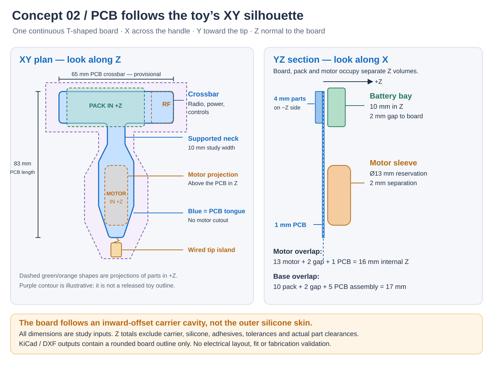

---
search:
  exclude: true
---

# Concept 02: T-Shaped PCB in the Toy's XY Profile

30 October 2026. Lucy confirmed that the PCB should follow the full T-shaped profile: the handle crossbar and a longitudinal tongue through the body. This replaces Concept 01's rectangular board stacked entirely inside the handle. The electrical architecture and power scenarios remain proposals; this revision changes their mechanical arrangement.

**Current contour work:** [Concept 03](design-proposal-v3.md) makes pelvic fit and tailbone/perineal clearance lead the outer shape. The single T-shaped board remains the selected topology, but every dimension below needs reassessment inside that contour. This study does not establish wear comfort or a safe wear duration.

## Orientation and board outline

Use **X across the handle, Y from the handle toward the tip, and Z normal to the board**. The PCB lies flat in XY. Battery and motor occupy separate volumes offset in Z; drawing them over the PCB in plan view does not mean they intersect it.

The board follows the available **inner cavity**, with space for the carrier, silicone and assembly clearance. Its outline must not trace the outer silicone surface directly. Round the crossbar-to-tongue transitions and support the longitudinal tongue. A rigid carrier must carry loads through the neck and into the handle; the PCB and battery are not structural members.

These dimensions define a first editable outline study, not approved product sizing:

| Parameter | Draft study input | Meaning |
| --- | --- | --- |
| Crossbar | 65 mm X × 18 mm Y | Planar board envelope within the handle. |
| Narrow neck | 10 mm X | Initial tongue width at the neck; component and routing fit remain open. |
| Widest body tongue | 20 mm X | Expands below the neck, then tapers toward the distal end. |
| Tongue extension | 65 mm Y beyond the crossbar | Continues through the body toward the tip. |
| Overall board extent | 65 mm X × 83 mm Y | Includes the 18 mm crossbar and 65 mm extension. |
| Nominal board thickness | 1 mm Z | Study input, pending support, fabrication and stiffness decisions. |

No overall toy width, length or thickness is approved. The earlier 80 × 30 × 26 mm handle box and rectangular 65 × 18 × 5 mm PCB allocation remain historical Concept 01 studies. They do not establish the outside dimensions or board orientation of this revision. The schematic screenshot's older ≤25 mm circular-board note also remains unresolved.

## Components occupy separate Z volumes

Keep the battery across the handle, offset from the board. Place the motor along Y in the body, also offset from the board. The proposed overlap zones need their own thickness budgets:

| Overlap region | Initial Z budget | Limit of the calculation |
| --- | --- | --- |
| Motor over component-free board | 13 mm motor reservation + 2 mm separation + 1 mm board = **16 mm inside** | Excludes carrier walls and silicone; mounting and lead bends still need fitting. |
| Protected pack over populated board | 10 mm pack bay + 2 mm separation + 5 mm populated-board allocation = **17 mm inside** | The 5 mm allocation includes the board. Actual component placement and pack clearances remain open. |

The motor reservation is Ø13 × 34 mm. Keep both board faces free of components wherever that reservation overlaps the board in XY. A support or motor sleeve must hold the motor without pressing it against FR4. Route the motor connection near its lead exit and leave a defined cable path through the carrier. At the base, the illustrated 5 mm populated-board allocation is 1 mm board plus 4 mm component allowance on the −Z side.

The pack bay is 44 × 22 × 10 mm, including protection, tabs and lead exit. It is a space claim, not a selected cell or a capacity claim. Its 22 mm width in Y can extend beyond the crossbar's 18 mm board depth: the battery bay and board are different shapes. The carrier and outside handle must accommodate both. Neither a 500 mAh nor a 1000 mAh pack is asserted to fit.

Keep radio placement at an outer crossbar end, with its eventual exclusion volume clear of the cell, magnets, contacts and wiring. Both local controls and the two external charging contacts stay at the base. Their travel, mounting and sealing volumes still require placement.

## Keep the tip sensor independent

Retain a small wired temperature-sensor island at the distal tip for this revision. Run power, ground, SDA and SCL through a separate corridor beside the motor. The long PCB tongue does not require the sensing IC to sit on the main board.

This lets the tip position and thermal path change without redrawing the entire board. Anchor the harness at both ends and characterize response through representative silicone, including bias from motor heat. Moving the sensing IC onto the rigid tongue would require a separate thermal and mechanical review.

## Editable artifacts and next validation

The source reservations are `hardware/cad/concepts/layout-v2.json`, with the editable illustration in `hardware/cad/concepts/layout-v2.svg`. The native outline and DXF are `hardware/pcb/concepts/xy-outline-concept.kicad_pcb` and `hardware/pcb/concepts/xy-outline-concept.dxf`. Regenerate them with `python3 tools/concept_xy.py`.

The KiCad artifact contains mechanical Edge.Cuts geometry only: **zero footprints, tracks and nets**. It is not a placed board, routed design or fabrication release.

KiCad 7.0.7 parsed the rounded outline and exported `hardware/pcb/concepts/xy-outline-concept.step` as a board-only model with a 1.000 mm study thickness. This confirms conversion of the outline; it does not confirm product fit or electrical design. The native file's simple two-layer stack is a model placeholder, not an approved fabrication stackup.

Next, compare the XY outline and both Z stacks in an inert sectional carrier using board and component dummies. Resolve neck support, motor retention, real pack dimensions, wiring, controls and antenna space before placing circuitry. The drawing and arithmetic provide a reviewable starting point; they do not establish CAD-solid fit, structural strength, molding feasibility or physical performance.
