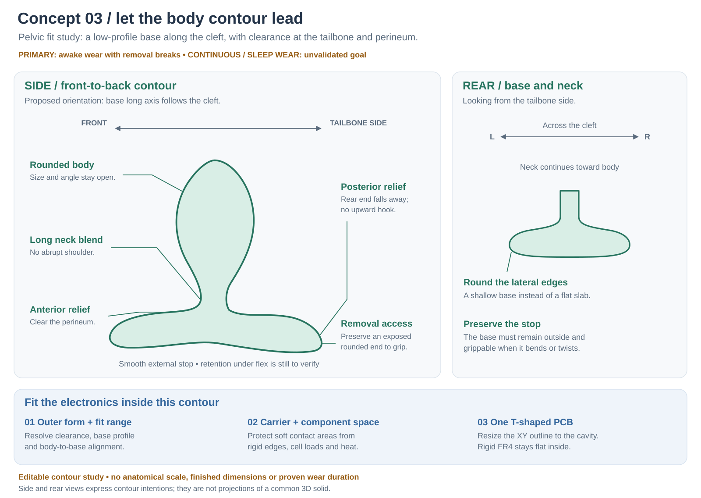

---
search:
  exclude: true
---

# Concept 03: Pelvic Contour Before Electronics

30 October 2026. The primary use goal is awake wear with removal breaks. Lucy also wants to explore continuous wear including sleep for experienced users. These are intended-use goals, not established safe durations; experience does not validate the secondary mode. The separate 24-hour battery target remains an electrical requirement.

The selected construction direction is now [Plan A: hollow cast-metal body with a whole polymer flange](materials-and-rf-study.md). Keep this contour's anatomical intent while developing the rigid metal body and flange joint; the illustration does not define material compliance or a finished wall section.

## Shape direction

Study a shallow, front-to-back base that follows the cleft, with the posterior end falling away from the tailbone region. Give the front end perineal clearance, round the lateral edges and blend the neck into the base over a long, smooth transition. Keep the external stop and an accessible rounded end for removal. A thin base that can fold inward is not an acceptable solution to bulk.

The proposed contour is an engineering hypothesis. It is not derived from a pelvic scan, anthropometric dataset or fitted prototype. The side and rear illustrations express separate contour intentions; they are not orthographic projections of one 3D solid. No dimensions or uniform anatomical scale can be inferred from them.

| Feature | Direction for the next solid model | Still to establish |
| --- | --- | --- |
| Posterior wing | Fall away from the coccyx region; avoid an upward hook or stiff raised end. | Clearance over the intended fit range and postures. |
| Anterior wing | Relieve the perineum-facing surface; keep a smooth outward removal end. | Front clearance and removal access with clothing displaced. |
| Base across the cleft | Explore a shallow saddle with rounded lateral edges and low outward projection. | Width, thickness, compliance and behavior when seated or moving. |
| Neck and shoulder | Use long blends without an abrupt shoulder, ridge or crease. | Neck diameter/length, blend radii and deformation. |
| Body relative to base | Vary angle and offset independently during design. | Alignment and size range; no product adjustment mechanism is specified. |
| External stop and grip | Preserve a broad flared stop and accessible grip under deformation. | Resistance to folding, twisting, inward migration and loss of removal access. |

The aim is clearance near the coccyx, not support that presses on it. Do not assume one pelvic curve fits every wearer or posture. Standing, seated, walking and bending configurations must be considered; these are geometry-review cases, not instructions for a wear trial.

## Body directions and toy axes

The drawing's **front is anterior/perineum-side; rear is posterior/tailbone-side**. The base long axis is proposed to run front-to-back within the cleft. This orientation is a study choice for review, not a previously confirmed fit.

Preserve the toy coordinate convention: **X across the T-handle, Y toward the tip, Z normal to the PCB**. In this proposed worn orientation, toy X is approximately anterior–posterior and the PCB plane is near the sagittal plane. Toy X must not be silently relabeled anatomical left–right. Body-to-base pitch and offset are still open; toy Y is not a fixed anatomical vertical.

## Let the cavity set the board outline

The selected direction remains **one T-shaped XY PCB with a handle crossbar and a body tongue**. Preserve that topology while redrawing its outline inside the eventual carrier and outer contour. Conventional populated FR4 stays flat; flange compliance must not depend on bending it during wear.

[Concept 02](design-proposal-v2.md) demonstrated a mechanical board outline, not a fit inside this shape. Its 65 ×83 mm board, 17 mm internal pack/board thickness budget and 16 mm internal motor/board thickness budget need reassessment. The thickness budgets exclude carrier walls, silicone and tolerances. They could force unwanted bulk or pressure points across the cleft; do not carry them forward as accepted product dimensions.

Keep rigid edges, magnets and cell loads away from intended contact areas. Put controls and charging contacts on outward-facing, accessible surfaces, clear of the grip and body-contact regions. Their exact placement, contact exposure and sealing remain unresolved. Do not thin protective walls or the external stop simply to fit the old component boxes.

Fit the real component envelopes after the contour and fit range are agreed. If one rigid T board cannot fit the required cavity, review smaller or rearranged reservations first, then present a segmented or rigid-flex alternative explicitly. No architecture change is adopted by this study.

## Evidence needed before wear claims

[Planned Parenthood Toronto](https://ppt.on.ca/factsheets/anal-play/) advises suitable anal toys to have smooth, clean, flexible surfaces and an easily gripped flared base. [Oxford University Hospitals NHS](https://www.sexualhealthoxfordshire.nhs.uk/services/psychosexual-therapy/lubricants/) explains that the anal/rectal lining can be damaged by friction, sharp features and sudden movement. Neither source establishes a safe continuous-wear or sleep-use duration. These sources support surface and retrieval requirements; they do not validate the illustrated geometry.

[ISO 3533:2021](https://www.iso.org/standard/79631.html) covers sexual-product material/design safety and user information. Its public scope is not a 24-hour wear allowance. The full standard has not been assessed here and no conformity is claimed.

Next, define the intended fit range and build a dimensioned native solid with an internal carrier. Compare contours on inert anatomical surrogates, checking contact distribution, seated projection, movement clearance, deformation and removal access. Surrogate geometry checks will not establish tissue safety or comfort.

Review finished materials, cure, pigments, seams, cleaning and lubricant compatibility for the intended contact. Map motor, battery and electronics hot spots in normal and fault conditions; the tip sensor alone cannot establish temperatures over the whole surface. Obtain qualified clinical and materials input to define acceptable contact conditions, wear duration and any later human-evaluation plan. This concept does not specify a human wear trial or endorse sleeping with the device.

## Editable sources and validation boundary

- Outer-contour inputs and unresolved parameters: `hardware/cad/concepts/contour-v3.json`.
- Editable vector: `hardware/cad/concepts/contour-v3.svg`.
- Reproduce the vector and its documentation copy: `python3 tools/concept_contour.py`.

The generator renders non-dimensional illustration coordinates. It produces no CAD solid, molding tool, manufacturing outline or validated anatomical fit. The earlier KiCad outline remains available for reference; no electrical, mechanical or clinical validation is implied by its successful export.
