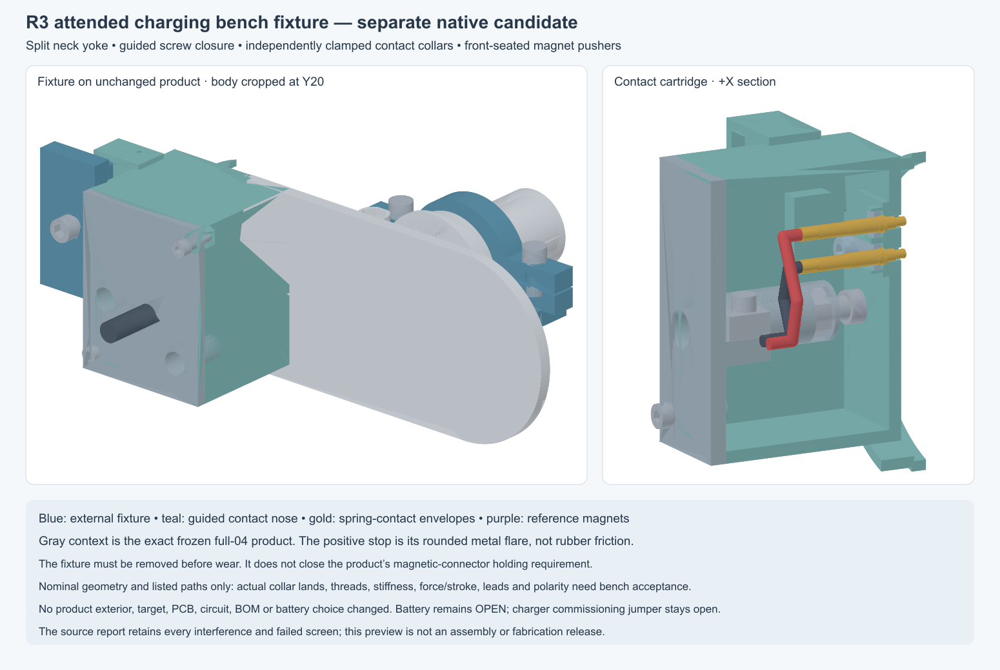

---
search:
  exclude: true
---

# R2 charging contacts

30 October 2026. Keep two isolated electrical contacts on the outward flange,
with magnetic alignment and retention. J1 remains the internal two-pin input;
the shell is not a charging conductor. No external connector, feedthrough seal
or finished contact material is selected, and the human-owned BOM is unchanged.

## Separate R3 fixture for attended bench work

`hardware/cad/dock-mate-r3/` adds a removable split neck yoke, external frame
and screw-adjusted contact carriage. It holds the existing product through
the growing-radius metal root, independently of magnetic attraction or rubber
friction. The product exterior, targets and electronics are unchanged. This
is a temporary dry bench fixture; the product's magnetic holding requirement
remains open.

The new 0973 contact candidate has independently adjustable collar retainers;
magnet pushers seat external magnets against their rigid front datum. The
source report retains maximum-body/bore/land arithmetic and an explicit
0.2206–0.9794 mm compression budget. Custom receiving tolerances, collar lands,
actual force/stroke, loaded stiffness, threads and electrical path remain
unqualified. The catalog's conflicting spring/mid-travel references are kept
explicit; no current or holding rating is inferred for the complete assembly.

All 34 final solids survive saved-history recompute and STEP read. Six listed
loading paths, thirteen carriage poses, eleven assumed driver paths and five
nut-entry paths clear their stated scopes. The checked 97-role product context
has no positive intersections. A perimeter guide rejects all 63 stated reverse
yaw/tilt samples before contact, with at least 1.064 mm separation; this is not
every misalignment or deformation. The source index is
`hardware/design/dock-mate-r3.json`. Use its reversible assembly and calibration
instructions, with JP1 still open until the charge-commissioning gates pass.

## Use flat targets at the toy

Study two flush, fixed target contacts in a rigid insulating seat, with magnets
behind the cover. Put the moving spring contacts on the removable cable/dock.
The rigid core should locate the contacts; cover compression must not set their
spacing or spring travel. Draw the contact-to-seat and seat-to-core seal paths,
rear wire termination, strain relief and magnet capture separately. A press-fit
or a rubber cover does not establish sealing.

Mill-Max **1941-0-00-15-00-00-03-0** is a dimensional candidate for the fixed
targets: nominal head Ø1.83 ×0.76 mm, barb Ø1.47 mm, stem Ø1.35 mm and
overall length 4.29 mm. The current drawing lists ±0.051 mm diameter and
±0.127 mm length tolerances. Current rating is application-specific. The
older exact-part sheet identifies gold over nickel; finished contact suitability
is unresolved. The current overview gives a 1.448 mm mounting hole, while the
older family table gives 1.422 mm for 1941. Resolve the controlled fit before
releasing a bore. [Current manufacturer overview](https://www.mill-max.com/products/discrete-spring-loaded-target-contacts/flat-face-target-contact-for-spring-loaded-pins/1941),
[current drawing](https://www.mill-max.com/sites/default/files/external/products/fullsize/2022-10/1941.svg),
[exact-part reference sheet](https://datasheet.octopart.com/1941-0-00-15-00-00-03-0-Mill-Max-datasheet-180670608.pdf).

These pins do not provide a ready-made sealed magnetic connector. A custom
seat, dock alignment, qualified termination and selected mating spring contact
are additional parts; do not copy the provisional pin into the confirmed BOM.

## Screened complete connector

The Mill-Max **879-20-002-00-011000** target has two contacts on approximately
4 mm pitch, a 7.62 mm housing depth, 15.62 mm overall depth and a 4.32 mm
concave well. Its solder-cup magnetic mate is **878-22-002-00-011101**, with
2.286 mm full stroke. This is useful reference geometry, but the recess and
exposed assembly need substantial integration work for the intended flush,
easy-clean flange; it is not selected for installation as supplied.
[Manufacturer target drawing](https://mm.digikey.com/Volume0/opasdata/d220001/medias/docus/8918/879-20-002-00-011000.pdf),
[manufacturer spring-contact drawing](https://mm.digikey.com/Volume0/opasdata/d220001/medias/docus/8918/878-22-002-00-011101.pdf).

## Acceptance still needed

J1 pin 1 is regulated +5 V; pin 2 is GND. **USB500 limits U1.IN current**, including
its system load and charging, to **450/475/500 mA min/typ/max**. The separate battery
charge setting is approximately 100 mA. VIN-DPM starts at **4.35/4.50/4.63 V**;
the **4.35 V operating minimum does not guarantee 100 mA charging**. Reduced
charge during input-voltage management is normal behavior. [TI BQ24074 Rev N,
table 8.5 and section 9.3.4.1](https://www.ti.com/lit/ds/symlink/bq24074.pdf).

J1 also feeds direct VBUS guard/pullup branches and input-capacitor inrush ahead
of U1. Thus 500 mA is not a hard ceiling on every whole-path current or transient.
The existing resistor corners bound R3 and R46 branches individually below
0.531 and 0.483 mA at 5.25 V; these are not an exhaustive or necessarily
simultaneous load estimate. Include IC bias and measured startup behavior.

Use `VIN = Vsource − VF(D1) − I × (RF1 + Rcable + Rcontacts + Rinternal)`.
At an illustrative 5.00 V source and F1's 0.70 Ω catalog resistance reference:

| Total input | F1 drop | Remaining D1/cable/contact/internal drop to 4.35 V | Remaining drop to 4.63 V |
| --- | --- | --- | --- |
| 100 mA | 70 mV | 580 mV | 300 mV |
| 250 mA | 175 mV | 475 mV | 195 mV |
| 500 mA | 350 mV | 300 mV | 20 mV |

F1's 0.70 Ω maximum is specified at 20°C one hour after trip/reflow, rather
than as a hot operating bound. Its 0.5 A hold rating is for 20°C still air;
the manufacturer's guidance falls to 0.42 A at 40°C. Verify installed
performance. [Littelfuse 1206L, pages 1–2](https://www.littelfuse.com/assetdocs/littelfuse-ptc-1206l-datasheet?assetguid=2b6a1515-d4ee-4c83-8bd4-152b4901b8f5).
D1's 0.55 V maximum is tested at 1 A /25°C; it is not an all-temperature
drop guarantee at these lower currents. The table leaves its actual drop
unassigned. [Diodes B140HW, page 2](https://www.diodes.com/datasheet/download/B140HW.pdf).

Preserve the current circuit and JP1-open state. Measure source/J1, post-F1,
VBUS_CHG, OUT and BAT voltages, input/charge/system currents and contact/passive
temperatures during startup, radio activity and sustained load. Record the
achieved charge rate and voltage-management behavior. Qualify the complete
path for 500 mA charger input plus its parallel branches and qualified startup
current; the table's whole-path examples do not set that acceptance limit.
No rating is assigned to the
1941 target by this study. Consider a lower-loss protection path only if the
required prototype behavior and measured budget justify it.

Check actual polarity, alignment tolerance, contact resistance and
temperature under the qualified input load, cable pull-off, wet/short exposure,
cleaning, corrosion, isolation and leakage paths. The electrical source needs
its own current limit. The present PTC is not a precise current limiter.
No IP, wear or body-contact suitability is inferred from the connector family.

Source URLs, download hashes and drawing observations are recorded in
`hardware/design/dock-interface-r2.json`. No parts were ordered or suppliers
contacted.

## Standalone native flush-insert study

The editable local study is saved in `hardware/cad/dock-interface-r2/` as
`DockInsertR2.FCStd`, with STEP exports, separate seal/work-space solids,
`geometry-report.json` and `installation-review.json`. New seats, bores,
bosses and keepers have native primitive/boolean history. The exact archived
full-01 housing BReps are frozen reference context; the canonical R2 CAD and
routed `5ba844fa…` PCB are unchanged. A separate exact overlap screen against the archived full-02/77abefb3… roles
finds no unresolved static hits; the two J1 wire-space overlaps are alternate
representations of the same interface. This does not transfer full-01 motion
results or establish complete full-02 integration.
Battery selection stays **OPEN**.

Two nominally flush fixed-target faces sit at Y−30/X−30/Z8 and Z12. The upper
contact is +5 V, the lower GND. Their head backs bear on hard shoulders;
a flanged insulating insert and inside screw-held bridge set their position.
Contact-to-insert annular reservoirs, rear termination/encapsulation spaces
and the insert-to-cover perimeter path are separate geometry. Material,
compound, seal dimensions, contact pull-out and body-contact suitability are
unselected. The study stem clearance is not a released press-fit bore. With
a fixed head-back seat, the catalog ±0.127 mm head-length tolerance also
prevents a claim of finished flushness without a controlled solution.

Two blind, buried magnet pockets have positive inside keepers, with nominal
centers XZ(−37.75,0) and (−21,−8). The left uses one screw plus a locating
tongue; the right uses two screws. The reference S-04-1.5-N is Ø4 ×1.5 mm,
±0.1 mm, axially magnetized and nickel-copper-nickel plated. Its maximum-size
envelopes are modeled; catalog attraction is not an installed holding-force
approval. The coating requires a qualified environmental barrier.
[Manufacturer dimensions and handling guidance](https://www.supermagnete.de/eng/data_sheet_S-04-1.5-N.pdf).

Keeper fitting and driver access use the removed cover on the bench, with
loose pigtails held clear before final strain relief. The final wire path
crosses one driver space; other driver paths hit assembled parts, so in-situ
keeper service is not established. Two 1.5 mm OD routing spaces reach the
actual J1 rows: pin 1/+5 V at Y−20 and pin 2/GND at Y−22. They provide space
studies rather than selected wires, accepted bends or qualified terminations.
The main service-cover retention and continuous cover/core seal remain open.

Asymmetric magnet positions, opposed outward magnet poles and polarity labels
are an orientation strategy only. A separate external-mate/key study is now
available below; it has not changed the frozen target or full-03 cover.
`hardware/design/dock-mechanical-r2.json` indexes the source-matched geometry
and installation findings, including narrow nominal clearances and all
qualification gates. All 25 saved native roles also passed an independent
force-history recompute and STEP reopen. No parts were ordered or supplier
messages sent.

## External mate and retention screen

`hardware/cad/dock-mate-r2/` contains a separate editable `DockMateR2.FCStd`,
STEP, inspected review figure, checker and README. Its design index is
`hardware/design/dock-mate-r2.json`. Twenty mate roles and a separate copied
keyed-cover proposal retain valid saved-history geometry. The mate has two
spring contacts, unlike guide keys, hard contact stops, buried magnets, a
screw-held contact retainer and a rear cable clamp.

The normal rigid approach clears its stated nominal bound and samples. In 63
listed reversed yaw/tilt cases, the guides stop the mate before conductive
intersection, with 0.2325 mm minimum separation under the explicit study stack.
These samples do not establish rejection of arbitrary lateral or deformed
approaches. The matching blind recesses are only in the copied-cover proposal;
their 0.5 mm nominal floors need review and fresh full-assembly integration.

The modeled Mill-Max 0933 spring75 imposes 60 gf per contact at its specified
0.7 mm mid travel. The same drawing's spring72 option is 35 gf. Neither option
is selected for the product. Critical collar/bore/axial-retention fits remain
unresolved; the nominal 0.05 mm axial-float target is not a proven tolerance
stack. [Mill-Max manufacturer catalog, printed page 27](https://www.mill-max.com/sites/default/files/external/catalog/2021-02/023-028.pdf).

Installed magnetic retention is a concrete unresolved interface. At the
conservative dimensional/gap screen, two ideal magnet pairs total 0.882 N,
less than the two spring75 contacts' 1.177 N specified mid-travel force.
Spring72 leaves only 0.196 N ideal residual at mid travel, before cable loads,
force spread or deeper compression. This is a sensitivity calculation, with
no accepted installed force curve or pull-off rating.
[Manufacturer magnet-pair calculator](https://www.supermagnete.de/eng/adhesive-force-calculation).

Close the actual barrel retention/stroke and magnet-gap/force balance before
adopting the mate. A lower-force spring alone does not establish reliable
holding. Source inputs, calculator captures and limits are retained in
`dock-mate-r2/retention-screen.json`. The main source, PCB, circuit, JP1-open
state and human-owned BOM remain unchanged.
