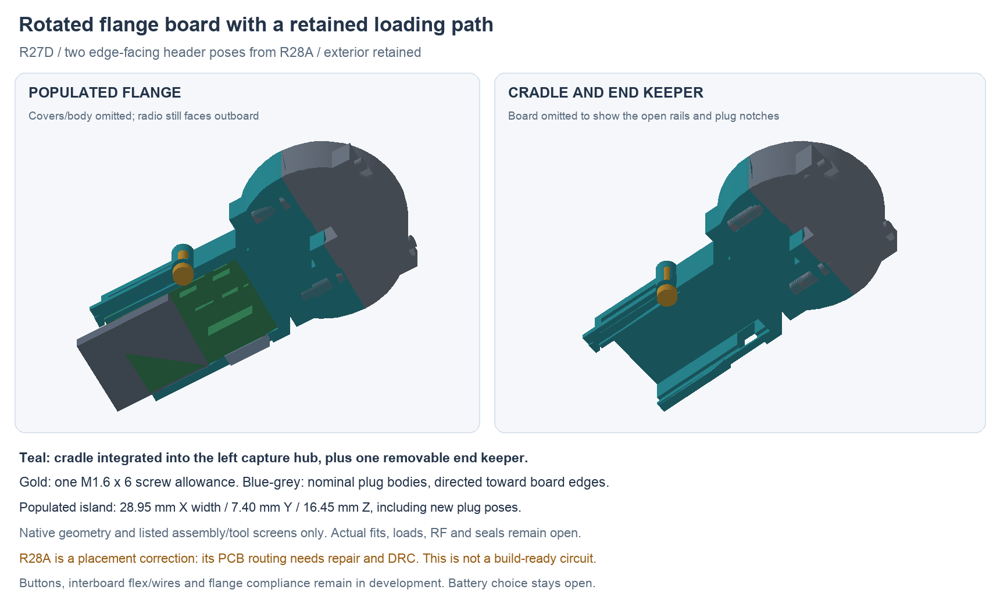

---
search:
  exclude: true
---

# Rotated flange cradle and plug access R27 / R28

R27D develops the allowed 90° flange-board option into an integrated native
cradle. It turns the complete flange island 90° about X, then moves it 1.5 mm
inward and 0.3 mm down. The exterior, 15 mm neck, R25 independent shell-mounted
motor and R26 stationary tip/wires are preserved. Battery choice remains open.

**Geometry checkpoint only.** R28A changes two connector poses to make their
approaches accessible. Its reference copper is not repaired: native DRC has
78 violations, 11 unconnected items and zero footprint errors. It is not an
electrical build candidate. The complete prototype proposal remains unfinished.

## Why this orientation

The [R24 comparison](flange-orientation-r24.md) showed a small radio/cover
intersection for the unshifted X90 pose. The new ten-pose screen uses the
current R26 geometry. Nine shifts clear all fixed primary/mate/allowance roles.
At +1.5X / −0.3Z, before the connector correction, the populated island has
1.358 mm nominal clearance to the upper cover and 1.368 mm to the lower cover.
These are placement margins, not a finished-part tolerance or comfort result.

After turning J1 and J7, the populated island including nominal mates spans
**28.95 mm X × 7.40 mm Y × 16.45 mm Z**. The R24 Y90 option used 28.95 mm
in Z. The existing outside covers remain 90 mm X / 38 mm Z; these inherited
study dimensions are not newly accepted ergonomic targets. No exterior was
enlarged to fit the board. The radio's antenna end remains outboard, but the
rotated housing, frame and wiring still need RF review.

## Retention with one keeper

The left capture hub gains an integral open cradle. The source hub material
is conserved, and its existing body-collar capture/fastener interfaces remain.
The populated PCB slides inward from the outer wing through edge rails.
A single removable end keeper and candidate M1.6 × 6 screw close that path.
There are no new PCB mounting holes. Separate edge notches admit the plugs.

The model leaves 0.2 mm at each slot side and each front/back face, plus
0.2 mm at each end stop. These are nominal assembly allowances. They permit
board movement: establish measured seats/shimming or restraint and switch
registration before adopting a button linkage. The cradle's local PCB support
does not substitute for flange removal-load and compliance design.

The keeper's Ø3.2 mm screw-head envelope and Ø1.25 mm pilot use the existing
M1.6 × 6 / 1.5 mm hex candidate reference from the tip support. Female threads,
polymer process, tightening, keeper stiffness/creep, guide wear and actual
retention force are not qualified. The long keeper is a prototype proposal.

## Two connector corrections

New approach checks caught an inherited layout problem: J7's nominal plug
swept through several backside passives and J1's plug through the service
switches. A final parked mate clearance alone had missed this.

R28A therefore changes only these native flange footprint angles:

| Ref | Before | R28A | Intended approach in original PCB coordinates |
| --- | ---: | ---: | --- |
| J7 interboard | 180° | 0° | Toward the +Y board edge |
| J1 charging | 0° | 180° | Toward the −Y board edge |

All 24 values, numbered-pad net maps, footprint centres and sides are
conserved. The other 22 component poses, including radio/decoupling and
sensors, are unchanged. Native Fab boxes and same-face courtyards have no
overlaps, and all 24 listed nominal mate approach positions clear component
boxes. R27D binds all 24 transformed Fab/height boxes to this saved native
placement. Plug bodies remain conservative nominal boxes, not actual maximum
housing/contact/lead profiles or hand-access proof.

The rotations change pad positions, so the old copper cannot be inherited as
a valid circuit. `hardware/pcb/flange-access-r28/candidate-a/` contains the
native placement, inspection and failing native DRC. Keep it separate from
the passing R23D board. Repair routing, review copper/planes/USB and source
parity, then rerun native DRC before generating a fabrication package. The
legacy J1 value text also needs reconciliation with its SH2 footprint/candidate
during that review; no part selection is implied by this placement correction.

## Saved geometry and stage evidence

`hardware/cad/flange-controls-r27/candidate-d/FlangeCradleR27.FCStd` is the
editable integrated source. It preserves 110 R26 roles directly and 28 flange
roles through the recorded inverse transforms; the original left-hub material
is conserved inside the enlarged cradle.

The source checks 132 primary roles / 8,646 static pairs with no unexpected
intersections. Four screw/pilot interfaces and same-net tip solder/tail
interfaces are named separately. Seven nominal mates have no final hits.
Fresh forced saved-history review covers 141 roles, has no external-document
links and verifies the two-header native placement binding.

All 11 listed PCB-loading positions clear with plugs and covers waiting.
All 24 nominal plug positions clear after board seating. Fresh review also
checks nine hub-closing positions, eight keeper approaches, eight screw
approaches and a generic Ø2.2 mm driver shaft. The screw/pilot contact remains
an unqualified process interface. These finite rigid screens do not prove
continuous travel, actual connectors/tools, wire bending or physical assembly.
See `assembly-docs/flange-cradle-r27.md` for the target order.

A preserves the initial PCB/boss, keeper/rail and service-plug clashes. B
clears static geometry but retains blocked J1/J7 approaches and a keeper-pocket
entrance catch. C has corrected geometry but its probe used the pre-rotation
approach directions; those hits are invalid evidence for the new outward
approaches. D uses directions extracted from the new native placements and
opens the keeper pocket through its approach. Original reports are retained.

## Remaining prototype work

The rear-facing SW1/SW2 envelope centres are X−21.35 and X−15.35 mm, both
Z4.5125 mm, with actuation along +Y. They remain behind the unchanged solid
rear cover. R27 does not add a button opening, diaphragm, return mechanism
or accepted operating stroke. The earlier B3U travel screen remains an input;
the D2F wetting-rail alternative is not adopted here.

Next work is the two-header copper repair, real supported interboard/service/
charging wires or flex, and working local silicone controls with registration
and load bypass. Semi-flex remains allowed for installation bends; repeated
flange movement needs its own qualified flexible connection. Pack/NTC retention,
flange stop/removal loads, seals/material/process and the complete build/test
plan remain open. No purchases, physical tests or human-owned BOM edits occurred.
