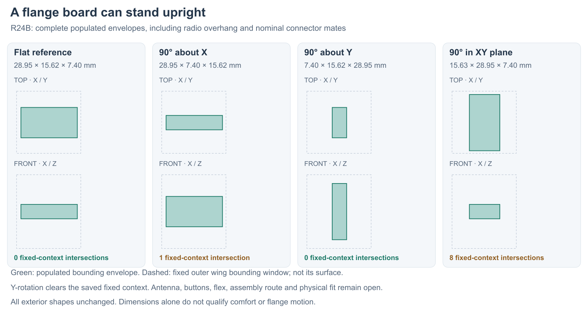

---
search:
  exclude: true
---

# Flange orientation and semi-flex: R24

1 November 2026. Lucy permits semi-flex PCB construction and a 90° flange-board
rotation where it improves packaging without widening the flange. The motor
must have its own shell-coupled mount; R21's shared PCB/motor keeper is rejected.

The R24B native study rotates the current flange substrate, all 24 component
height envelopes and three nominal connector mates as one rigid island. It
preserves the current exterior covers, body and hub. This is a packaging
comparison, not a revised routed board or an accepted flex design.

## Actual envelope comparison

X runs along the handle, Y toward the tip, and Z is the original PCB normal.
All rotations use the same populated-envelope centre. Dimensions include the
module overhang and nominal connector mates; the bare board is 23.5 × 15 × 1 mm.

| Orientation | X span | Y span | Z span | Intersections with fixed cover/hub/body context |
| --- | ---: | ---: | ---: | --- |
| Flat reference | 28.95 mm | 15.625 mm | 7.4 mm | 0 |
| 90° about X | 28.95 mm | 7.4 mm | 15.625 mm | 1: radio envelope / upper cover, 0.070861 mm³ |
| 90° about Y | 7.4 mm | 15.625 mm | 28.95 mm | 0 |
| 90° in the original XY plane | 15.625 mm | 28.95 mm | 7.4 mm | 8 |

The **90° about Y option is a candidate**: it clears this fixed context without
enlarging the existing external shape. It trades span along the handle for
depth through the flange. That does not establish a comfortable flange size
or physical fit. The unchanged covers span 90 mm in X and 38 mm in Z; these
are inherited study dimensions, not newly chosen ergonomic targets.

The X rotation retains the outboard antenna direction but has a small cover
intersection in this pose. It is not accepted as fitted. The in-plane turn
extends through the existing cover/service-cover region. No cover was cut or
silently enlarged to make a candidate pass.

## Semi-flex and motion

A bend made once during assembly could eliminate interboard plugs and wires.
It also needs a new continuous native circuit layout, layer transitions,
supplier stackup/bend rules and an assembly route. R23D's six-layer body and
the four-layer flange are separate routed sources; they are **not already a
semi-flex board**.

[Würth Elektronik describes SEMI.flex](https://www.we-online.com/en/products/printed-circuit-boards/flex-solutions/semiflex)
as suitable for a few installation bends in a defined housing.
[Eurocircuits also describes its six-layer option as flex-to-install](https://www.eurocircuits.com/electronic-manufacturing-technology/new-semi-flex-pool-6-layer-pcbs/),
stable during operation. This supports keeping semi-flex on the assembly
shortlist. It does not qualify a moving flange hinge. Where wear deflects the
flange, use a separately designed flexible link with supported endpoints and
strain relief, or a flex construction rated for the actual repeated motion.
The flange stop/removal loads need their own mechanical path.

Rotating the radio changes antenna orientation, metal proximity and the local
button/charging interfaces. Follow [Espressif's module-placement guidance](https://docs.espressif.com/projects/esp-hardware-design-guidelines/en/latest/esp32c3/pcb-layout-design.html)
and review the final housing, wires and body loading. No RF result transfers
from the flat pose. New button actuation, sealing, support, harness/flex,
loading and antenna checks remain open.

## Native sources and check scope

`hardware/cad/flange-orientation-r24/candidate-b/` contains four editable
FreeCAD studies and `orientation-screen.json`. Each has copied source shapes
and editable placements, with no external document links. Source/native PCB
hashes and exact executed builder are retained. The comparison checks rigid
shape volume and inverse-transform bounds conservation, then actual Boolean
intersections against ten fixed context roles. It does not check wires,
antenna performance, continuous assembly motion, tolerances or physical parts.

Candidate A is rejected and preserved: replacing rather than composing a
source placement lost source offsets. B composes placements and checks their
inverse against every original shape before saving. The flat case reproduces
the original complete populated envelope.
