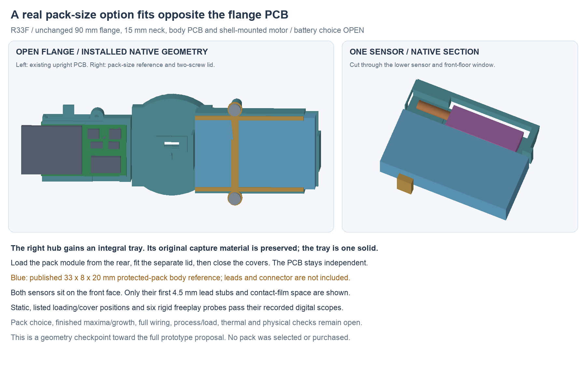

---
search:
  exclude: true
---

# Right-wing pack and sensor tray R33

R33F places the battery-size reference opposite the upright flange PCB. The
right capture hub gains an integral tray and a separate two-screw rear lid.
This keeps the 90 mm flange, 15 mm neck, metal exterior, both routed boards,
body PCB keeper and independent shell-mounted motor unchanged. The old R32
body-pack additions are superseded; the source R26 carrier remains in place.
Its now-unused body tray has not yet been simplified away.

This is the current pack **geometry checkpoint**, not the completed prototype
proposal. Battery selection and the human-owned BOM remain open. Actual pack
leads/connector, a complete pack/NTC adapter, matched finished maxima/expansion,
retention process, flange loads/compliance and seals still need design review.
Physical, electrical, thermal and runtime commissioning remains unperformed.

## Why move the pack

The R32 18 × 33 × 6 mm gauge did not establish a feasible protected pack.
The [Bitcraze 350 mAh reference](https://store.bitcraze.io/products/350mah-lipo-battery)
publishes 20 × 8 × 33 mm **excluding cable**, explicit PCM protection and
15C continuous output. R33 uses only that published body-size option, oriented
33 mm X × 8 mm Y × 20 mm Z. It does not select or purchase the pack, qualify
the PCM/current conditions or turn a catalog size into a controlled maximum.

The reference specifies a 35 mm cable **including** its Molex 51005-2P
connector, pin 1 positive. That connector does not mate directly to the
four-signal J2 interface. Lead exit, actual insulation/connector envelope,
polarity, mounting and an adapter remain to be designed. Do not trim, splice
or connect a real pack from this size study.

The source still recommends 1–3C charge, whereas the candidate circuit uses
approximately 100 mA. Confirm actual low-rate charge/termination compatibility,
cell/protection limits and the full system load before adopting this option.
No capacity or runtime measurement follows from the placement.

The straight body-layout scan A and pitched body/PCB scan B found zero clear
poses in their recorded search sets. This does not prove every body arrangement
impossible. Scan C found three clear right-wing positions against the unchanged
housing, controls, electronics, hubs and existing wire allowances. R33F develops
the middle Y position into a native tray, without moving either PCB.

Smaller battery searches are recorded in
`hardware/design/battery-fit-r33/options-screen.json`. The protected
[TinyCircuits 150 mAh option](https://tinycircuits.com/collections/batteries/products/lithium-ion-polymer-battery-3-7v-150mah)
is rated for only 150 mA, below the motor's 450 mA rated-current reference alone.
The [Grepow narrow-cell table](https://www.grepow.com/shaped-battery/ultra-narrow-battery.html)
offers a promising 125 mAh cell row, but does not define a finished protected
assembly for this design. Neither is substituted into the circuit.

## Native dimensions and load path

The published-size gauge occupies X[7,40], Y[−24,−16], Z[−10,10] mm.
The separate sizing reservation adds 0.5 mm per side. This is an engineering
study budget, **not supplier tolerance or approved pouch growth**.

The tray's front floor, side rails and end stops locate the pack. Its rear lid
overlaps the long edges and seats on two outboard posts at X18, Z±12.4 mm.
Two M1.6 × 6 candidate screws face rearward. Their Ø3.2 × 1.6 mm head and
Ø1.25 mm pilot are envelope/process studies; actual threads, drives, torque,
locking, material, creep and strength remain to be specified and tested.
Screw preload is intended to react through the posts rather than the pouch.

Pack restraint goes through the tray into the right hub. The original hub
material is conserved, and the complete hub/tray is one solid. This is not
proof of removal-load capacity, tray stiffness or comfortable flange flex.
Moving the pack to one wing makes those load/compliance checks explicit;
permitting semi-flex wiring does not itself qualify repeated movement.

Both existing NTC candidates move to the pack's front face, with head entries
at XYZ[20,−14.43,−3] and [20,−14.43,3] mm and axes along +X. Their source
head, first 4.5 mm lead stubs, film process boxes and larger clearance
reservations are rigidly reoriented. Floor windows and non-contact guards keep
them out of the intended restraint path. They do not mount to the PCB.

The [R32 sensor source notes](pack-retention-r32.md#sensor-attachment-and-actual-lead-length)
still apply: 52 ±5 mm is overall sensor length, with a conservative 33 mm of
insulated wire outside the maximum coating and bare end. Do not cut at the
modeled stub. Respect the actual lead diameter/pitch, 4 mm straight entry,
bend/strain limits and soldered-adapter approach. Film boxes do not establish
formed adhesive contact, dry sealing or thermal/vibration compatibility.

## What was checked

The current editable file is
`hardware/cad/battery-fit-r33/candidate-f/FlangePackR33.FCStd`.
Its adjacent review copy changes visibility only. The canonical native SHA is
`c5edbbf09534bf635547cf0431879f01326af78a55eb9bd0b8e72c0b98368618`.

- Fresh forced history: 177 roles including three reservations; 161 unchanged
  source roles conserved, no external-document links, no source hub removal.
- 2,171 new physical comparisons and 495 rigid/reservation comparisons have
  zero unexpected intersections. Two screw/pilot contacts are named separately.
- 63 listed loading, lid, screw, cover and added-tray hub-closure positions;
  six ±0.5 mm common module positions and two generic rear driver shafts pass.
- Six 0.05 mm rigid translation sweeps encounter the tray/lid at the first
  0.65 mm gauge sample before sensor or housing contact. Sensor gap there is
  at least 0.15 mm; gauge-to-cover gap is at least 0.262 mm.

These are finite rigid geometric screens. They do not establish continuous
connected assembly, actual tooling/hands, pouch deformation/rotation, growth,
bond/retention force, process tolerances or physical fit. The hub-closure screen
checks **added tray material only**. The underlying hub still uses R30's parked
loose-end assembly order; a finished interboard loop must not be forced through
that operation. Cover screens check the new parts, not a complete seal system.

The figure uses source-native meshes and a Boolean section through the lower
sensor. Metal/skins and remote parts are omitted as labeled. No fit conclusion
is inferred from the render itself.

See `assembly-docs/flange-pack-r33.md` for the unperformed target order.
The frozen package index binds this checkpoint and its source inputs. D retains
the initial disconnected stops, lid-hole and rear-head clashes; E is statically
clear but cuts 7.788 mm³ from the source hub. F moves the sensors outward and
conserves the complete hub. Failed candidates remain separate from the current
native file.
