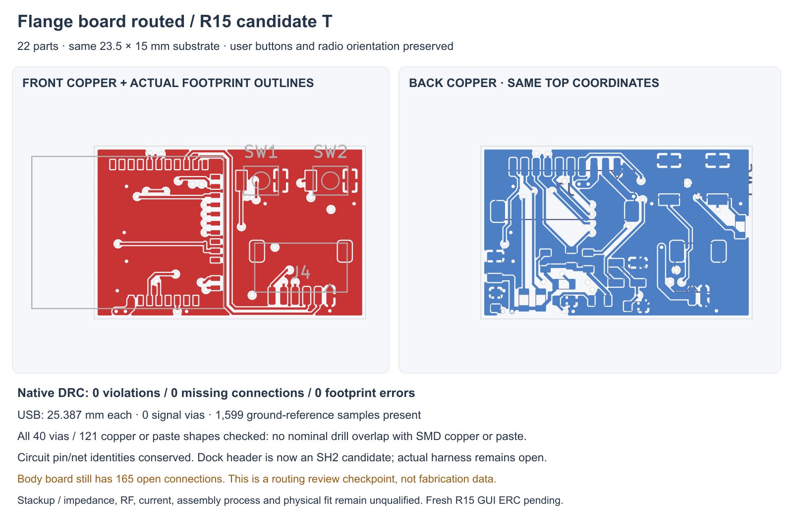

---
search:
  exclude: true
---

# Routed flange board R15

1 November 2026. **R15 candidate T** routes the radio, local controls, dock
input and service interfaces on the separate flange board. Its saved native
KiCad check reports **zero DRC violations, zero missing connections and zero
footprint errors**. The body board remains unrouted with 165 missing
connections. The complete prototype proposal is still unfinished.

## Source and layout changes

Open `hardware/pcb/route-r15/candidate-t/system-r15.kicad_sch` for the complete
device circuit, or `flange/flange-r15.kicad_pro` in that directory for this
board. The body source is copied unchanged from R14B. Earlier R12/R14 files
and the fuller-nose R13F native CAD remain preserved.

The flange retains its 23.5 × 15 × 1 mm substrate, four copper layers, radio
orientation, antenna overhang and both user-button positions. All passives
are now on the back. The supply capacitors and reset bypass move close to
their radio pins, and short signal escapes leave room for the USB pair.
The wide radio feed is a 0.65 mm candidate path; narrower resistor branches
are separate. Widths are geometric design choices, not current ratings.

J1 changes from the PH2 dock header to **SM02B-SRSS-TB**, an SH2 candidate
with the same DOCK_5V/GND pin assignment. Proposed mate/contact identifiers
are SHR-02V-S-B and SSH-003T-P0.2-H. The [JST SH specification](https://www.jst-mfg.com/product/pdf/eng/eSH.pdf)
states its 1 A rating at AWG28; that does not qualify the eventual harness,
installed temperature or complete dock path. The CAD height remains a 3.2 mm
study allowance, not a controlled part maximum. No BOM or procurement change
is implied.

J4 rotates so its mating direction is +Y; J7 on the back now mates toward −Y.
Both differ from the older cable-corridor assumptions. Actual plugs, lead
exits, bends, slack, strain relief and supported installation need a new
drawing. The service connector is used with the cover removed.

## Saved circuit and copper checks

| Check | Actual result and limit |
| --- | --- |
| Native flange DRC | 0 violations / 0 unconnected / 0 footprint errors, using unchanged project limits |
| Physical placement | All 22 native poses, footprint IDs, pad coordinates and nets match the checked R15B placement |
| Circuit conservation | All 338 full-device pin/net/function/type nodes match R14; 215 body and 107 flange nodes. J1's footprint field is the sole component-field change |
| Board pad/net comparison | 115 physical electrical pad entries checked; no mismatch. Fourteen explicit native NC pins remain copper-netless |
| USB copper | Each path is 25.387 mm, width 0.2 mm on F.Cu, with zero signal vias; saved copper is identical to the manual E seed |
| USB return screen | All 1,599 samples at the trace center and both 0.1 mm edges have filled In1 GND beneath them; no signal tracks on In1 |
| Drill/paste screen | All 40 vias against 121 native copper or paste shapes: no nominal drill overlap with SMD copper or paste |
| CAD context | 2,093 new-envelope/fixed-context pairs have no intersections; three nominal plug probes also clear |

The USB pair's nominal main geometry is 0.2 mm width / 0.25 mm gap. Matching
length and sampled reference copper do not establish 90 Ω impedance. The
near-edge segments, actual supplier stackup and service fixture need review
against [Espressif's layout guidance](https://docs.espressif.com/projects/esp-hardware-design-guidelines/en/latest/esp32c3/pcb-layout-design.html).
Installed radio performance remains open. No current, thermal, EMC or runtime
result follows from native connectivity.

The drill inventory uses native rotated pad polygons, including paste-only
shapes, with zero native paste margins asserted. It screens nominal geometry;
mask treatment, stencil, module ground-pad soldering, process tolerances and
assembly yield remain separate. A local ground stitch was moved 0.2 mm away
from the module land edge to remove the earlier copper overlap. The rejected
R inventory is preserved.

R14's saved full-device ERC remains source evidence. **A fresh R15 GUI ERC
has not been obtained:** native app observation timed out. The new native XML
exports conserve every electrical node and pin type; that comparison is not
reported as an R15 ERC pass. No electrical exclusions or rule relaxations
were added.

The CAD check replaces the old flange envelopes in memory against exact R13F
geometry. It does not save an updated integrated CAD assembly. It also does
not supply wing retention, compliance, controls, real wires, tolerances or
physical fit acceptance.

## Review records and remaining work

The candidate directory contains `saved-copper-audit.json`,
`native-netlist-parity.json`, `drill-paste-inventory.json`,
`flange-mechanical-fit.json`, the native DRC report, XML exports and native
front/back/reference SVG plots. `hardware/pcb/route-r15/artifact-index.json`
binds the review package. Earlier failed routing and clearance attempts are
retained and identified in that folder's README.

`source-conservation.json` also compares the complete text of all 13 sheets
after only the declared project-name, J1 footprint and title-label changes.
Every wire, symbol, no-connect and driver flag is retained. All three symbol
libraries and the board/ERC/net-rule objects in all three projects match R14.

Next: route the body power/motor/guard circuit; define actual supported
interboard conductors and fault/current/return behavior; integrate flange
retention/compliance, working controls and stationary tip support/thermal
coupling to the fuller cap. Battery selection stays OPEN. Parts, materials,
seals, manufacturing interfaces and the practical complete first-build plan
remain necessary for Lucy's review. No fabrication package is released.
