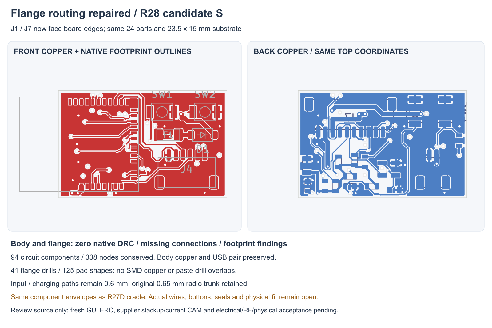

---
search:
  exclude: true
---

# Repaired flange routing and review project R28

R28S repairs the two edge-facing connector poses needed by the
[R27D rotated cradle](flange-cradle-r27.md). The complete native project now
includes the unchanged six-layer body and repaired four-layer flange.
**Both boards have zero native DRC violations, unconnected items and footprint
errors.** Battery selection stays open; the complete prototype proposal is
still in development.

## Current sources

`hardware/pcb/flange-access-r28/candidate-s/` contains `system-r28.kicad_sch`,
the body/flange native projects and PCBs, all 13 source sheets, three symbol
libraries and fresh native XML exports. Footprint libraries use explicit
relative references to the unchanged, retained R23 libraries in this repository.
The source is reviewable; no current supplier-approved fabrication packet or
physical circuit result is claimed.

The board still uses the R28A J1/J7 angles. All 24 flange component centres,
sides, Fab/height boxes and numbered-pad net maps are preserved. These match
the source used by R27D, so no cradle or exterior change is needed for this
copper repair. The 15 mm neck, independent shell-mounted motor and stationary
R26 tip/wires remain. This does not validate actual connectors or wiring.

J1's PCB value is corrected from stale `S2B-PH-SM4-TB` text to the existing
**SM02B-SRSS-TB SH2 candidate**. Its footprint and electrical pins do not change.
The schematic retains its functional `MAGNETIC_DOCK_5V` value; its note makes
clear that this is an internal header, separate from the exposed charging
contacts. No part is added to the human-owned BOM.

## Routing changes

The obsolete J1/J7 branches and the STRAP8 crossing of the new pads are reopened.
The existing USB pair, radio supply trunk, local decoupling and other retained
paths stay fixed. A new 0.65 mm B-side supply escape reaches the existing
paired radio-feed vias; it adds no new supply via or inner-layer crossing.

The hard-access DOCK_PRESENT_N and STRAP8 MCU escapes are retained before the
remaining routing. MOTOR_PWM gets a short reserved route with a compliant
0.6/0.3 mm via. Low-current new logic uses the existing 0.15 mm native minimum.
The router rejected the requested settings file because `router_scoring` had
the wrong JSON type, then used defaults. Its log and post-run settings are
retained; the requested neck-down/scoring settings were not applied. Eighteen
generated narrow traces are explicitly raised to 0.15 mm. Seven 0.45 mm power necks
are widened to the proposed **0.6 mm input/charging width**. Fresh native DRC
passes after those changes. No rule or exclusion is relaxed to obtain the pass.

In1 stays GND-only; routing uses F, In2 and B. A router-only 0.2 mm boundary
inset helps maintain the unchanged native 0.3 mm copper-edge rule. The offline
router's own connectivity/clearance reports differ from KiCad's on several
fixed source features; the actual saved native DRC and independent reviews
own the reported result.

## Saved evidence

| Check | Current result | Scope |
| --- | --- | --- |
| Full native XML | 94 components / 338 pin-net-function-type nodes equal R23 | All source circuit identities preserved; not a fresh GUI ERC |
| Body PCB | Byte-identical to R23D; 65 footprints / 211 electrical pad entries | Six layers; new project/library context also checked |
| Flange PCB | 24 footprints / 119 electrical pad entries; all mapped to fresh native XML | Same poses as the R27D source; J1 candidate label corrected |
| Native DRC | Body 0/0/0; flange 0/0/0 | Violations / unconnected / footprint findings |
| Native rules | Board, ERC and net-setting objects equal source projects | No reduced clearance, via, edge or width limits |
| Local copper | 268 retained route records conserved | Includes protected USB and radio/local circuits |
| USB pair | Same 0.2 mm F-only copper; about 17.63553 mm each; no signal vias | All 1,173 centre/edge samples have filled In1 GND |
| Flange drill/paste | 41 through vias against 125 native pad shapes; zero drill overlaps | Native polygon/drill-circle screen; no fabrication/process acceptance |
| Input power copper | DOCK_5V, DOCK_FUSED, VBUS_CHG all 0.6 mm | Geometry requirement; current/temperature still need review and test |

`saved-circuit-review.json`, `layout-inspection.json`, native DRC reports,
`flange/route-geometry.json` and `flange/drill-paste-review.json` bind these
results to the saved files. `project-package.json` and `power-width-repair.json`
record packaging and the final power-width stage. The earlier zero-DRC snapshot
before enforcing the proposed power width is retained under
`before-power-width-repair/`; its pass is not substituted for the final review.

Earlier A–R placement, seed, incomplete route and search attempts remain
preserved. Failed residual searches produced no adopted copper. One fine
experiment proposed vias below the flange's native minimum and is explicitly
not adopted. The native router executable failed internally; its log is kept,
and the Java implementation produced the retained session. Final native via
and width rules remain unchanged.

## Next build work

This closes the connector copper repair, not the full prototype handoff.
Define and fit actual supported interboard/service/charging and motor harnesses
or flex, working local silicone controls, pack/NTC retention, flange stop/load
and compliance, seals and supplier-reviewed materials/processes. Semi-flex is
permitted but is not implemented by these two separate routed boards.

Fresh GUI ERC, supplier stackup/impedance/process review and current CAM remain
open. The USB sample screen is not a continuous return-path or impedance proof;
zero DRC does not establish RF, current, thermal, runtime, physical fit or wear
acceptance. No parts were purchased or fabricated. See
`assembly-docs/pcb-overview.md` and the prototype handoff for the current scope.
