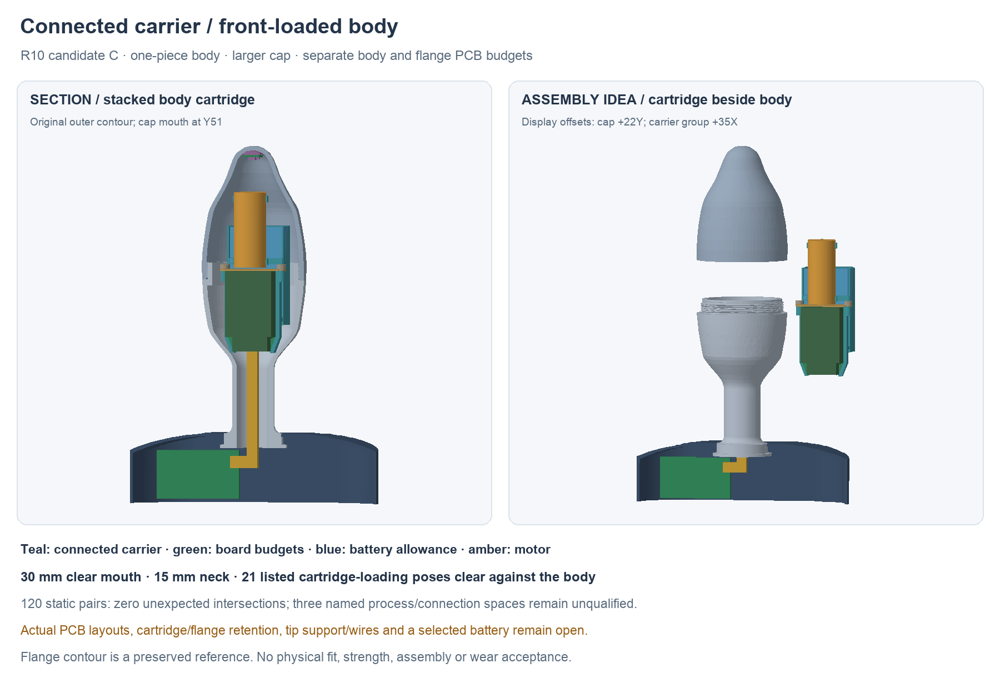

---
search:
  exclude: true
---

# Front-loaded carrier R10

The newer [R11 central hub](front-load-retention-r11.md) adds nominal body/carrier
capture and moves the flange board budget outboard. R10 remains preserved.

1 November 2026. This continues Lucy's one-piece body, larger cap and separate
body/flange-board direction, with assembly simplicity as the priority.
The source is `hardware/cad/front-load-r10/candidate-c/FrontLoadR10.FCStd`.
The [R9 study](front-load-study-r9.md) remains preserved comparison evidence.

The saved candidate survives a fresh full-history recompute. All 120 pairs
among its 16 reported roles have zero unexpected intersections; two nominal
shaft/pilot interferences and the link's connection to its board space remain
separately named, unqualified interfaces. Twenty-one listed 5 mm-step cartridge
loading positions clear the body. The carrier/cap gap is nominally 0.945 mm;
its smallest body gap is 0.314 mm. These checks do not establish continuous
motion, manufacturing tolerances, loads or physical assembly.

## What changed

The carrier is now one connected native solid: an open battery tray, tapered
PCB guide rails and two motor saddles. The body PCB slides into the carrier
on the bench. One removable end plate and two small screw envelopes retain
its forward end; the print material, actual screw/drive, pilot/formed thread
and tightening limits still need definition. Open saddles need actual motor
retention, and the battery needs a supported, insulated retention method.

The motor moves back from R9's Y66.5–92.8 to Y55.5–81.8, restoring 11.48 mm
to the first tip component face. That space enables a new wire/support study;
it is not a finished bend-radius-qualified tip harness. The previous motor
carrier/cap collision is absent in the new geometry.

To load the stacked arrangement, the cap mouth moves from Y66 to Y51, near
the widest body section, and the clear opening grows from 26 to 30 mm. The
outer contour and 15 mm external neck remain unchanged. The cap is longer;
its circular joint is farther down the body. Thread profile, finish allowance,
continuous sealing and manufacturing feasibility remain open. Finite meridian
samples give about 1.397 mm wall to the female groove envelope, with 1.5 mm
male root wall. Those are study measurements, not accepted wall specifications.

**Battery tradeoff:** this variant budgets a finished protected pack of
18 × 33 × 6 mm, with a 19 × 34 × 7 mm allowance. It does not qualify the older
20 mm-wide pack budget. No actual pack or capacity has been selected; a complete
protected-pack envelope, lead exits, two cell sensors and endurance profile
must fit before this variant can become a build proposal.

## Board and interconnect work

The [circuit allocation](../architecture.md) now has a source-bound detailed
record at `hardware/design/body-flange-partition-r9/partition.json`.
All 87 current main-board footprints are allocated once: 66 body, 21 flange.
An actual saved-KiCad pad/net extraction agrees with the source allocation.
The missing battery-voltage feed corrects the earlier nine-path estimate to
**ten logical crossing nets**; actual return wires and fault/service needs may
increase the physical conductor count.

The new body substrate tapers from 14 mm wide at Y26 to 18 mm at Y31, ending
at Y54. The main component space is 16.8 mm wide with 5 mm front height and
2.5 mm back height, narrower near the rear. Source courtyard/height review
motivates this enlargement: the prior 3 mm top budget did not contain J2's
4.8 mm candidate height. No revised native KiCad boards have been placed or
routed yet. The substrate, component boxes and link are space allowances.

The separate flange board remains 30 × 17 mm, with radio/controller and local
controls behind the nonmetal region. Existing button-operation questions are
still open. Keeping the tip island means three rigid boards total, including
the two new main boards.

## Assembly target and remaining work

Load the battery, slide the body PCB into its guides, fit the end plate and
retain the motor outside the shell. Feed the supported tail through the neck
before inserting the cartridge from the front. Attach the separate flange
electronics with the cover open; then seat the stationary tip assembly and
close the cap without winding wires. This is a target sequence, not a build
instruction release.

Next, provide positive cartridge retention/anti-rotation and a mechanically
retained central flange attachment with a deliberately compliant region.
The electrical link must carry no removal loads. The current tip board and
thermal shoe have clearance but no new carrier load path; that support and
actual four-wire route must be completed. Then place and route the two main
boards against these exact interfaces and make the actual parts/process list
reviewable. Battery options remain open.

No physical build, supplier order, material/strength, electrical commissioning
or wear acceptance is claimed. The design is still **not ready to build**.
