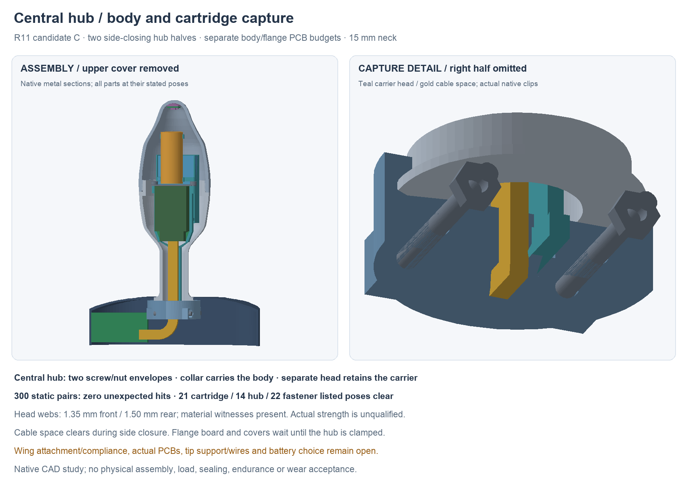

---
search:
  exclude: true
---

# Central capture hub R11

The newer [R12 board placement](split-pcb-r12.md) and
[R13 fuller nose/drop-in keeper](simple-assembly-r13.md) continue this study.
R11 remains unchanged; its board boxes and loading assumptions are historical.

1 November 2026. Candidate C continues the [R10 carrier](front-load-carrier-r10.md)
with a positive central attachment for the one-piece metal body and internal
carrier. It adds two small hub halves, two nominal M2 screw/nut pairs and a
retaining stem on the carrier. The current native is
`hardware/cad/front-load-retention-r11/candidate-c/FrontLoadRetentionR11.FCStd`.

## Capture and assembly

The hub closes from the sides around the concealed metal collar and the
carrier's rectangular head. A matching flat on the covered collar/pocket
opposes rotation. The carrier head has its own axial and rotational capture;
the electrical link does not retain the carrier. The hub is local to the
body's base. It is not a rigid frame across the flange wings.

The parting plane passes through the cable lane, so the halves can close
around a cable space instead of requiring a finished connector to pass through
a closed hub tunnel. The flange PCB and covers wait during hub closure.
Nuts enter from the right; screws enter from the left with the covers off.
The study at `assembly-docs/r11-hub.md` defines the proposed
sequence and the limits of the checked tool/fastener shapes.

The one-piece metal body gains only a flat on its covered rear collar. The
15 mm neck and main outer contour remain unchanged. The cap/opening stay at
R10's 30 mm/Y51 study dimensions. A native copied R10 carrier feature graph
is extended with a neck stem, head and two forked connections to the rails.
The old R10 native and Full05 remain unchanged.

## Verified scope

- All 25 reported roles survive fresh saved-history recompute without saving.
  Their 300 static pairs have zero unexpected intersections. Three separately
  named packaging/process interfaces remain unqualified.
- Twenty-one listed cartridge-loading positions clear the body, including
  the new stem/head passing through the neck. Fourteen side-hub closing poses
  and 22 listed nut/bolt approaches clear their stated fixed contexts.
- Eight probes move the body or carrier ±0.6 mm axially or ±5° about the body
  axis. Each intersects the closed hub, demonstrating a nominal geometric
  stop in those directions. They do not establish zero play, a pull-force
  rating, deformation, strength or retention under arbitrary loads.
- The carrier head has a 1.35 mm front web and 1.5 mm rear wall. Exact material
  witnesses are complete in the saved hub. The earlier side-closing candidate
  had only 0.05 mm at the front; it remains preserved and is not adopted.
- Two assumed 1 mm-radius straight driver shafts clear with covers and flange
  PCB waiting. Actual screw/drive profiles, handles, grip, torque, threads and
  manufactured fit remain to define.
- The lower/upper flange cover and service cover shapes are exact copies of
  the preserved source. Moving the hub below the roof avoids their earlier
  interference; no cover material is removed. The protected outer-wall check
  and original flange-envelope checks pass their stated geometric scope.

Records are `geometry-report.json`, `saved-review.json` and the artifact index
under `hardware/cad/front-load-retention-r11/`. Original failed upper-half
loading and the thin-web candidate are retained.

## Electrical and flexible-flange boundaries

The flange substrate budget moves outboard to X−43.8…−13.8, Y−26…−11 and is
now 30 × 15 mm. Its 21 source parts are not placed or routed yet. The body
board's 66-part allocation also still needs actual placement/routing. Existing
button operating questions are open. Neither the shifted board nor the hub
qualifies a flexible flange or finished control mechanism.

The ten-net link remains a curved space reservation: 4.8 mm width, 1.8 mm
height and 8 mm bundle-centerline bend. Its inner boundary is 5.6 mm radius.
Those values do not select a wire/FPC construction or prove an individual
conductor's bend radius, current, strain relief or dynamic life. Actual
termination, fault behavior and supported routing must be designed together.

The wing board is not yet mechanically retained. Its nominal edge gap to
the central hub is only 0.3 mm; this is not an accepted compliance zone.
Next, design the PCB island/wing attachment and a bounded compliant region
while preserving an effective external stop and removal load path. PCB
packing must earn its space instead of inheriting the substrate budget.

The stationary tip support/load path and real tip wires also remain open.
Battery selection remains OPEN; the narrower finished 18 × 33 × 6 mm pack
budget is still conditional. Actual materials, seals, strength, controls,
charging/dock integration and prototype parts/process choices remain needed
before the full proposal is ready to consider building. No physical result
or fabrication release follows from this study.
