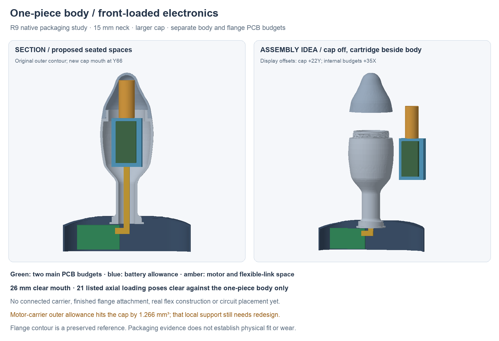

---
search:
  exclude: true
---

# One-piece body and front-loading electronics

The newer [R10 carrier study](front-load-carrier-r10.md) develops this architecture
with a connected carrier, wider board budget and revised loading opening.
R9 and its results below remain preserved comparison evidence.

31 October 2026. Lucy asked to prioritize simple assembly: explore a one-piece
metal body, a larger threaded nose cap and separate body/flange PCBs connected
flexibly. This is the current architecture study. The split-shell Full05 and
its routed single T-board remain preserved comparison sources.

## Proposed construction

- One hollow metal body, retaining the 15 mm external neck and outer contour.
- A larger nose cap provides loading access. The study moves its mouth from
  Y73 to Y66 and clear bore from 21 to 26 mm. These are packaging inputs,
  not approved thread or sealing dimensions.
- A front-loaded body cartridge holds the battery, power electronics, motor
  and sensor connections. Its short PCB has no rigid extension through the neck.
- A smaller flange PCB holds the radio/controller and local controls behind
  the nonmetal antenna region. Isolated magnetic charging contacts stay in the
  flange. A 30 × 17 mm board on one side is a budget; actual circuit fit is open.
- A compliant electrical link passes through the neck. For the first prototype,
  investigate a short stranded harness with accessible terminations before
  committing to custom rigid-flex. Neither construction nor bend radius is
  selected. The link must not retain the flange or take removal loads.

This removes the proposed longitudinal metal seam, split-thread alignment and
rear shell-clamping bolt. It still needs a retained flange, stationary tip
support, cap stop, dielectric insulation and sealed interfaces. Supplier
feedback must establish a practical hollow-body manufacturing route.

## Loading constraint and first layout

The old 21 mm mouth is smaller than the 22.136 mm diagonal of the existing
21 × 7 mm battery allowance. Even that bare allowance cannot pass the old
mouth in a centered straight axial slide. Battery selection stays **OPEN**.

The separate native study is `hardware/cad/front-load-r9/FrontLoadR9.FCStd`.
It contains a new one-piece body and larger cap, plus explicit envelopes:

| Item | New study pose/budget |
| --- | --- |
| Battery allowance | 21 × 34 × 7 mm, Y32–66, Z−5.5–1.5; previous dimensional allowance, not a selected pack |
| Body PCB | 14 × 29 × 1 mm, Y35–64, Z2.5–3.5 |
| Component height allowance | 3 mm above that substrate; no placement/routing proof |
| Motor | Existing candidate maximum Ø11.1 × 26.3 mm moved to Y66.5–92.8, centered at Z0 |
| Carrier exterior budgets | Expanded pack, board and motor envelopes; no connected carrier, fasteners or retention yet |
| Flange PCB | Separate 30 × 17 × 1 mm substrate budget; no routed circuit |

All 21 listed axial loading positions, at 5 mm increments from +100 mm to
the seated position, have zero carrier-envelope/body intersection. The body,
cap and six other reported roles are valid single solids; the reported board,
component, battery and motor allowances do not intersect one another, the
body or cap. These are nominal packaging checks, not continuous-motion,
populated-circuit or physical assembly acceptance. The cap was removed during
the loading check. Cap screw-on and the finished tip assembly need new checks.

A reopened, forced native-history check preserves all eight reported roles
and the 15/12 mm outside/inside neck section. Its additional check finds a
**1.266 mm³ intersection between the motor-carrier outer allowance and cap**.
The motor itself clears; its local support needs a taper or revised pose.
No finished cartridge/cap fit is accepted. This finding is retained in
`hardware/cad/front-load-r9/saved-review.json`.

Original body/cavity curves are exact saved native snapshots. New mouth,
helix, cavity and envelope features have editable native history. Not every
spreadsheet input is expression-linked; the builder is the full regeneration
route. Full05 remains unchanged. The new helix is a provisional custom study;
no standard M-thread designation, fit, tolerance or torque is accepted.

## Electrical split

Keep the antenna/controller, buttons and charging-contact interface in the
flange. Keep the battery, charger/independent charge guard, power conversion,
motor driver and cell-temperature wiring in the body. This keeps the motor's
high-current loop local. Put motion sensing in the body unless product behavior
deliberately calls for flange motion.

The initial interface budget is dock supply, ground/returns, regulated logic
power, motor PWM/ARM, I²C, dock-valid status and motion interrupt: nine logical
paths before extra returns, fault/service signals or shielding. This is an
allocation proposal, not a pinout, connector selection or current-qualified
harness. Reconcile all six circuit sheets before routing either board.

**Board count:** this splits the existing main board into two. Retaining the
small remote tip island would make three rigid PCBs in total. Two total would
require integrating the tip sensor into the body assembly; its geometry,
thermal interface and motor clearance are not yet designed.

## What can flex

Separating boards removes the rigid electrical bridge through the neck.
It does not make the flange flexible by itself. The capture core and PCB
edges must stop short of the intended moving region. Use a mechanically
retained central attachment, a compliant region with bounded travel and strain
relief on both sides of the link. The external stop and removal load path
must remain effective. Flange stiffness, travel, fatigue, retention and comfort
are not established by this packaging study.

## Proposed assembly sequence

1. Assemble and test the body electronics/cartridge outside the metal body.
2. Feed the tail through the neck; slide the cartridge in from the open nose
   and engage a positive accessible retainer.
3. Connect the tail to the separate flange electronics with the flange open.
4. Secure the flange mechanically, then fit its cover and charging interface.
5. Seat the stationary tip thermal interface and close the cap without winding
   wiring or applying cap thrust to the sensor board.

This is a target sequence. Cartridge retention, tail threading/removal,
accessible connections and cap/tip coupling need actual designs and checks.
Earlier Full05 installation checks do not transfer.

Next, resolve that motor support, finish the connected carrier and flange retention,
then allocate and route the two main PCBs around them. The human-owned BOM
remains unchanged. No fabrication, physical assembly, electrical endurance or
wear acceptance is claimed.
