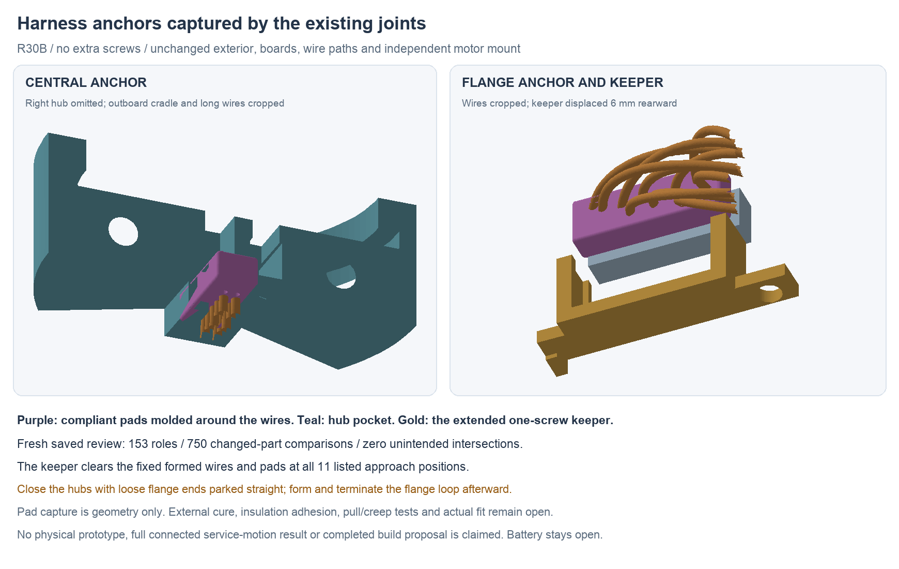

---
search:
  exclude: true
---

# Captured wire anchors and assembly order R30

R30B adds two compliant wire anchors captured by the existing hub halves and
one-screw PCB keeper. There are **no additional screws**. The exterior,
15 mm neck, R28S boards/circuit, R29 installed wire paths, independent motor
mount and stationary tip remain unchanged. The pads provide a proposed load
path from the wire jackets to the retainers; the actual grip depends on an
unqualified overmold bond, not geometry alone.

The installed native is
`hardware/cad/harness-support-r30/candidate-b/HarnessSupportR30.FCStd`.
The adjacent `HarnessSupportR30-review.FCStd` is a fully editable display copy
with identical non-GUI archive contents. Its proof records which exterior and
superseded objects are hidden. The separate `parked-d/` model shows the loose
wire stage used for hub closure. No physical build has occurred; the complete
prototype proposal remains unfinished.

## What changes

The central 7.0 × 2.1 × 3.0 mm pad sits behind the carrier head. New pockets
in the hub halves capture it when those halves close. Small upper bridges join
the added pocket bodies to existing hub material, without changing the body
collar or hub-bolt witness regions. A declared pocket/throat cut removes local
material; it is not a general redesign of the body capture.

The 10.8 × 3.6 × 2.0 mm flange pad sits around the wire departures near J7.
A cup on the existing PCB keeper slides over it from the rear. Top/bottom
slots admit the wires without threading them through closed holes. A new
front stop on the cradle bounds forward movement. A local relief opens the source upper-rail area for the cup; a nonempty
source rail witness below Z8.6 is retained. The screw boss and body-collar/bolt witness regions retain
all their source material. Neither geometric capture nor retained material
establishes a load rating.

Pad outer corners have 0.25 mm nominal radii. Captured faces have 0.10 mm
nominal clearance; the flange front stop has 0.30 mm. Pads must be molded
around the actual wires. The CAD voids follow the 0.60 mm wire allowance and
do not define independently drilled gripping holes. The process proposal
is stored locally at `hardware/cables/harness-support-r30/README.md`; it is
candidate work, not a published or selected process.

## Saved geometry and staging

| Check | Result | Limit |
| --- | --- | --- |
| Installed native | 153 final roles valid; no external links | Fresh forced saved-history review |
| Source conservation | 148 unchanged R29 roles conserved | Explicit BRep serialization differences retain zero removed/added material and matching bounds |
| Changed-part static check | 750 comparisons; zero unexpected intersections | One inherited screw/pilot interface named separately |
| Material removal | Contained in declared tools | Source collar and hub-bolt witness regions lose zero material |
| Keeper approach | 11 listed rearward offsets clear | Formed wires and both pads fixed; covers/screw waiting |
| Pad capture | All 12 translation witnesses meet a retainer at ±0.5 mm | Rigid geometry only; no soft-pad force or creep result |
| Loose-end stage D | 1,435 parked-wire comparisons; zero intersections | Three covers explicitly absent; source prefix plus straight free tails |
| Stage D motions | 9 left-hub, 9 right-hub and 11 populated-board positions clear | Complete parked wires and central pad included; fixtures/hands assumed |
| Isolated pad transport | Correctly centered listed poses clear; minimum metal gap 0.3718 mm | Actual trimmed native bounds; no whole connected harness or housing proof |

Stage D has an independent fresh saved review: all 153 source roles retain
material, each of the ten parked wires retains the exact source body-prefix
poles, and the 120 mm external envelopes and pair gaps pass. The external
length is an envelope for starting stock; after body termination the actual
loose tails are shorter. Extra tail length lies along the same clear −Y path,
not stored inside the final product.

The initially tested order, closing the hub around the already formed flange
loop, fails at several left-hub offsets. That failure remains in B's
`assembly-screen.json`. It is superseded by **parking loose flange ends
straight back, closing the hubs, then forming/terminating the loop**. Both
pads need not be cast before threading; the prototype order forms the central
anchor first and the flange anchor after the final wire departures are set.
The wire-forming transition and actual J7 mating are still hand/fixture work
to verify, not passed continuous-motion results.

A stopped on source BRep-text equality after recompute. B checks geometry and
material at the established limits instead; serialization changes are retained
in the record. Parked C accidentally included the waiting service cover in its
static sweep. D repeats the intended stage with all three covers explicitly
absent. Earlier transport probes used inflated generic cut-shape bounds for
centering; their offsets are not physical-fit evidence. The current
`transport-centering.json` uses actual trimmed optimal bounds, while keeping
the old probe files visible.

## First-build implications

The practical order is in `assembly-docs/harness-support-r30.md`. It keeps
loose flange ends through carrier/body loading and hub closure, seats the
board, forms and terminates the loop, then externally cures the flange pad
before fitting the keeper. Actual fixtures, cure, contact preparation and
mating access remain to verify. No complete service-removal sequence or
repeated flange-flex result is established.

A [Dow 3145 gray datasheet](https://www.dow.com/documents/11/11-1832-01-dowsil-3145-rtv-mil-a-46146-adhesive-gray.pdf?iframe=true)
serves only as a coupon-material reference. Its moisture-cure and substrate
dependence require external cure verification and jacket-bond testing. No final
grade, primer, supplier or cure schedule is selected. The process note proposes
initial handling tests of 1 N per bundle and 0.2 N per wire for 30 seconds,
with relative slip ≤0.2 mm. These are prototype experiment targets, not maker
ratings or achieved performance.

Working silicone controls and board registration, the remaining motor/dock/
pack/NTC wiring and retention, flange loads/compliance, seals/materials/process,
current fabrication outputs and the complete practical build/test package
remain open. Battery selection and the human-owned BOM are unchanged.
