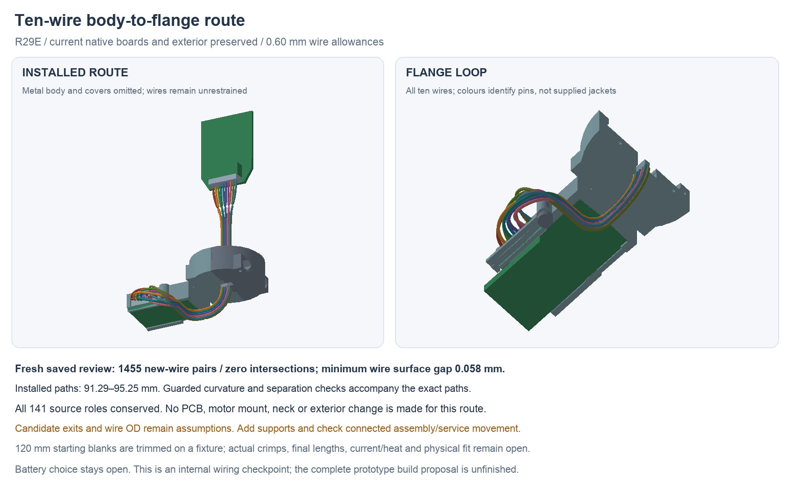

---
search:
  exclude: true
---

# Ten-wire interboard route R29

R29E adds ten individual wire allowances to the saved R27D assembly. It keeps
the [R28S circuit and both native PCBs](flange-routing-r28.md), 15 mm neck,
exterior, independent shell-mounted motor and stationary tip unchanged.
**The installed candidate clears the source parts and the other wires.**
Supports, strain relief and connected assembly/service movement still need
work before this becomes a finished harness or complete build proposal.

## Sources and circuit

The editable source is
`hardware/cad/interboard-r29/candidate-e/InterboardR29.FCStd`.
`review-e/wire-plan.json` contains the exact stored Bezier poles and circular
arcs. `plan-review.json`, `geometry-report.json` and the independent
`saved-review.json` bind the results below to these files.

The editable cable source, `hardware/cables/interboard-r29/interboard-r29.yml`,
uses J6→J7 pins 1–10 unchanged: GND, VBUS_CHG, 3V3, PACK_P, MOTOR_ARM,
MOTOR_PWM, DOCK_PRESENT_N, I2C_SDA, I2C_SCL and ACCEL_INT_N.
The logical review compares every numbered pair with the current full-system
native XML. No part is added to the human-owned BOM; battery choice stays open.

The [JST SH catalogue](https://www.jst.com/wp-content/uploads/2025/06/eSH.pdf)
supports the **SHR-10V-S without protrusions** housing candidate, 11 mm wide.
The B variant is 13 mm wide and is not substituted. SSH-003T-P0.2-H contacts
accept the candidate's AWG/nominal insulation range. Catalogue reference
outlines do not establish the exact assembled contact-egress datum.

The wire candidate is [Accu-Glass 100690, 28 AWG stranded Kapton](https://www.accuglassproducts.com/wire-and-cable/kapton-insulated/stranded-wires/28-awg).
Its catalogue OD is nominal 0.508 mm without a published tolerance. The model
uses a separate **0.60 mm OD allowance and 4.0 mm centreline bend target**.
That target exceeds the current 3.302 mm long-term radius plus 0.30 mm if the
maker radius is measured inside. Received dimensions, radius basis and
produced crimps still need confirmation. `reference-review.json` records the
sources and the unadopted larger-bend Alpha 2842/7 comparison.

## Installed geometry

Each wire leaves the body header, converges into a five-column/two-row bank,
passes down the existing neck corridor, turns toward the flange and rises
into a three-dimensional connector loop. The bank uses 0.8 mm column pitch
and 0.9 mm row spacing. Concentric rising turns preserve separation; the two
radii are 4.9 and 4.0 mm. The final loops avoid both each other and the saved
cradle/keeper. No source material or exterior envelope is changed.

| Check | Result | Scope |
| --- | --- | --- |
| Current pin map | All 10 J6/J7 nets equal current native XML | Numeric mapping; not a physical mating-face view |
| Source conservation | All 141 primary/mate/allowance roles conserved | Same saved R27D geometry; no PCB/exterior change |
| Fresh saved history | 151 roles valid; no external-document links | All source roles plus 10 swept wires |
| New geometry | 1,455 new-wire comparisons, zero intersections | Every wire against all source roles and the other wires |
| Wire spacing | Native minimum surface gap 0.05762 mm | At the assumed 0.60 mm OD; not a tolerance margin |
| Continuous numeric separation | Lower bound 0.03112 mm | Sample distance minus derivative-hull speed/spacing allowance |
| Curvature | Guarded radius at least 4.0 mm | Stored polynomial derivative bounds and exact circles; tangent joins |
| Path lengths | 91.29–95.25 mm | Installed wire exits to exits; not finished cut lengths |

The curvature and separation calculations use explicit floating guards, not
formal directed-rounding arithmetic. Static checks do not cover moving
connected wires or actual connector/contact geometry. The wire supports are
not modeled yet; do not load the headers or rely on free wire placement as
strain relief.

A preserved first native candidate has 45 wire-to-wire intersections despite
clearing fixed parts. B/C are loop-search evidence only; C's separated loops
still inherited crossing lower turns. D corrects the rising turns but keeps
an unfinished loop. E's revised loops receive the complete path review and
fresh native check. Earlier failed plans are not fabrication input.

## First-build work

The cable recipe proposes ten **120 mm starting blanks**, two housings and
twenty contacts. Trim on a routing fixture only after confirming actual mated
exits and loading order. Excess removed during trimming is not service slack.
WireViz output and the child BOM are generated outside the repository; see
`assembly-docs/cable-harnesses.md` for local output links.

The intended assembly order attaches the body end while the cartridge is
accessible, feeds loose/unhoused flange ends through the neck route, seats the
cartridge, and dresses the bend before the capture hubs close. Seat the flange
board before mating J7, with covers waiting. Build a guide/strain-relief scheme
and check this order with the actual contacts, housing insertion and supported
wire movement. The current installed geometry alone does not prove that order.

`logical-review.json` includes illustrative power/return drop at 120 mm per
wire and two mated interfaces per conductor. These are scenarios, not approved
load or enclosure ratings. Test common-ground drop, power transients, I2C,
noise, current/temperature and shorts before normal operation. Working local
controls, the other harnesses, pack/NTC retention, flange loads/compliance,
seals/material/process, current fabrication outputs and the complete first-build
plan remain open. No parts were purchased or fabricated.
