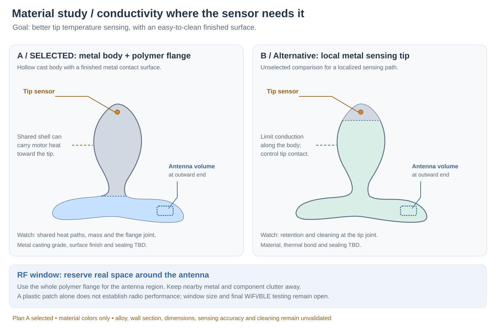

---
search:
  exclude: true
---

# Plan A: Hollow Metal Body and Polymer Flange

30 October 2026. **Lucy selected Plan A: a hollow cast-metal body with a whole polymer flange.** The stated thermal goal is better temperature sensing, alongside an easy-to-clean finished surface. This is the construction direction for the next design pass. Casting alloy, polymer grade, wall thickness, finish, joints and dimensions remain open. The current contour and single T-shaped PCB direction remain provisional inputs; no active heating/cooling is requested.

## Put the thermal path where the measurement is

Assume the measurement objective is local tissue-contact temperature at the tip. Improve the path from that contact surface to the sensor while reducing the influence of motor/electronics heat and the outside environment. A thermally bonded sensor initially measures its own die, coupled to the shell; it does not automatically become an accurate tissue thermometer.

[Analog Devices' contact-temperature guidance](https://www.analog.com/en/resources/technical-articles/2022/07/16/12/31/guidelines-for-using-contact-temperature-sensors-to-add-temperature-measurement-to-wearable-products.html) stresses separating the desired body measurement from device temperature, minimizing thermal mass and avoiding electronics heat. It is guidance for skin wearables, not validation of this product or its contact conditions. Applying those principles here suggests the following comparison:

| Candidate | Opportunity | Main question |
| --- | --- | --- |
| **Plan A — selected:** hollow metal body + polymer flange | Exposed, finishable metal contact surface; conductive path to the tip sensor; radio volume at the flange. | Does the shared shell spread motor heat or lose heat through the neck enough to bias the reading? Mass, stiffness and response need measurement. |
| Plan B — unselected: local metal sensing tip + insulating body/flange | Short, low-mass thermal path to the sensor, with less direct conduction along the shell. | Can the metal-to-body interface remain securely retained, flush, sealed and cleanable? This adds a joint near the sensing surface. |

Develop Plan A first. Retain Plan B as an unselected comparison if the shared-shell thermal behavior needs a different solution; changing to it would be a separate design decision. Thermal benefits remain engineering hypotheses. Do not cast a solid metal volume around the electronics or assume more metal produces a faster, more accurate reading. Actual wall thickness, thermal mass, contacts and heat sources decide the result.

Keep the wired sensing island at the tip and the battery NTC separate. Characterize the finished sensor-to-surface interface with the motor and radios both off and active, using controlled thermal fixtures and an independent reference. Capture offset, response time and heat-source sensitivity before claiming temperature accuracy. A controlled-fixture result will not itself validate tissue temperature or wear duration.

## Give the antenna a nonmetal volume

Use the selected whole polymer flange to reserve an antenna region at its outward end. The earlier wraparound endcap on a metal flange remains an alternative, not the selected construction. A whole polymer flange offers more room to place the antenna and move nearby metal away; it also creates a structural and sealed metal/body-to-flange joint. Polymer does not automatically mean flexible.

The antenna must occupy the nonmetal region. A small plastic patch over an antenna still surrounded by cast metal may remain shielded or detuned. Reserve clearance from the shell, battery foil, motor, magnets, contacts and fasteners; select the plastic and any coating with RF performance in mind.

[Espressif's ESP32-C3 layout guidance](https://docs.espressif.com/projects/esp-hardware-design-guidelines/en/latest/esp32c3/pcb-layout-design.html) favors the module antenna at the carrier-board edge and recommends at least 15 mm housing clearance in all directions, followed by final-product range/throughput testing. This is integration guidance, not a formula for a 15 mm antenna window. Window size is not fixed here. Check both WiFi and BLE in the finished enclosure with representative body loading, orientation, clothing and motor activity.

## Casting and cleaning are separate decisions

If stainless is pursued, specify an actual casting grade and its inspection/finishing process. [Nickel Institute's casting guidance](https://nickelinstitute.org/media/1768/procurementofqualitystainlesssteelcastings_10021_.pdf) identifies CF3M as comparable to wrought 316L; it does not make them identical products or establish finished body-contact suitability. Alloy choice remains open.

An as-cast surface is not the proposed finished contact surface. Define defect acceptance, machining, polishing and post-fabrication cleaning/passivation as appropriate. [Outokumpu](https://www.outokumpu.com/en/expertise/stainless-basics/post-fabrication-treatment) explains how fabrication defects and contamination affect corrosion resistance and how finishing treatments restore surface quality. A shiny surface alone does not establish a sound, cleanable casting.

Keep material joints flush and eliminate accessible crevices. Validate the chosen cleaning process on the whole assembly, including seals, contacts, button membranes, adhesives and electronics protection. No boiling, autoclave, immersion rating or sterilization capability is claimed. A full silicone cover would add another thermal layer, so it must be included in any sensing comparison.

## Packaging consequences to resolve

Preserve the contour's tailbone/perineal relief, accessible stop and smooth underside. Reassess contact geometry and load when replacing a compliant surface with rigid metal. Check the metal/polymer joint's retention, sealing and cleaning at the neck; do not rely on an unreviewed adhesive joint to carry retention loads.

Prove the T-board, motor and sensor can be inserted through the eventual assembly opening, and that a hollow casting can be manufactured and inspected. An RF window is not automatically a usable assembly opening. Define the internal dielectric carrier, electrical clearances, shell grounding/ESD strategy and isolated charging contacts before detailing the metal shell. No parts are added to the human-owned BOM.

The editable comparison is `hardware/cad/concepts/materials-and-rf.svg`. Its profiles reuse Concept 03 illustration curves; colors indicate material regions only. No dimensions, cast wall section, antenna window size, thermal result or joint design can be inferred from the drawing.
