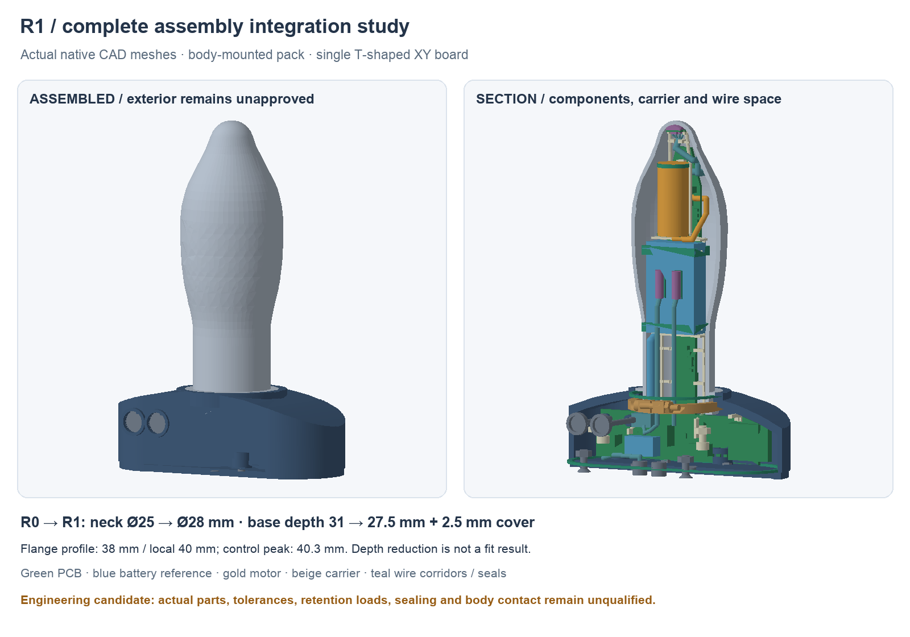
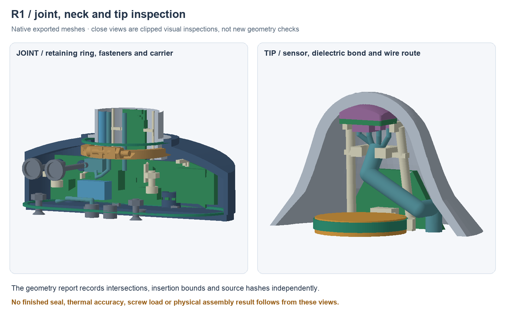

---
search:
  exclude: true
---

# R1 body-mounted battery option

**Superseded development baseline.** R2 replaces the assembly direction with side-loaded longitudinal metal halves. R1 files are preserved: final static geometry is clear, but the current continuous body/flange bounds remain unresolved and the populated board has a confirmed collision during the proposed long slide into its carrier. R1 is not a cleared assembly route. See `hardware/cad/prototype-r1/baseline-status.json` and the current `assembly-checks.json`; no further R1 geometry regeneration followed the R2 decision.

R1 is an engineering assembly candidate for review. It preserves Plan A: a hollow cast-metal body, a whole polymer flange and a single T-shaped main PCB. It does not approve exterior dimensions, wear duration, material, a casting supplier, charging, sealing or fabrication. The R0 flange-mounted battery option remains available.

The native source is `hardware/cad/prototype-r1/ButtplugPrototypeR1.FCStd`, with a combined STEP and individual part STEP/STL files alongside it. `parameters.json`, the editable native feature history and `build.py` are the source; regenerate with `tools/prototype_mechanical_r0.py --revision r1`. The default generator still builds R0. JSON regeneration is the complete route: selected body dimensions have spreadsheet expressions, while several carrier, control and joint details remain editable source constants. Threads are represented by nominal major-diameter envelopes.

## Exterior tradeoff

| Study dimension | R0 | R1 candidate |
| --- | ---: | ---: |
| Neck outside / bore diameter | 25 / 22 mm | 28 / 25 mm |
| Flange depth, excluding cover | 31 mm | 27.5 mm |
| Depth including 2.5 mm cover | 33.5 mm | 30 mm |
| Flange left/right width parameter | 38 mm | 38 mm |
| Local joint / control-inclusive width | 40 mm | 40 / 40.3 mm |
| Body working length | 98 mm | 98 mm |

The body battery therefore trades 3 mm of neck growth for 3.5 mm less base depth. That is not evidence of better anatomical fit. The anterior/posterior contour and posterior clearance remain study geometry; the product's awake-wear goal with removal breaks and separate sleep goal are unvalidated. A thinner protected pack or thinner retention system could change this comparison, but no replacement cell is selected.

## Mechanical assembly

The capture joint transfers load from the metal lip through split shims and a split retainer into a polymer seat. Two small crossbolts join the retainer halves. A D-shaped shoulder register limits rotation. The proposed spigot has a 25 mm bore and 28 mm outside diameter, leaving 1.5 mm radial metal. Its strength, casting allowance, gasket stack, screw loads and shim thickness require supplier and bench review; adhesive is not the sole retention path.

The open dielectric carrier connects the flange root, pack supports, motor cradles, remote sensor support and wire saddle. The pouch loads from the open side; removable loose caps close the pack supports. A thin PET tape wrap retains each cap against the carrier; it does not tighten directly around the pouch. These are loose restraints, with adjustable soft pads, rather than a specified compression of the pouch. Battery selection is explicitly open. The 350 mAh Bitcraze pack remains a dimensional reference, nominally 33 × 20 × 8 mm excluding its 35 mm cable/connector. Its maximum dimensional tolerance, lead exit and received condition remain unknown. No replacement battery or exterior change follows from keeping that choice open.

The motor has two slit cradles, soft radial liners and axial stops around the NFP-E1015 datasheet maximum body. A relieved front cradle gives the lead pair an exit; the end stops overlap the endface projection, with nominal 0.4 mm front and 0.1 mm rear axial gaps. Clip strain, material and vibration retention are untested. Two physical Vishay NTC heads contact the pack broad face through reversible tape/bond pads, inside the dry cavity. Each head/lead-entry reservation is 3 mm diameter × 10 mm; 52 ± 5 mm factory leads require extensions and an insulated common-ground splice. Three conductors are not forced into one PH contact.

The tip board is 6 × 4 mm with 0.3 mm corner radii in the XZ plane, 0.620 mm finished thickness, with its backside fixed at Y94.8. Its component face points toward the base. Actual TMP117 and C101 body maxima map from the native tip board, with the reported 0.9/0.65 mm assembly heights and a provisional 0.1 mm margin on each body edge. Two outer hooks retain the unpopulated board edge. The full rounded backside footprint retains a dielectric bond, approximately 0.68–1.7 mm thick axially. Bond application, positioning and cure remain open; the hard-part insertion check excludes deforming bond material. Electrical isolation, bond reliability and installed temperature accuracy/time lag are unqualified.

The tip board is rotated 180° in its plane: native local X maps to −toyX and local Y to −toyZ. Viewed from the base looking toward +Y, with +Z up, the wire row is along the lower edge; pin 1 (3V3) is rightmost at toyX+2.1. Pins 1–4 run right to left: 3V3, GND, SDA, SCL. Four separate solder reservations and 0.6 mm individual-wire corridors fan into a two-by-two arrangement within the 2 mm common bundle before the strain-relief saddle. Solder volume, wire diameter, bends, insulation, attachment and cut lengths remain prototype studies, not approved assembly dimensions.

The complete carrier, pack, motor, tip board and populated main board must be premated outside the shell and inserted together. Inserting the main board afterward would require the short tip/motor cables to span an impractical temporary distance. Carrier anchors are at X/Z (−25, 9.5) and (18.5, 12), with tool access above the PCB. Longitudinal 3.9 mm-radius bypasses let the carrier pass the fixed 3.6 mm-radius cover bosses; the nominal root web directly below each upper bypass is 1.6 mm. Local ears support the anchor holes. Material, print direction, torque and vibration strength remain unqualified. Two short channels at Y2–3 and14–15 capture the main-board neck edges with 0.2mm nominal side/vertical gaps. A front crossbar datum stops forward motion; soft rear edge pads on the service cover provide unqualified longitudinal capture/preload. The carrier anchor bolts do not clamp the PCB. Hold the accessible crossbar during module insertion, then close the cover after inspecting harness slack and connections.

## Detailed interfaces and remaining gates

The bench fastening candidates use drawing-backed cap-screw and hex-nut geometry: [M2 × 16 screw](https://www.accu.co.uk/metric-cap-head-screws/2774-SSC-M2-16-A2), [M2 nut](https://www.accu.co.uk/hexagon-nuts/7884-HPN-M2-A2), [M2.5 × 6 screw](https://accu-components.com/us/metric-cap-head-screws/3804-SSCF-M2-5-6-A2), [M2.5 × 8 flush cover screw](https://accu-components.com/us/phillips-countersunk-screws/65911-SIK-M2-5-8-A2) and [M2.5 nut](https://www.accu.co.uk/hexagon-nuts/7886-HPN-M2-5-A2). Dimensions were read on 2026-10-30; contradictory stock fields are not treated as availability confirmation. These are internal prototype candidates, not a human-owned BOM change.

The perimeter and body-face gaskets have explicit free/assembled thickness studies. Guided plungers align with SW1/SW2 beneath captured silicone diaphragms. Charging contacts, their insulating feedthroughs and two dry-side 5 × 2 mm magnet bays remain reservations. The blind magnet pockets leave approximately 0.45 mm nominal cover material; retention, force, coating, polarity and sealing remain open. None is a qualified liquid seal. The [Bitcraze spare battery cable SKU100046015](https://store.bitcraze.io/products/spare-battery-cable) is a candidate OEM mate: its [drawing](https://www.bitcraze.io/documentation/hardware/battery_cable/battery_cable-datasheet.pdf) gives 22±1mm from lead-exit face to free ends, with 2±0.5mm stripped ends; the separate 33mm product length includes an undimensioned connector. Received connector/boot dimensions, mated PH4 and dock-header geometry, physical harness bends, PET-cap retention strength, printed clearances and final seal compounds remain assembly gates.

The antenna-end FR4 is cut back to X31.6. No modeled hardware enters the antenna's XY projection. Nominal three-dimensional distances from its reserved volume are 16.540 mm to the metal body, 15.215 mm to the potentially conductive rear retainer, 17.169 mm to the nearest carrier nut, 18.141 mm to a cover nut, 23.482 mm to a dock magnet and 38.732 mm to the reference pack. [Espressif's housing guidance](https://docs.espressif.com/projects/esp-hardware-design-guidelines/en/latest/esp32c3/pcb-layout-design.html#general-principles-of-pcb-layout-for-modules-positioning-a-module-on-a-base-board) recommends 15 mm clearance and testing the assembled product. These measurements do not establish RF compliance, a universal polymer-wall clearance, or tolerance margin; the 0.215 mm retainer margin and final housing/proximity tests remain open.

`geometry-report.json` records the actual component-envelope input hash, native solid validity, intersections and insertion scope. `placed-components-input.json` freezes the whole placement report used for that build. Separate normalized component, mated-SH-envelope and board-outline fingerprints let a later routing-only update be compared without mistaking metadata changes for mechanical changes. The main native board uses the final 87-reference placement and its exact antenna-end cutback to X31.6, giving 66.6 mm overall X span from X−35. The 70 mm crossbar parameter is a historical symmetric study input; it does not drive this imported outline. R0's historical board stays unchanged. A clean nominal kernel result is separate from tolerance qualification, a populated hardware build, load testing, RF verification or physical fit. Keep the charge jumper open and motor limits under bench control until the separate electrical gates are satisfied.

The separate inert `NeckBore25Gauge.FCStd`/STL/STEP coupon has a nominal 25mm bore, 20mm length and an entry lead-in. Its editable source is `build-neck-gauge.py`. It allows a printed/received-part insertion comparison before machining a shell; no coupon has been printed or tried. It cannot establish full-body taper clearance, electrical operation or anatomical fit.

The [3M850 transparent tape candidate](https://www.3m.com/3M/en_US/p/dc/v000175222/) is published as 3.18mm wide and 0.05mm thick. R1 reserves 0.1mm around the carrier for the wrap/lap. Adhesion, retention under vibration and compatibility with the eventual carrier are untested. The resulting approximately 0.2–0.4mm nominal bore bottleneck is too small to treat as a qualified production allowance. Do not enlarge the exterior automatically to absorb it.
