---
search:
  exclude: true
---

# Mechanical prototype R2

**Architecture update, 31 October:** the current [R9 front-loading study](front-load-study-r9.md)
explores a one-piece body, larger cap and separate body/flange PCBs to simplify
assembly. The R2/Full05 material below is the preserved split-shell baseline;
its PCB, carrier and installation checks do not establish the new architecture.
Battery selection remains open.

31 October 2026. R2 follows Lucy’s split metal body: two longitudinal cast-metal halves form an open-ended tube and a common male nose thread. A female nose cap supplies the external nose end wall and front retention; an ordinary transverse bolt clamps registered metal lugs at the rear. A rigid polymer flange/core supports both halves and the radio. A removable elastomer cover fits afterward. Alloy, foundry, casting/finishing route, threadlocker, seal materials and flexible-cover retention remain open. Polishing the registered empty assembly is the finish intent; it does not seal the joints.

Lucy selected **15 mm neck diameter** as the next design target. This is not a comfort or wear-duration validation. The current body length of 98 mm, 37.338 mm maximum body diameter and flange contour are engineering references. Battery selection remains **OPEN**.

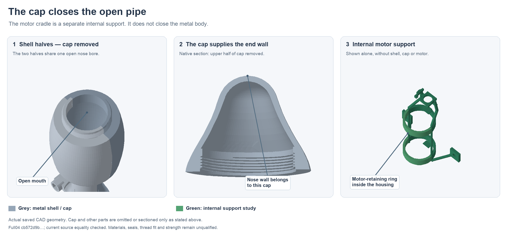

The green motor-retaining rings are internal supports. The metal halves have
one open nose bore; only the female cap supplies its external end wall.
This read-only detail uses the saved full-04 shapes and checks their equality
with the released R5 upper study. It adds no geometry or assembly acceptance.
Source bindings are in `hardware/cad/prototype-r2/open-pipe-review/`.

## Current integrated checkpoint: Full05

`hardware/cad/prototype-r2/full-05/ButtplugPrototypeR2Full05.FCStd` combines the
R4 button-loading changes, R5 core-join keepers and R6 carrier ports in one
saved editable assembly. It preserves the full-04 history, open-pipe metal
exterior, 15 mm neck, current routed PCB poses, product charging insert and
both full button blocking rings. The source index is
`hardware/cad/prototype-r2/full-05/artifact-index.json`.

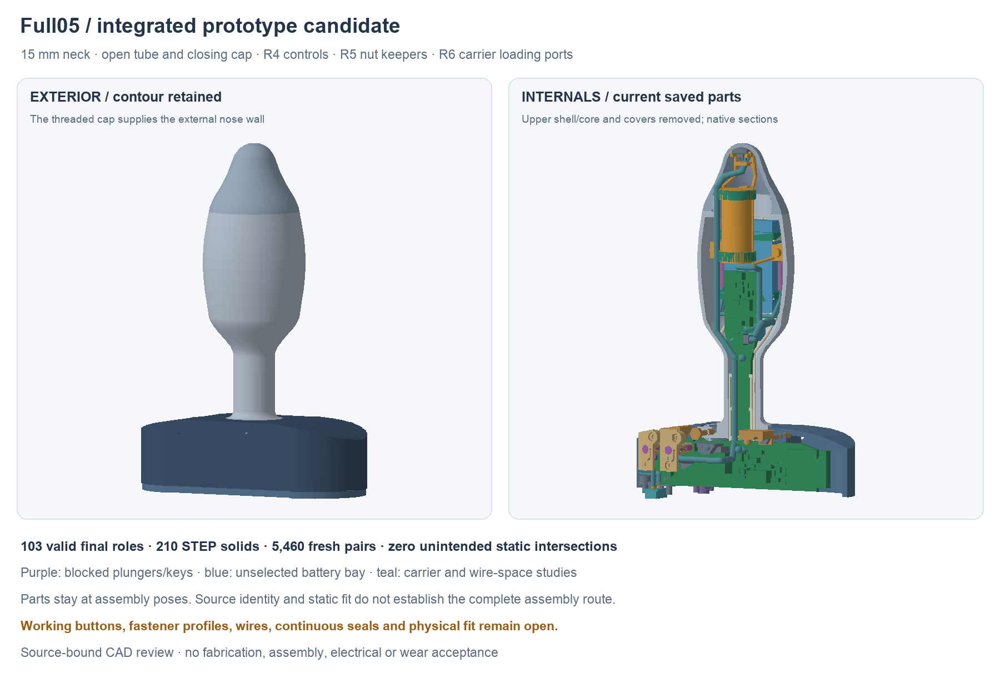

All 103 final roles match their exact source geometry. A fresh 5,460-pair
screen covers final/final and both spring auxiliaries, with zero unintended
intersections, 32 named process interfaces and no spring hits. Independent
forced saved-history recompute preserves all 103 final roles within the
stated numerical comparison limits; the STEP reimports as 210 valid solids.
The native contains actual copied feature graphs, nine guarded base
rebindings and no cross-document links. Superseded objects stay as hidden
history. Source snapshots/builders remain the regeneration route; not every
parameter-sheet cell drives a live expression.

These checks establish the saved source and nominal static fit. The separate
Full05 route review now binds 65 chronological records to this exact native:
54 rigid-stage records clear 420 listed poses, while 11 process/handling
stages remain explicitly unqualified. All records partition the complete
104-role operational context; two sensor heads split one saved native role.
Source transfers use exact saved geometry or a verified subtractive carrier
chain, with added fixed context checked freshly. The corrected button order
is cartridge, side key, mounting screws, then tool. Both the pre-keyed drop
and screw-before-key failures remain preserved. Read
`hardware/cad/prototype-r2/full05-route-review/README.md` and its frozen
`assembly-sequence.json`. This is finite evidence, not continuous-motion or
physical assembly acceptance.
The exact-current STEP numerical review matches all 210 solids unambiguously
by its stated bounds method. Its upper-core difference of −0.00814445048 mm³
and aggregate −0.00763955167 mm³ exceed the unchanged 0.001 mm³ volume screen.
All convergence screens pass, but numerical stability is not a true-error or
surface guarantee. Optimal bounds differ by at most 0.000043089 mm; four
solids change topology counts with preserved face counts. The cause and
complete exchange acceptance remain open in
`hardware/cad/prototype-r2/full05-exchange-review-r1/`. The earlier full-04
review does not transfer to this export. A single isolated-core export also
exceeds the volume screen; its unequal recorded writer uncertainty prevents
a composition-only inference. A finite source-history review locates the
highest stored BRep tolerance at the inherited rear-clamp bearing/lug pocket
and upper/lower-core split. Actual saved boundary witnesses predate the new
keeper and control-port cuts. This metadata does not establish a source
defect or explain the exchange difference. Its frozen record is under
`full05-exchange-review-r1/high-tolerance-localization-r1/`.
Working button
travel/return, real fastener profiles/threads, hand access, actual wires,
sensor bonds, continuous seals, material/strength, received parts and physical
assembly remain open. Battery selection remains **OPEN**.

The read-only tip wire bend screen at `hardware/design/tip-wire-bend-r1.json`
now binds the actual saved cylinder/sphere route. Its 8.3 mm leg between two
90° turns permits at most a 4.15 mm uniform circular fillet at those fixed
vertices. The documented [Alpha 2841/7 example](https://www.alphawire.com/products/wire/hook-up-wire/premium/2841_7)
fails the separately defined center/inside/outside-radius interpretations,
even at its smallest listed diameter. This is a fixed-polyline screen;
different smooth routing remains possible. It does not select the wire or
establish individual four-wire paths, slack, crimping, bus behavior or cut
lengths. The 153.931 mm polyline is not a cut length or a lower bound.

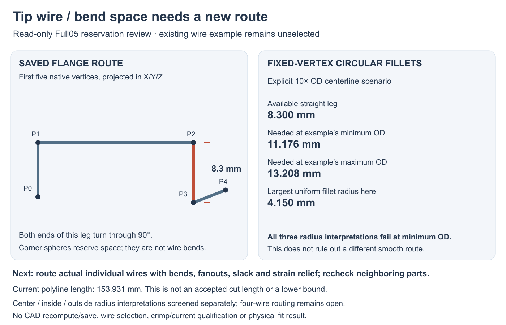

The separate `hardware/design/local-controls-working-path-r2.json` proposes
larger internally mounted D2F-01F-D switches as an operating-mechanism study.
The simple candidate boxes expose conflicts with current control parts,
core-join retention hardware and the tip harness. They do not establish a
fitting pose. A new native layout, switch/membrane/return/stop qualification
and always-available wetting/logic circuit are needed before adoption. The
audited main PCB, current R4 mechanism and full blocking rings remain unchanged.

## Saved exterior checkpoint

`hardware/cad/prototype-r2/exterior-checkpoint.FCStd` and `exterior-checkpoint.step` contain nine valid native final objects, with editable sketches, revolutions, extrusions and Boolean history. The frozen regeneration wrapper is `build-exterior-checkpoint.py`, supported by `exterior-checkpoint-helpers.py`; checkpoint dimensions live in `exterior-checkpoint-parameters.json`. Full R2 development uses separate `build.py`, `native_helpers.py` and `parameters.json`. `exterior-checkpoint-report.json` records hashes, exact bounds, scope and the final-object list. Per-part STL/STEP exports include actual native sections removing positive Z and a 1 mm waist slice at Y10–11. Radial control poles bound the body at exactly 37.338 mm; the saved native metal has zero volume outside that enclosing cylinder. The native sketch poles remain editable; manual pole edits need a fresh contour/tangency check, while parameter changes use source regeneration.

| Feature | Current study |
| --- | --- |
| Axes | X across flange; positive Y toward tip; Z normal to PCB |
| Metal split | XY plane, Z0; halves open along positive/negative Z |
| Neck | 15 mm OD over Y0–20; 1.5 mm radial-wall input gives 12 mm bore |
| Neck to base | Circular R3 metal root blend over Y−3–0; 21 mm root meets the central flat flange roof tangentially |
| Neck to body | Shape-preserving native spline tangent to the straight neck at Y20 |
| Proposed single T-board | 8 mm bare waist centered at Z−0.5–0.5; short body tongue to Y52 |
| Bare-board radial margin | 1.969 mm to the nominal 12 mm bore, before carrier, wires or tolerances |
| Flange cover | Split, removable 1 mm skin reserved inside the outer contour budget |

The positive metal capture shoulder remains recessed below the exposed base. The split elastomer cover avoids claiming that a one-piece boot can stretch over the 37.338 mm body. Material, tear, retention, sealing, cleaning and assembly tests remain necessary. The outer flange perimeter still needs an edge-finish review.

This checkpoint has a **plain nose-cap exterior**. It does not include a released thread, rear bolt, registers, structural core capture or seals. It contains a proposed bare board, not a new electrically laid-out PCB. The checked electrical R0 files and preserved R1 development baseline are unchanged.

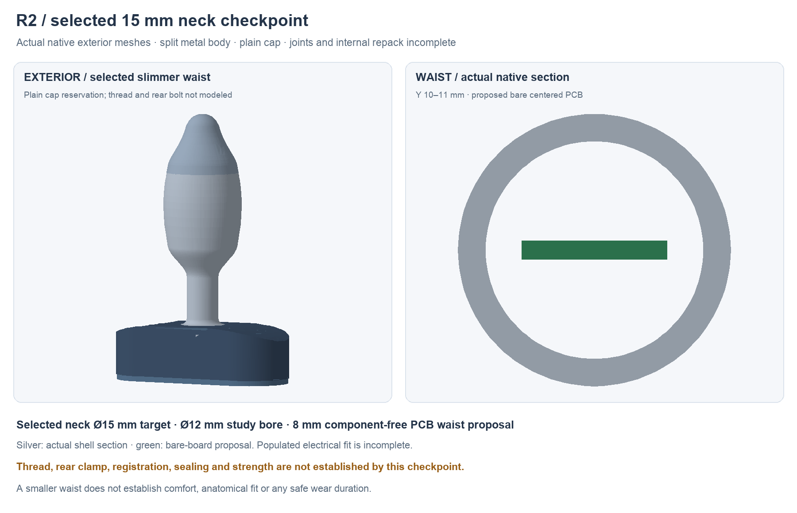

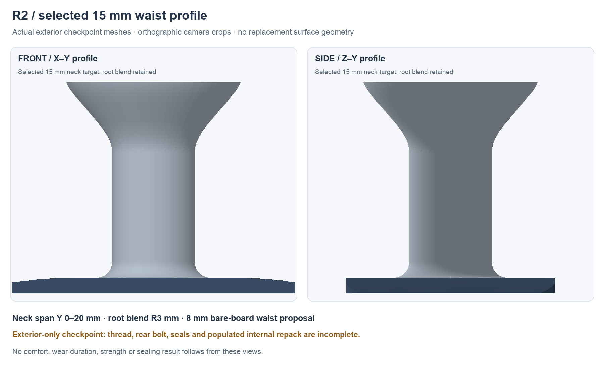

## Nut access and assembly order: separate R6 candidate

`hardware/cad/retained-nuts-r6/` adds an outward side port for the second
carrier-anchor nut and forward ports for both motor-module nuts. It keeps the
R5 carrier's lead-in, diagonal strut, anchor bearing floor and motor-pocket
floors, roofs and opposing faces. The carrier remains one connected solid;
104 scoped changed-carrier/context/spring comparisons have zero intersections.
Independent forced saved-history review preserves that solid exactly, and
the one-carrier STEP passes validity/count checks.

Five anchor-stage tests and eight corrected motor/sensor-stage tests clear
103 sampled poses in total. The three access ports alone were insufficient:
the original order hit the cell NTC heads and upper metal. The corrected
order fits the motor nuts and bolts before lowering the two sensor heads,
with their leads and the upper half still waiting. The operational record
splits one native two-head compound into two explicit movers, giving 104
stage roles from 103 native roles. Those original failures remain recorded.

The anchor nut requires hands-on support while the carrier lowers and its
bolt begins; each motor nut is held against its datum until its bolt engages.
The illustrative tool spaces do not prove hand access or gripping. Source
bores do not prove true threaded capture, loaded seating or torque. Actual
pack sensor coupling/wrapping/leads, the countersunk head profile, material
and strength remain open. The frozen mapping and checks are in
`hardware/cad/retained-nuts-r6/artifact-index.json`. Full05 now contains the
mapped carrier, with its whole-assembly route review separate. The earlier
full-04 source remains unchanged.

## Carrier loading: preserved separate R5 candidate

`hardware/cad/prototype-r2/side-loading-r5/` gives the lower carrier a small
flat on its diagonal flange strut. It clears all 30 fresh sampled straight
loading poses without changing the lower core, metal halves or exterior.
The carrier stays one connected solid. The smallest sampled remaining-strut
gap is 0.066475 mm; the minimum of 61 normal sections retains 66.24% of the
original strut area. These narrow nominal margins still need material,
process, strength and manufactured-fit review.

Its sequence record explicitly maps moving, fixed and waiting parts for all
103 roles of the proposed R5 upper assembly plus this carrier. Conditional
lower-core, populated-board/module and upper-metal samples clear. The tip
seats before routing its long harness; rigid wire volumes do not establish
flexible installation. Independent forced saved-history review and one-solid
STEP validity/count checks pass.

**Three nut preload routes remain unresolved:** the second carrier-anchor nut
hits the diagonal strut, and both motor-module nuts hit their pocket roofs.
All are clear when seated, which does not prove loading. The separate
retained-nuts R6 candidate above adds checked staged access; it has not replaced this source.
The source-bound records and exact role map are in
`hardware/cad/prototype-r2/side-loading-r5/index.json`. Full05 preserves this
lead-in beneath the R6 ports; the standalone source and full-04 are unchanged.
This conditional source sequence is not complete assembly acceptance.

## Fastener profiles: source screen R1

`hardware/design/fastener-fit-screen-r1.json` compares the simplified native
fasteners with one manufacturer family per joint. Published main/module
outer-head maxima and nut AF/height match their source bodies. Actual drive
profiles, length tolerances, bearing details and formed-thread engagement
are not established by those envelope matches.

The M2.5 carrier screw has a specific unresolved difference: the manufacturer's
listed full head/transition height is 1.5 mm, while the native uses a 1.1 mm
pure cone. That does not prove a cylindrical rim or an exact collision.
A controlled full-head silhouette is required before changing seats and
rechecking the surrounding core/carrier/cover and tool routes. The R5 ideal
main-bolt socket likewise does not guarantee actual screw/key fit. This screen
does not select a part, material, finish, torque or supplier stock.

## Core-join nut loading: separate R5 candidate

`hardware/cad/core-join-r5/` gives the two core-join nuts a real side-loading
route before upper-core closure. Each nut sits on a keeper's 0.6 mm backed
tongue; the loose pair is held together, lifted 0.2 mm, slid from +Y into the
removed upper core, then lowered to its seats. A small bench-fitted screw
retains the keeper. The nuts remain at their original positions.

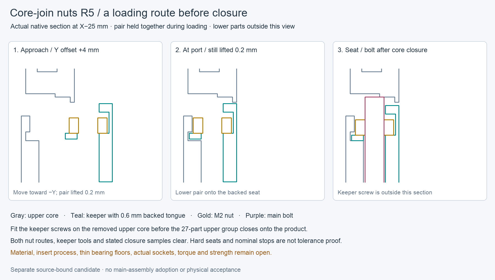

The study preserves the exact R4 control parts and key ports. Its 103-role
context has zero unexpected intersections in 1,631 scoped changed/spring checks;
all six receiver-wall rings remain. Thirteen finite loading/tool sequences,
including the 27-part upper group, clear at 95 sampled positions. Both nuts
meet stops in all eight bounded capture probes. Independent forced native
history and STEP validity/count checks preserve 11 study solids; the STEP
contains those 11 parts, not the whole 103-role context. A read-only peer
audit found no discrepancy within that scope.

This is a separate candidate, with its exact mapping and source hashes in
`hardware/cad/core-join-r5/artifact-index.json`. Full05 adopts its mapped parts.
This source study does not qualify the preceding
lower/carrier/module/PCB loading sequence. The proposed main-bolt socket has
only 0.01 mm nominal key-face clearance and is not a controlled selected screw.
Actual sockets, hard-seat fit, the 0.5/1.2 mm keeper screw floors, inserts,
materials, torque and strength remain open. Rejected development-01 and its
actual failures are preserved beside the corrected source.

## Button loading clearance: separate R4 candidate

`hardware/cad/local-controls-r4/` corrects the R3 bayonet's zero-clearance
assembly state. Before the key is fitted, each guide has a **0.15 mm sampled
turn window** at Z offsets −0.20…−0.05 mm. The track floor moves down 0.25 mm;
the original guide home, plunger and full blocking ring remain unchanged.
After turning, the guide rises home and a side-entry key supports its
closed-roof pocket. The existing mounting screw retains that key.

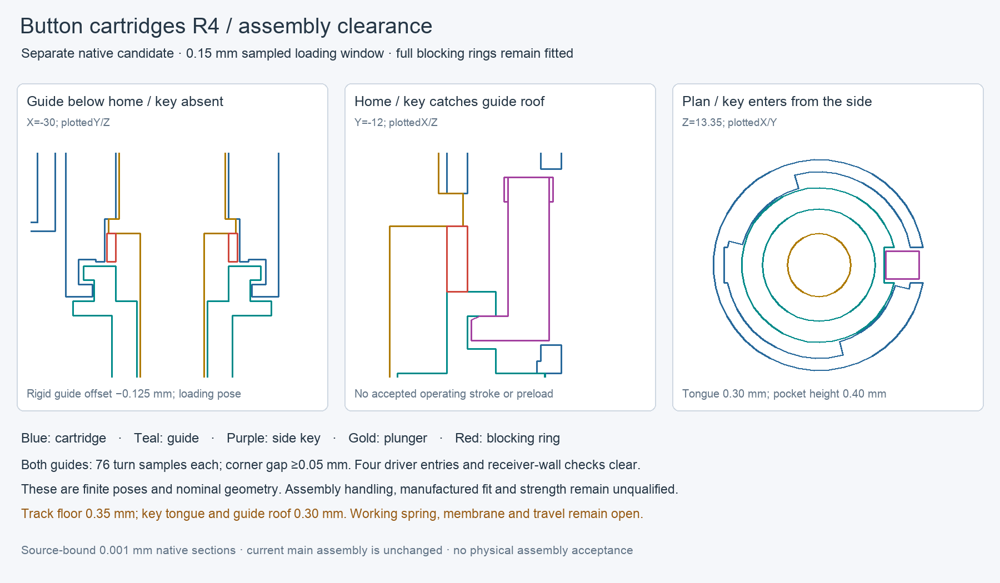

Both 76-pose turn sets, entry/rise samples, side-key approaches and four
dimensioned tool checks clear. Six corner samples per guide have at least
0.05 mm nominal gap. The seven changed roles have no unexpected intersections
in 651 comparisons against each other and the 90 retained full-04 roles;
all four receiver wall rings remain. Independent forced saved-history review
preserves 23 final single-solid roles, and STEP reimports as 23 valid solids.
These are finite nominal geometry checks, not continuous motion or manufactured fit.

The guide is still fully blocked. The 0.35 mm track-floor web and 0.30 mm
roof/key tongue need material, process and strength review; support during
loading, tolerances, screw retention, spring return, membrane and working
overtravel remain unresolved. The exact seven-role integration map is in
`hardware/design/local-controls-retention-r4.json`; do not replace the actual
lower core or skin with standalone reference exports. The changes are now
present in Full05 through the six control parts and R5's composed upper-core
ports. The actual lower core and skin retain their checked source geometry.

The separate requirements screen at
`hardware/design/local-controls-operating-screen-r1.json` explains why the
working stop remains open. Even before the full tolerance/compliance stack,
the current independent switch-height and pretravel ranges put electrical
closure between 0.15 and 0.70 mm of plunger movement. A single stop reaching
the late case would require 0.55 mm beyond operation in the early case;
neither the checked newer manufacturer-authored datasheet nor the legacy
primary source supplies an allowable value for that movement. This is a
missing requirement, not a permitted overtravel. The one coaxial return-spring
concept still needs actual dimensional/load limits, guide friction and
finished-membrane response. Full blocking rings remain fitted.

## Preserved rear joint, controls and dock: full-04

The preserved source package at `hardware/cad/prototype-r2/full-04/`
combines rear-joint R4 and local-controls R3 with the preserved full-03 carrier,
body, PCB poses and charging insert. The metal halves are an open-ended tube;
the female cap alone supplies the external nose wall and front retention.
The 15 mm neck and open battery choice remain fixed design directions.

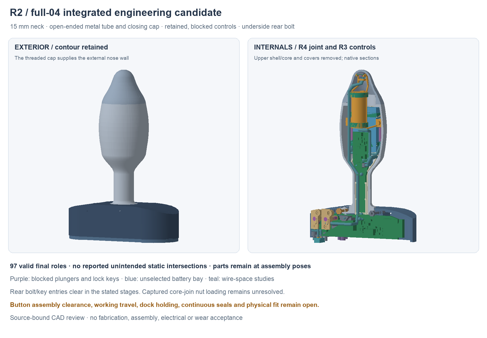

The saved native has 97 valid final roles plus two separate unselected spring
spaces. Independent forced history recompute preserves every final role,
including the exact 15 mm waist and centered 8 ×1 mm bare board. The source
record covers all 4,851 static pairs, with zero unexpected intersections and
30 individually named process/thread/termination interfaces. All 99 saved
role/auxiliary shapes match the source composition, using an explicitly
recorded common-volume fallback for one coincident carrier comparison.
These are nominal geometry checks, not actual-part or tolerance acceptance.

R4 confines rear access to the underside, preserving all four control receiver
walls that the R3 through-cut damaged. Its source-bound actual bolt/key entries
clear with skins removed. Rear nut preload precedes upper-core closure; lower
core/clamp assembly precedes the carrier and its anchors. The sampled upper
closure carries the controls and two already captured core-join nuts. **Sampled
straight +Z loading of those nuts into the bare core is blocked.** A manufacturing/loading
method or revised access is required before this is an executable assembly.
The linked staged reports retain their moving groups, fixed parts and failures;
full-03 motion results have not been transferred to this revision.

R3 button guides, separate rotation keys and dimensioned M1.6 mounting
interfaces are integrated. Full blocking rings remain installed. Nominal bench
loading/turn samples have no positive axial assembly-clearance window;
working travel, return, membrane, insert process and strength remain open.
The separate external charging mate still needs critical pin retention and
holding-force work. Its copied target key recesses are not adopted here.

The native edit route preserves full-03 history and adds native core Boolean
features; new rear/control components are exact source-bound BReps. Edit those
components in their standalone sources and regenerate with `full-04/build.py`.
Legacy parameter sheets are labeled as history; current Full04 sheets are
snapshots, not a claim that every feature is spreadsheet driven.

The STEP reimports as 204 valid solids, but its original 0.001 mm³ volume gate
remains failed. The separate `full-04/volume-metrics.json` compares the same
compound metric: imported minus native is +0.197765 mm³; individual-solid sums
differ by +0.173275 mm³. Native compound volume is itself nonadditive, so the
earlier mixed sum-versus-compound difference is not evidence of that much
lost material. The later read-only `hardware/cad/exchange-review-r1/` study
uses adaptive Gauss–Kronrod integration on unchanged geometry. Aggregate
difference is +0.000571489 mm³; every one of 204 individual differences is below
the same 0.001 mm³ threshold, with largest absolute difference 0.000327208 mm³.
Tightening requested integration error changes each individual volume by at
most 0.000013588 mm³. This is a passed numerical volume screen, not a rigorous
true-error bound. Bounds without display triangulation differ by at most
0.000043089 mm; four solids change edge/vertex counts while preserving face
counts. Complete surface equivalence and dimensional acceptance remain open.
Use native CAD as the review source and keep STEP at review status. Continuous seals, actual wires,
supplier processes, physical fit and complete assembly remain unfinished.

## Preserved integrated controls and dock: full-03

The preserved integration candidate lives separately at `hardware/cad/prototype-r2/full-03/ButtplugPrototypeR2Full03.FCStd`. It opens the frozen full-02 native and retains its editable history, 15 mm neck, open-ended metal tube, cap, PCB poses and open battery bay. It adds the source-bound blocked control cartridges and dock insert without adopting the separate rear-clamp/seal-space alternative. The original `77abefb3…` native and its 223-file full-02 archive remain unchanged.

`full-03/geometry-report.json` binds the new native, exact source snapshots and every canonical STEP/STL/native-section export. Its 87 valid final roles include the revised upper/lower polymer cores, upper skin, two blocked control assemblies, dock targets, buried magnets, keepers, nominal fasteners and termination/seal spaces. Two unselected spring occupied envelopes are checked separately. All **3,916 unique role pairs** are covered by the static screen: zero unintended intersections and zero new individual component/mechanics intersections. Its 26 positive interfaces are explicitly retained as electrical/process-space junctions or nominal screw/pilot intersections; they do not establish working threads, actual sealing or physical fit.

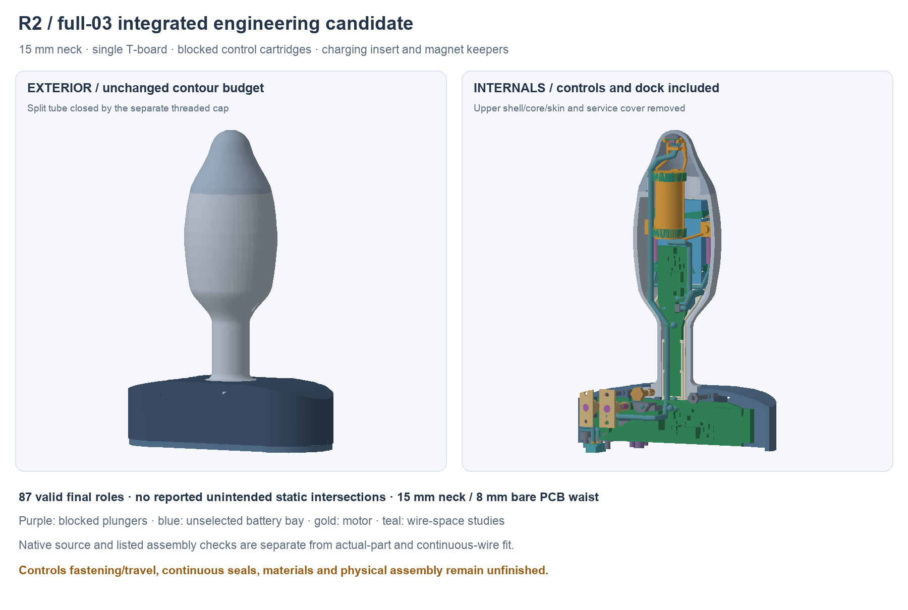

The integrated cores and upper skin have new native primitive/Boolean history. The lower core preserves the full-02 wire reliefs while adding insulating switch supports. Cartridge and dock parts are imported exact BReps with source native/object hashes, rather than mesh conversions. Their editable standalone sources remain `hardware/cad/local-controls-r2/` and `hardware/cad/dock-interface-r2/`; changing those interfaces requires a new source revision and integration rebuild. `full-03/build.py` is the complete integration editing route; not every dimension is driven by the spreadsheets.

`full-03/envelope-review.json` independently checks the unchanged 15 mm waist and bounds every dock structural role inside the exact union of the original solid flange exterior and plain service cover; all outside volumes are zero. The added internal bosses are not outward growth.

Both full 0.8 mm blocking spacers remain installed. Accepted operating stroke is still null. The dock’s flush nominal contact faces are X−30/Y−30, with GND at Z8 and +5 V at Z12; buried magnet references sit at X/Z−37.75/0 and −21/−8. The plain service cover and old short J1 wire-row reservation are superseded by the insert/keepers and two pitched wire-space routes. Cover-to-core fastening, the cover perimeter seal, actual wire folding/strain relief, contact tolerances and magnetic retention remain open. The separate external charger/key proposal is not part of this checkpoint.

The source-matched `full-03/assembly-motion-checkpoint.json`, produced by `verify-assembly.py`, records **13 clear sampled rigid operations**, **14 clear reconstructed prismatic dock sweeps** and **11 clear assumed main/control tool entries**. These cover cartridge installation, PCB loading, upper-core closure, cap screw-on and the prefitted dock cover’s approach. The dock sweep reconstructs each rigid source part with both directed differences below 0.00001 mm³ before bounding its −10 to 0 mm Y translation. This continuous result is limited to that straight rigid dock movement; the other listed operations are samples.

Keeper screws must be fitted with the dock cover removed on the bench. `full-03/dock-tool-access.json` finds all five assumed rigid bench tool entries clear, while retaining ten intersections in the fully assembled housing and two with final loose-wire spaces. The pigtails must remain loose and held clear during those bench operations; no in-situ service or wire-flex result is claimed. Actual selected fastener heads/drive/recesses, wire folding/strain relief, working controls, seal materials, tolerances and physical assembly remain outside these digital checks. The [independent full-03 native review](../assets/prototype-r2/reviews/full-03-native-review.json), also saved as `full-03/root-independent-native-review.json`, confirms all 87 final roles survive forced history recompute with unchanged bounds/volumes; STEP reimport has 194 valid solids. These counts include reference/process-space roles, not a released production parts list.

## Preserved full-02 joint and carrier checkpoint

The preserved **full-02 engineering candidate** is `hardware/cad/prototype-r2/ButtplugPrototypeR2.FCStd`, also frozen under `checkpoints/full-02/`, with combined STEP and per-role STEP/STL/native-section exports. `geometry-report.json` and `checkpoint-state.json` bind that native, 54 valid final roles, exact input snapshots, FreeCAD version and export hashes. Its lower board/pack carrier and separately retained motor/tip support are each one solid. The final-pose screen has **zero unintended reservation intersections, zero candidate-component/mechanics intersections and zero modeled NTC-wire intersections**. These results do not qualify physical fit or individual wiring.

The full native `Parameters` sheet matches current `parameters.json`, including the Y73 cap seam. Some construction values remain explicit in the builder; the sheet does not imply that every feature is expression driven. Regeneration uses `build.py`, followed by `finalize-checkpoint.py`. The latter hashes inputs/exports and archives noncanonical generated exports without changing geometry. Frozen exterior files remain separately reproducible.

The former **full-01** native, sources, exact failing checks, independent review and figure copies are preserved under `hardware/cad/prototype-r2/checkpoints/full-01/`. Its [independent native review](../assets/prototype-r2/reviews/full-01-native-review.json) confirms saved-geometry/recompute consistency; it did not establish assembly. Its pack-drop and cap screw-on checks failed. The current images below show full-02 with the separately retained motor/tip support and corrected cap entry.

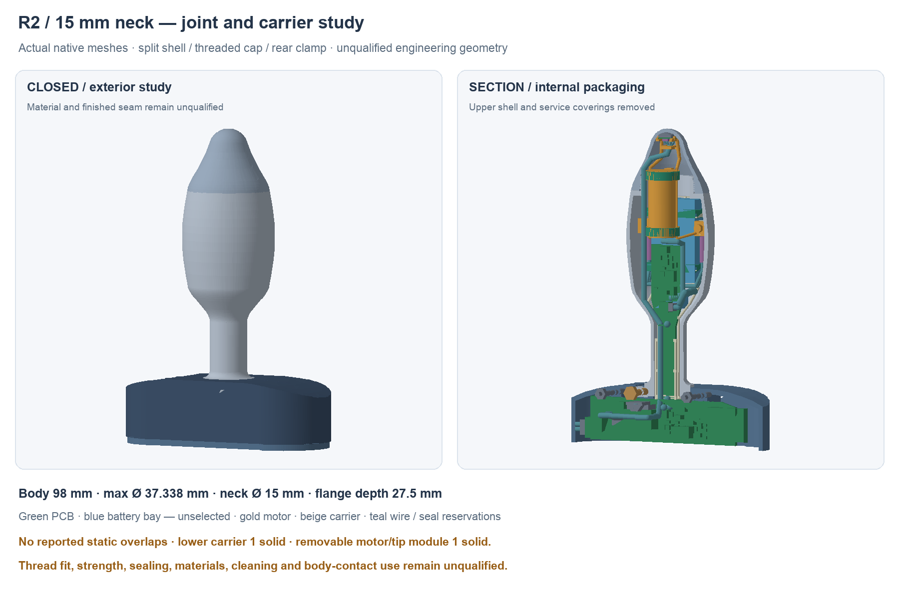

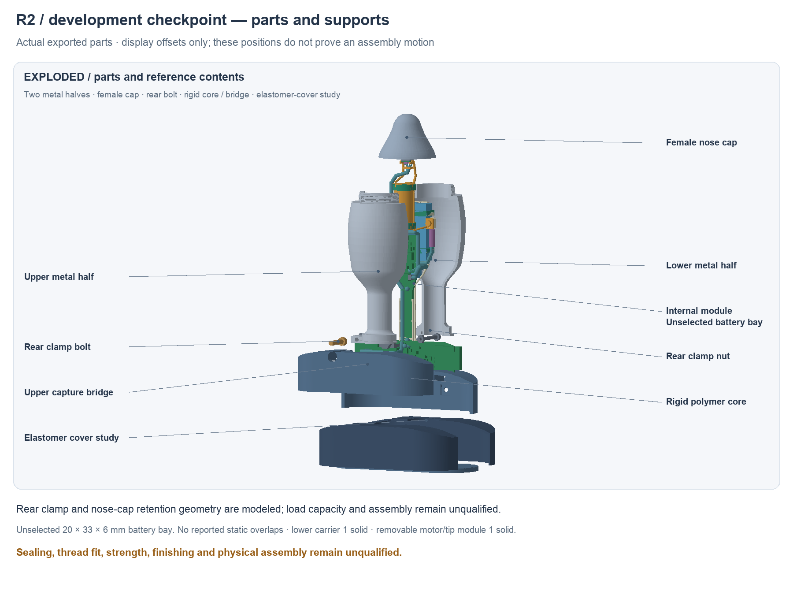

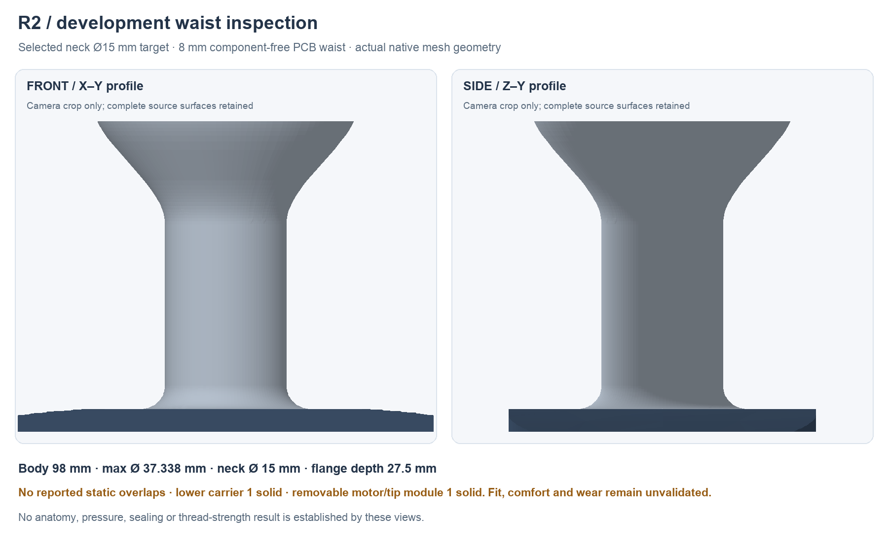

| Interface | Current numerical study |
| --- | --- |
| Split male thread | Common native helix before splitting; pitch 0.75 mm, threaded height 4 mm from Y73.5 |
| Male root / crest | Ø24 / Ø25 mm; Ø21 mm clear bore gives 1.5 mm nominal root wall |
| Female cap | Ø24.2 mm bore, Ø25.4 mm groove envelope; minimum master exterior across thread 29.751 mm gives 2.175 mm wall to groove envelope |
| Female entry relief | R12.75 through Y73.75, 0.75 mm beyond the nominal mouth; removes the entry lip implicated in full-01 failures |
| Nose registration | Round pilot and paired hard keys/pockets; metal shoulder stop at Y73 |
| Rear clamp | Symbolic M2.5 bolt normal to split, X−13/Y−6.7; access from negative Z before fitting elastomer |
| Core capture | Recessed lip and D-flat capture both metal halves; bolt clamps metal lands rather than PCB or pouch |
| Removable motor/tip support | Keyed side-post seats outside pack allowance; two M1.6 × 4 screw/nut geometry studies with open positive-Z tool approach before closing upper metal |
| Thin battery bay | 20 × 33 × 6 mm finished-pack design budget at X−10/Y37/Z−10.5; no actual battery selected |
| Pack size allowance | Additional 0.5 mm per side retained as a 21 × 34 × 7 mm envelope; earlier exact probe leaves only 0.131 mm residual to metal |
| Motor | Manufacturer maximum Ø11.1 × 26.3 mm, Y55.5–81.8, center Z3.5; liner/caps/tape reservations remain unqualified |
| Tip | Actual 6 × 4 mm rounded PCB, 0.62 mm finished; component face toward base, actual candidate bodies and four-pad termination included |

The former 8 mm Bitcraze reference pack does not meet this full allowance. The thin design budget must eventually contain PCM, insulation, tabs and supplier maximum dimensions. Lead exit and both NTC assemblies are additional interfaces. No available current-qualified battery or runtime result is implied. `motor-support-fastener-study.json` records the small fastener geometry sources without selecting parts, materials, coatings or tightening loads.

The exact imported R2 routed-pose report is copied to `placed-components-input.json`; 87 component bodies and SH2/SH4/PH2 mates are represented. A separate PH4 reservation uses the nominal catalog 9.8 × 2 mm extension and 5.5 mm height above PCB. These are candidate body/mating reservations rather than solder, boot or tolerance-qualified maxima. R0 remains unchanged. `mechanical-geometry-fingerprint.json` and `placement-input-comparison.json` distinguish geometry changes from routing/metadata changes; native CAD contains no PCB copper.

J1 faces negative X. A separate pitched two-wire exit row uses the first 3.55 mm of independently checked side space, without claiming a complete dock harness. J2/J5 now have larger native pitched-row/turn/ruled-loft **fanout bays**. They supersede crossed speculative individual wires; no individual conductor route, minimum bend radius or strain-relief result is inferred. Tip and pack bundles cross the bare waist separately above the board. The tip’s handle crossing is at Y−15.5/Z11, clear of the proposed local switch guide envelopes. Each factory NTC approach contains two separate wire reservations; the manufacturer’s approximately 1 mm lead diameter is information only. Actual cut/slack, insulated solder-to-stranded transitions and cell coupling remain open.

The proposed sequence loads the pack and board before installing the keyed motor/tip carrier. Motor and prewrapped liners then enter the open lower cradles; caps/tape follow. The stationary tip assembly can approach through the open nose. The upper metal half registers with the lower half; rear bolt, upper core and core-join screws secure the base before the later outer covers. The cap screws over the registered open tube and provides its nose end wall. No separate closed metal tip is required beneath it. Thread alignment and phase must still be maintained; engagement of arbitrarily separated halves is not demonstrated.

`assembly-motion-checkpoint.json`, produced by `verify-assembly-checkpoint.py`, records **10 clear sampled operations and seven clear assumed straight driver-shaft probes** on native `77abefb3…` / geometry report `9d2f4343…`. This includes full pack-allowance drop, removable motor/tip support loading, stationary tip seating and cap translation/rotation at the common 0.75 mm pitch. These exact-BRep listed poses are not continuous swept coverage, actual wire routing, tool/fastener qualification, tolerance analysis or physical assembly. The [independent forced-history/native review](../assets/prototype-r2/reviews/full-02-native-review.json), also saved as `independent-full-native-review.json`, confirms saved geometry and recompute consistency.

`open-mouth-evidence.json` separately confirms that both metal halves end at Y78.8. Exact sections through Y73–78.8 retain a 10.5 mm inner radius; a Ø21 cylinder through Y71–98 has zero shell intersection. No shell section exists beyond Y78.8. The female cap alone supplies the external nose wall. The green ring near Y80 is internal motor cap/liner/tape geometry, separate from the shell. `verify-open-mouth.py` exports actual clipped shell, mouth and internal-support shapes under `open-mouth-evidence/`; the source native remains unchanged. Internal supports occupy this bore, so this shell-only result is not a free full-assembly insertion corridor.

The tip PCB remains keyed and stationary. Its supported thermal shoe and dielectric interfaces are intended to transfer cap-contact loads into the carrier rather than the PCB/bond. Pad friction, preload, material, support strength, thermal response and installed accuracy remain unqualified. Component-side local tip X/Y map to toy negative X/negative Z; use the builder’s four-pad map to preserve pin 1.

This preserved checkpoint is not assembly released. Continuous longitudinal seam sealing through cap/base junctions remains unresolved. Polishing and threadlocker do not establish sealing. Full-03 above adds blocked actuator/support geometry and dock feedthrough/magnet references; working control retention/travel, service-cover fastening and complete termination/sealing remain open. Core screw access bores remain open during assembly beneath the later elastomer cover. The split cover has no qualified retention, seal or material system. Thread fit/phase/runout, finish allowance, matched-pair polishing and all contact materials require supplier/bench review.

## Open nose close view

The [open-nose close view](../assets/prototype-r2/open-nose-r2.png) shows the
actual shell mouth and the separate internal motor ring. Its source-hash
record is `assets/prototype-r2/open-nose-r2-source.json`; the cap is displaced
only for illustration. The shell has no hidden nose end wall.

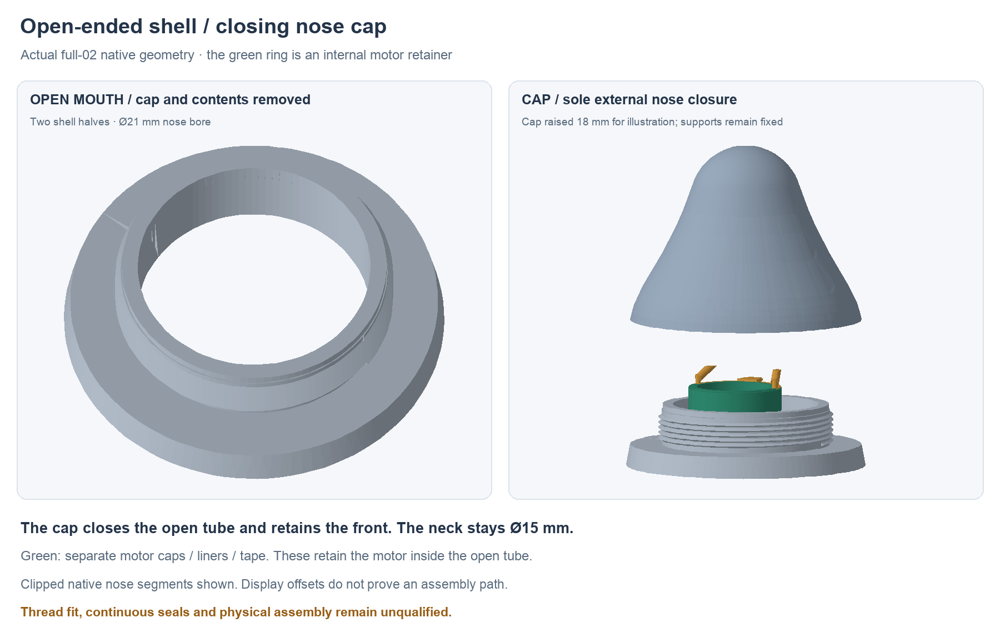

## Local control cartridge proposal

The separate source `hardware/design/local-controls-mechanical-r2.json`, reproduced by `tools/local_controls_r2.py`, proposes two retained axial cartridges at the unchanged SW1/SW2 centers. Its standalone native uses the checked `5ba844fa…` routed poses and archived `full-01` core/cover. That standalone source remains frozen; full-03 above reconstructs its core changes on the actual full-02 core. It is a blocked packaging proposal, rather than a completed working button assembly. The switch inputs come from the [Omron B3U catalog](https://omronfs.omron.com/en_US/ecb/products/pdf/en-b3u.pdf); its published pretravel is **not** an allowable overtravel specification.

The silicone remains continuous over each button, inside the existing outer contour. A local 8 mm diaphragm region retains a full-thickness 3.2 mm central boss; a 0.5 mm vertical underside relief thins the surrounding annulus. The hard plunger head follows the actual inner-cover contour with a nominal 0.05 mm gap. The diaphragm, spring and head coupling still need a material, force and deformation design; the RAM probe contains only the undeformed membrane geometry. The split cover perimeter needs a separate continuous dry-cavity seal.

| Interface | SW1 power | SW2 mode |
| --- | --- | --- |
| Fixed PCB center, X/Y | −30 / −12 mm | −20 / −12 mm |
| Upper core at the axis, Z | 15.492–17.550 mm | 16–18 mm |
| Original upper skin at the axis, Z | 17.550–18.574 mm | 18–19 mm |
| Proposed lower support shoe, X/Y | −31…−29 / −12.8…−12.1 mm | −21.1…−18.9 / −12.7…−11.3 mm |
| Shoe top / removable insulating shim | Z−0.7 / 0.2 mm to the PCB back | Z−0.7 / 0.2 mm to the PCB back |

Each cartridge enters a real 6.1 mm upper-core opening from positive Z. Its conformal 7 × 15 mm flange seats in a 0.6 mm deep recess; the counterseat is 7.3 × 15.3 mm. Two nominal M1.6 screw interfaces, centered 5.5 mm forward/rearward of each switch, retain the flange and prevent rotation independently of the silicone. Four 4 mm underside receiving bosses extend to Z13.5. The proposal models 1.8 mm flange clearance holes and 1.3 mm receiving-pilot envelopes, **not** approved screws, inserts, working threads or screw-head clearances. Select those details and check the actual engagement, head recess, creep and locking before fabrication.

The lower guide is 3.4 mm OD from Z3.3 to Z12.8. A 1.8 mm shaft runs in a 2.0 mm bore, with a centered 0.8 mm contact foot over the switch actuator. A 3.6 mm collar is trapped between the 3.2 mm upper opening and the removable lower guide. The lower guide must attach positively to the upper barrel before the upper core closes; its fastening joint remains an interface reservation. A captive return-spring space, 3.0 mm OD / 1.9 mm ID, allows 1.8 mm installed height at rest and 1.0 mm at the maximum study stroke. No spring part, preload, rate or coil-bind limit is selected.

The lower-core pedestals widen below the back-side component layer, with narrow insulating shoes beside the actual B-side parts. SW1's shoe avoids R3; the exact nominal pedestal-to-R3 separation is 0.650 mm. The pedestals are clipped to the existing core envelope and each remains one solid. The upper core with the proposed openings and mounting bosses also remains one valid solid. Shim height must be set without preloading the PCB; electrical insulation, soldermask wear, flatness and press-load capacity remain unqualified.

The proposed 0.8 mm cartridge motion is **packaging capacity only**. The tip rests at Z2.35, giving 0.10–0.35 mm free gap from switch-height tolerance alone; the nominal gap is 0.25 mm. Combining that range with the catalog's 0.05–0.35 mm pretravel gives 0.15–0.70 mm motion to switching before other tolerances. It does not establish a safe final stop. Start with the full 0.8 mm blocking spacer, which permits no stroke. No shorter operational stop is accepted until controlled switch total-travel/overtravel data and the complete PCB/guide/tip/membrane stack are reviewed and tested.

The separate `hardware/cad/local-controls-r2/full-02-fit-check.json` binds frozen full-02 native `77abefb3…` and finds zero candidate/component/native-role intersections. The archived **0.623 mm³ full-01 SW2-guide/harness hit** is preserved in the earlier source-bound record. The high cable crossing at Y−15.5/Z11 with a 1.1 mm study radius clears the SW2 lower guide by 0.700 mm and the upper cartridge by 0.768 mm. The standalone `hardware/cad/local-controls-r2/LocalControlsR2.FCStd` and `local-controls-r2.step` contain 13 valid candidate solids, with both full blocking spacers installed. A read-only full native recompute is identical and STEP reimport retains 13 valid solids. Sampled cartridge insertion and PCB drop clear apart from the superseded full-01 harness; four bounded driver-entry envelopes clear with silicone removed. Actual head/recess/drive, lower-guide fastening, full motion, tolerances, force, membrane and seals remain unqualified.

The follow-up `hardware/cad/local-controls-r2/installation-full02-check.json`
binds both the unchanged standalone control native and archived full-02. It
reconstructs the proposed openings, receiving bosses and lower supports on the
actual full-02 cores in RAM; both cores remain valid single solids and the
outer-budget comparison is identical. Both cartridge insertion paths, the
populated-board drop and upper-core closure with preassembled blocked
cartridges clear all listed poses against actual full-02 geometry. Four
bounded driver-entry spaces also clear. This supersedes the legacy-harness
limitation for those listed paths while preserving the full-01 results.
Neither main nor standalone native is changed by the check; continuous motion,
actual fastener/head/recess, lower-guide joint and operating behavior remain open.

Assembly order is cartridge/plunger/spring and blocking-spacer capture first, lower support and PCB seating second, upper-core closure third, and the local silicone cover afterward. Service must retain the collar and spring when the cover is removed. The external contour and current PCB remain fixed throughout this proposal.
