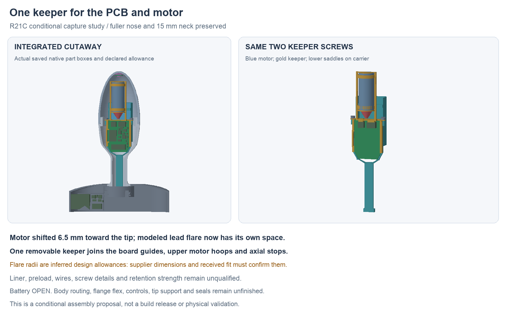

---
search:
  exclude: true
---

# One PCB and motor keeper: R21

**Rejected architecture, 1 November:** Lucy rejected the shared PCB/motor
keeper because the motor should transmit vibration into the metal body.
Preserve this study and its checks as history. Develop an independent
shell-coupled motor mount and separate PCB support. Semi-flex and a rotated
flange island are allowed; see [R24](flange-orientation-r24.md). Body routing
has since completed at [R23D](body-stackup-r23.md).

1 November 2026. R21C is a conditional motor-capture proposal built from
R20D's native history. Its saved native and scoped geometry checks pass. It preserves
the one-piece metal body, fuller nose without an inward dip, 15 mm neck,
actual body/flange PCB positions and the same two keeper screws. Battery
selection remains OPEN. This does not complete the prototype build proposal.

## Saved geometric evidence

- One valid keeper and one valid carrier;118saved roles survive a forced native
  history recompute, with no external document links.
- All5,995primary static pairs have zero unexpected intersections. Two named
  screw/pilot interfaces remain unqualified. The seven nominal mates and the
  conditional flare allowance have zero intersections in their stated context.
- All8board-drop,8motor-drop,8keeper-lowering and21cartridge-loading listed
  positions clear. The keeper check includes preinstalled nominal mates.
- Six1mmfixed-axis motor translation witnesses intersect the cage, covering
  ±X, ±Y and ±Z. These are obstruction witnesses, not an arbitrary extraction,
  rotation or load proof.
- All89current R19L part/pad records, outlines and nominal mates equal the
  original source inspection. All88actual Fab/height boxes match the current
  native PCB inspection within0.00001mm. Copper/holes/wires are not modeled.

Native source: `hardware/cad/motor-retention-r21/candidate-c/MotorRetentionR21.FCStd`.
The source-bound reports,120review meshes, executed helpers and artifact index
live beside it. R20D and the failed A/B attempts remain preserved. Physical
parts, process, tolerance and load checks remain open.

## Assembly change

Move the candidate motor 6.5 mm toward the tip, with its capsule starting at
Y62 mm and maximum-length end at Y88.3 mm. Move both lower saddles and their
support with it. Extend the existing removable PCB keeper into two upper
half-hoops, two side spines and axial end stops. The upper and lower pieces
form a cage around the capsule; the keeper uses its existing two screws.
No additional motor fastener is introduced.

J3/J5 plug slots open through the bottom of the keeper. A bridge above the
plugs and an upright between them keep it connected. This lets the keeper
lower over the nominal mating plugs, rather than requiring plugs to be
installed afterward through the motor space. The proposed local order and its unresolved assembly interfaces live in
`assembly-docs/motor-keeper-r21.md`.

These are proposed stages. Rigid pose checks do not establish actual wire
dressing, tool access, tolerances or physical assembly.

## Maker evidence and explicit assumptions

The [NFP motor drawing](https://nfpshop.com/wp-content/uploads/2022/04/Encapsulated-Vibration-Motor-NFP-E1015-3.7V.pdf)
shows a 26 ±0.3 mm long, Ø11 ±0.1 mm capsule and a lead flare extending
6 mm maximum behind it. The old cylindrical capsule allowance omitted the
flare. Source hash and separate design assumptions are recorded in
`hardware/design/motor-retention-r21/motor-source.json`.

The CAD capsule uses the maximum 26.3 × Ø11.1 mm. A separate 6.2 mm long
cone reserves the flare, with radii 0.9 and 4.8 mm. **Those radii are inferred
design allowances, not controlled maker dimensions.** The rear stop's
Ø10 mm opening depends on that assumption. Confirm the shipped variant and
radial flare envelope before relying on this cage. Wire OD, exit angle,
termination and bend radius remain undefined.

The hoops have a nominal 0.2 mm radial gap to the maximum capsule before a
liner is defined. The front stop leaves 0.2 mm after the maximum-length
capsule; shorter capsules leave more axial play. Liner material, compression,
axial preload, screw head/drive/thread details, creep, vibration transfer and
retention strength still need definition. Geometric capture is not a load
rating or a clamp-preload specification.

## Preserved failed attempts

- A stopped before saving: its front stop was a second disconnected solid.
- B added a connecting tie. Static nominal geometry cleared, but the keeper
  lower crossbar crossed J3/J5 mating allowances at Z offsets 4, 2, 1 and
  0.5 mm. It was stopped after that known loading failure; no completed
  cartridge check or saved native B package is claimed.
- C opens the lower slots and joins the remaining pieces above/between the
  plugs. Its results belong to C alone.

Logs and exact executed builders remain under
`hardware/cad/motor-retention-r21/`.

Body routing remains incomplete at [R19L](body-routing-r19.md). Real wires,
pack/NTC retention, flange attachment/compliance, working controls,
stationary tip support and thermal interface, seals, candidate parts/process
and the practical complete-build plan remain open. No ordering, fabrication,
electrical operation, runtime or wear validation follows from these checks.
