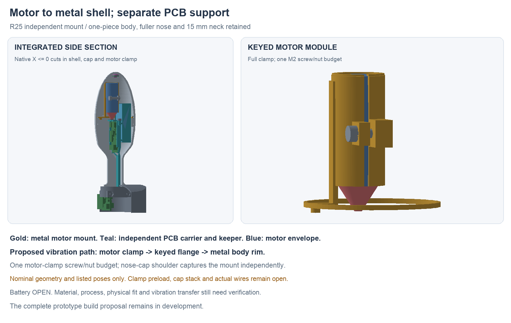

---
search:
  exclude: true
---

# Independent shell-coupled motor mount: R25

R25 develops Lucy's correction: the motor should transmit vibration into the
metal body and have its own retention, independent of the PCB support.
The rejected [R21 shared keeper](motor-retention-r21.md) remains history.
Battery selection stays OPEN. This is a bench-prototype design proposal;
the complete build package is still unfinished.

## Assembly and vibration path

One metal part combines a split motor sleeve, connecting beam and keyed
annular mounting flange. One M2 screw and nut budget close the sleeve around
the motor capsule. The mount seats directly on the metal body rim; an internal
shoulder in the nose cap captures its front face. The internal key prevents
the cap from winding the motor module around as it closes.

The intended vibration path is **motor capsule → metal clamp → mounting
flange → metal body rim**. No PCB, PCB keeper or plastic electronics carrier
retains the motor. Actual contact, clamp stiffness and transmission efficiency
still need measurement; a drawn load path does not establish performance.
The shipped NFP capsule material/variant also needs confirmation.

The electronics carrier loses its two motor saddles, support stem and bridge.
Its PCB-only keeper retains the open-bottom plug slots and their bridges,
with the original two screw budgets. The motor module and electronics
cartridge can be assembled separately on the bench. The cap supplies axial
module capture, so no extra mount-retaining screw or default shim washer is
introduced. See `assembly-docs/motor-shell-mount-r25.md` for the target order.

## Cap stop and nominal dimensions

The mount flange is **1.10 mm** thick. Its rear face seats at Y56.8 mm and
front face at Y57.9 mm. The cap's added seat starts at local Y57.8 mm; the cap
therefore closes 0.10 mm forward of its former position. The existing exterior
shoulder remains separated nominally, allowing the internal seat to load the
motor flange first. The offset is built into the mount itself.

The inherited right-handed thread has 0.75 mm pitch. The 0.10 mm advance
requires a **48° rotation about Y**; the saved assembly includes both changes.
A read-only phase study found zero body/cap intersection at +48° and
23.1451 mm³ at the opposite phase. The source R10 builder/report and the phase
study are retained. This does not qualify the provisional thread profile,
fit, tightening or locking process as a manufactured thread specification.

The fuller nose shape and 15 mm neck remain. The cap translation makes the
nominal tip position **Y98.10 mm**, 0.10 mm beyond the earlier study. The
stationary tip board/shoe poses are preserved references; their support and
thermal interface still need redesign for this cap position.

The motor remains at Y62–88.3 mm, centred at Z3.5 mm, with its Ø11.1 mm maximum
capsule allowance. The sleeve bore is nominally Ø11.2 mm and outside Ø12.8 mm.
Its 1.2 mm split provides clamp travel; actual elasticity, capsule pressure,
preload and rearward slip resistance are unqualified. The front stop locates
the motor, while the sleeve clamp supplies retention. The lead-flare radii
remain inferred allowances, not controlled supplier maxima.

The rounded internal key is cut from the bore side of the body mouth. It
does not break through the outside pilot. Its cutter radius is 1.2 mm about
Z14.2 mm, reaching radial position 15.4 mm inside the nominal 16.4 mm pilot.
The final seal/gland still needs its own complete wall and fit review.

## Proposed cap-stack limits

These are proposed prototype manufacturing limits for supplier feedback,
not measurements or approved casting tolerances. Apply them after finishing
to the local extrema of functional seating-face separation.

| Functional dimension | Proposed value |
| --- | --- |
| A: body rim depth from old exterior stop | 5.800 ±0.020 mm |
| B: cap internal seat depth from old rear face | 6.800 ±0.020 mm |
| C: integral mount flange thickness | 1.100 ±0.020 mm |
| Cap stand-off, A + C − B | 0.100 mm nominal; 0.040–0.160 mm worst-case arithmetic |

This arithmetic establishes a proposed stop-priority budget only. It is not
a toleranced assembly simulation, thread fit, contact-pressure or sealing
result. The actual parts must contact both annuli without bottoming on the
old shoulder. If the supplier cannot hold the functional dimensions, revise
the seats or fitting process before release.

The nut pocket is AF4.15 mm with six R0.3 corner reliefs, with at least
0.604 mm of nominal material at the outer X wall. The nut and screw are
dimensional candidates. The [Accu M2 ×8 screw reference](https://www.accu.co.uk/metric-cap-head-screws/250523-SSCF-M2-8-A4-R360)
specifies a 3.8 mm maximum head diameter, 2 mm maximum head height and
1.5 mm drive; the [M2 nut reference](https://www.accu.co.uk/hexagon-nuts/154931-HPN-M2-A2-BL)
specifies 4 mm maximum AF and 1.6 mm maximum thickness. Neither listing's
coating is selected. Full profiles, thread/length tolerances and the locking
process remain to define. The CAD nut uses a clearance hole, not a real
internal thread.

## Checkpoint and remaining work

**Current conditional checkpoint: D.** Its 113 primary roles pass 6,328
static pair checks with zero unexpected intersections. Two inherited
electronics-screw/pilot interfaces remain named and unqualified. All seven
nominal mates and the conditional flare allowance clear. Twelve motor-module
installation positions, 36 cap/motor/tip positions, 12 motor-into-clamp
positions and eight each of board-drop and PCB-keeper-drop positions clear
their stated contexts. These are finite rigid samples, not continuous
assembly or real-wire checks.

A fresh forced saved-history review confirms 121 primary/mate/allowance
roles, preserved source material and no external document links. The carrier,
PCB-only keeper and keyed body are verified subsets of their source shapes;
the cap's only local material addition is the declared internal shoulder,
with the assembly offset/phase removed for that comparison. Nominal minimum
mount clearances are 0.814 mm to the electronics carrier, 3.427 mm to its
keeper, 6.161 mm to the body substrate and 0.600 mm to the pack allowance.
The nominal coincident seat areas are 80.411 mm² at the body rim and
79.922 mm² at the cap. These areas do not establish real contact or preload.

Native source: `hardware/cad/motor-shell-mount-r25/candidate-d/ShellMotorMountR25.FCStd`.
Source-bound geometry, fresh native review, actual review meshes, exact
executed helpers and failed attempts are kept beside it. The default native
view shows current internals; its GUI-only configuration preserves every
geometry archive member.

The five-part `step-review-r1/` packet has separately re-read STEP files.
The new motor mount, electronics carrier and PCB-only keeper pass the initial
validity/solid/bounds/mass/material screens. The initial default-volume screen
fails for body and cap: +0.002955 and −0.003178 mm³ against 0.001 mm³. The
cap's Boolean difference also reports a removed volume larger than its source
volume, failing a comparison control; do not interpret it as physical loss.

A subsequent **read-only adaptive mass diagnostic** uses matching OCCT
[Gauss–Kronrod integration](https://github.com/Open-Cascade-SAS/OCCT/blob/V7_8_1/src/BRepGProp/BRepGProp.hxx) at two requested errors, without modifying or
re-exporting any shape. All five STEP/native adaptive mass differences are
below the same 0.001 mm³ limit. Body and cap differences are +0.00000255 and
−0.00000413 mm³; every row changes by less than 0.0001 mm³ between the two
settings. The native key-cut and cap-addition partition residuals are
−0.00000260 and −0.00001522 mm³. This supports the intended native material
changes and exposes instability in the default-volume calculation.

These are numerical stability checks, not rigorous error bounds or maximum
surface-deviation measurements. The initial failures remain preserved, and
the cap Boolean comparison remains unusable. Full geometric/supplier import
acceptance stays open; native CAD is authoritative. See
`adaptive-volume-diagnostic.json`, `step-review-r1/export-review.json` and
`step-review-r1/comparison-controls.json`. No threshold was relaxed and no
source/export was repaired to obtain these results.

The native source and candidate-specific evidence live under
`hardware/cad/motor-shell-mount-r25/`. Candidate A has cap-seat intersections.
B removes them but leaves only 0.0136 mm between the mount and electronics
carrier. C increases that gap to 0.8136 mm, but retains a 0.204 mm nut-pocket
wall and does not establish cap-stop priority. D enlarges/relieves the pocket,
uses the rounded internal key and adds the integral flange thickness with
the correctly phased cap offset. Preserve all attempts.

The existing R23 body and flange circuits/poses are unchanged. The source-bound
`hardware/design/motor-shell-mount-r25/r23d-pcb-envelopes.json`
binds both actual native substrate outlines/thicknesses and all 88 Fab-height
boxes to the current R23D inspection, with 89 main parts and 338 device nodes.
This establishes nominal CAD/PCB envelope parity, not wiring or physical fit.

Semi-flex and
the [R24 flange rotation options](flange-orientation-r24.md) remain allowed;
this motor revision does not choose a new flange pose or flex construction.

Before completing the build proposal, finish actual motor/tip/interboard
wires and strain relief, stationary tip support/thermal coupling, battery/NTC
retention, flange attachment/compliance and working local controls, the
seals/materials/process/finish and thread specification, current PCB exports
and a complete first-build/test plan. The proposed disabled pull, drive and
acceleration comparisons are recorded in the assembly target and
`hardware/design/motor-shell-mount-r25/critical-interfaces-proposal.json`.
Physical fit, electrical operation, runtime and wear have not been validated.
