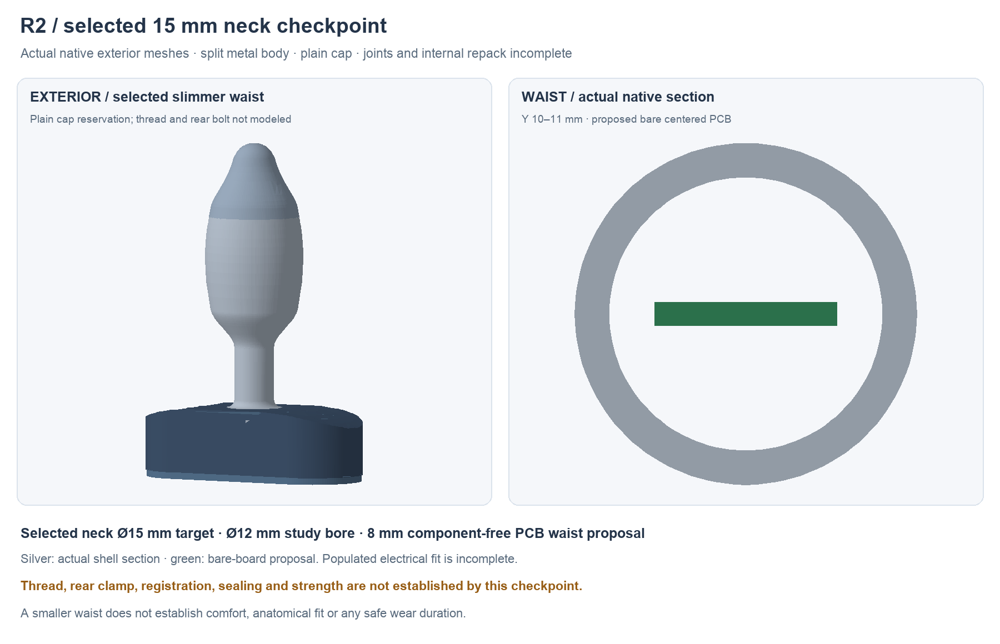
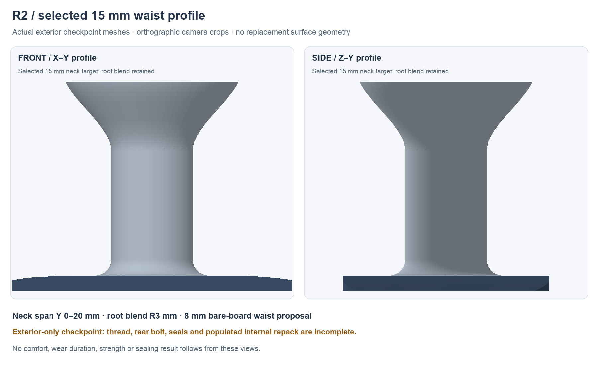

---
search:
  exclude: true
---

# R2 15 mm neck study

30 October 2026. **Lucy selected 15 mm outside diameter as the next neck study target.** Use an **8 mm component-free PCB waist**, nominally centered at Z−0.5 to +0.5 mm, for the next mechanical and PCB placement study. Retain one planar rigid T-shaped board; its body tongue length and populated regions must follow the contour. The checked R0 PCB remains unchanged.

The electronics assessment below is a read-only feasibility study, not a narrowed routed PCB or a complete package-fit result. Source hashes, component lists and native track-cut observations are in `hardware/design/narrow-neck-study-r2.json`. The audited R0 board is SHA256 `12761321b7cd5f08918e6d36e5567a54701b3eada3c59ac0086185c2883e83c0`.

## Saved native contour

`hardware/cad/prototype-r2/exterior-checkpoint.FCStd` and
`exterior-checkpoint.step` now contain the 15 mm exterior study. The waist is
20 mm long, with a 3 mm root blend into the flange and a tangent transition
into the wider body. The generated body stays within the 37.338 mm diameter
envelope. The centered 8 × 1 mm bare-board reservation ends at Y52; its
populated placement is a separate unfinished design.

An independent reopen touched and recomputed every native feature, checked all
nine final solids and read the combined STEP. A native section at Y10–10.1
measures 15 mm outside / 12 mm inside, with 1.969 mm minimum bare-board corner
clearance and no board/metal overlap. That clearance excludes supports,
insulation, wires and tolerances. The measured metal outside the requested
37.338 mm body envelope is zero. Results and source hashes are in
`hardware/cad/prototype-r2/independent-neck-section-review.json`.

This checkpoint has a plain cap; threads, the rear bolt, structural capture,
seals and full component/harness fit are still in development. Its two-piece
elastomer-cover geometry does not establish attachment, sealing or a physical
installation method. Editable profiles preserve the generated contour; manual
pole edits require the same envelope and tangent checks again. Nothing here
establishes comfort or a wear duration.

## Bare waist section

The first geometric input is a circular neck with **1.5 mm nominal radial wall**, giving 12 mm inside diameter at the selected 15 mm outside target. This wall is a study input, not a selected casting minimum, tolerance or strength result. A 1 mm finished bare board centered in that bore has the following minimum radial clearance at its corners:

| Outside diameter | Wall input | Board width | Bare corner clearance | Scope |
| --- | --- | --- | --- | --- |
| 15 mm | 1.5 mm | **8 mm** | **1.969 mm** | Preferred next study |
| 15 mm | 1.5 mm | 10 mm | 0.975 mm | Less room for supports, insulation and wires |
| 12 mm | 1.5 mm | 6 mm | 1.459 mm | Optional comparison only |
| 12 mm | 1.5 mm | 8 mm | 0.469 mm | Very small bare-section allowance |
| 12 mm | 1.5 mm | 10 mm | −0.525 mm | Does not fit even as a bare rectangle |

The calculation is bore radius minus `sqrt((board width/2)² + (board thickness/2)²)`. The JSON also screens a 1 mm wall input. None of these numbers includes a carrier, dielectric, wires, seams/registers, solder, tolerances or bending. The old Z−6.5 to −5.5 mm board pose cannot meet the selected bore even after removing its components. A rigid board cannot recenter only its waist while keeping the body in another plane.

## Move the logic regulator into the handle

Fourteen current component bodies intersect Y0–20 mm. Thirteen belong to the complete logic-regulator cluster: **U2, L1, C11–C16, C51–C52 and R11–R13**. The other is R40. Move the complete battery-divider group **R39/R40/C34** together as well: **16 references necessarily move** to clear this waist.

The preferred destination for U2 is the handle, near the MCU/logic load. Place its inductor, local capacitors, feedback divider and control resistor as a new compact cluster. TI calls for short, wide main-current paths, nearby input/output capacitors and inductor, local HF bypasses, and feedback close to its pin. Scattering those parts down the narrowed waist would defeat that guidance. [TPS63070 Rev B, section 11.1](https://www.ti.com/lit/ds/symlink/tps63070.pdf).

The current cluster's combined **body-only** projection is 9.075 ×15.575 mm and uses both board faces. That establishes a useful gross space requirement, not a free handle bay: charger, guard, service connector, switches and MCU already occupy the handle. A fresh placement must resolve those parts and keep the antenna region clear. No exact handle coordinates or preserved routing are claimed.

At Y20, the native routes cross the waist on eight non-ground nets: SYS, 3V3, I2C_SDA, I2C_SCL, ACCEL_INT_N, MOTOR_ARM, MOTOR_PWM and DOCK_PRESENT_N. The inner GND plane is additional. Samples of the current 3V3, ACCEL_INT_N, MOTOR_PWM and GND traces extend outside an 8 mm waist with the existing 0.3 mm copper-edge rule. The outline change requires new routing and plane fill; a narrower outline cannot simply be cut around the existing traces.

Moving U4/C27/R23/R24 and U7/C41/C42/R41 to the handle could reduce the waist to SYS, 3V3, SDA, SCL, MOTOR_ARM, MOTOR_IN1 and GND. This is a placement proposal with unchanged circuit functions. An 8 mm four-layer corridor is geometrically plausible, but current capacity, voltage drop, return continuity and actual routing remain unchecked. Motor startup/stall current is still unknown.

## Shorten and repack the body tongue

The first coordinated mechanical study ends the tongue at **Y52 mm**, with an 8 mm waist at Y0–20 widening toward a 14 mm body tongue by Y30. These are study coordinates; neither the final tongue length nor body silhouette is frozen. Ending before the motor avoids carrying the recentered board through it.

The actual R0 body audit finds **12 more references beyond Y52**: **U4, C27, R23–R25, U7, C41–C42, R41, J3, J5 and C30**. Combined with the waist/divider group, **28 references necessarily need relocation** for this option. A Y50 or Y48 end excludes 15 bodies; Y45 excludes 18. The JSON lists every affected reference for each end.

U3/L2 and most motor-regulator parts lie before Y52, as do U5/C28/C29. Their current locations are still not approved: C30 must move inside the end, and the local converter/driver loops and body-side population need a new placement. Study the mated J3 motor and J5 tip connectors upstream around Y45–49 on the positive-Z side, or in the handle. Include plugs, lead exits, retention and tool access, not only board headers.

Simply translating the historical long board upward intersects the previous reference battery and motor poses. The optional new below-board reference pack is only a geometric input, with **battery selection OPEN**. Its proposed top at Z−3.5 leaves only 0.3 mm from the recentered old 22 µF capacitor bodies at Z−3.2, before any carrier or tolerances. That is not accepted clearance. Sensor heads, bonds, leads and the protected-pack adapter are additional envelopes. Side-mounted NTCs would need their installed thermal response and attachment qualified.

The next native work is therefore a new handle/body placement, shortened centered outline, actual mated harness routing, electrical re-routing and source-matched mechanical fit/closure checks. R0's ERC/DRC results do not transfer to that new layout. R1 is historical, with unresolved full insertion bounds and the known C21 slide collision. JP1 stays open and firmware motor output stays locked pending the existing bench gates; this study establishes no wear-duration or comfort result.
