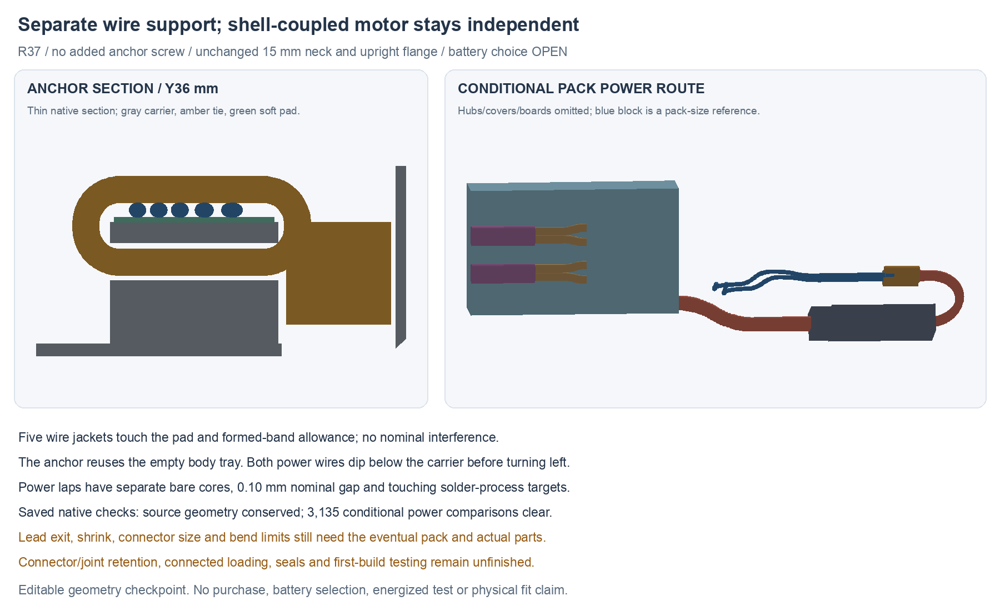

---
search:
  exclude: true
---

# Body-wire anchor and conditional pack power R37

R37 reuses the empty body battery tray for a five-wire saddle, compliant pad
and cable-tie allowance. It adds no anchor screw. The motor remains clamped
independently to the metal shell. A conditional prewired battery mate now has
complete power-wire paths and two separate lap-joint targets.

The 15 mm neck, exterior, upright 90° flange PCB, body PCB and sensor routes
remain. Semi-flex is still permitted; its earlier folded/flat space claims
are alternatives, not a completed flex circuit. Battery selection stays
**OPEN** and the human-owned product BOM is unchanged. R37 is a development
checkpoint; the complete build proposal remains unfinished.

## Editable source pairing

| Source | Role |
| --- | --- |
| `hardware/cad/pack-assembly-r37/body-anchor-b/PackBodyAnchorR37.FCStd` | Integral carrier saddle, pad and formed tie/head allowance |
| `hardware/cad/pack-assembly-r37/power-f/ConditionalPackPowerR37.FCStd` | Same anchor plus conditional complete power route and local hub channels |
| `hardware/pcb/pack-pigtail-r35/candidate-f/` | Unchanged full native circuit and body/flange boards |
| `hardware/cables/pack-adapter-r37/pack-adapter-r37.yml` | Combined sensor/power fixture recipe matched to native nets |

Use power F as the latest integrated geometry. Source R36 H/I remains the
preserved sensor-wire/service-opening checkpoint. Earlier R37 placement
screens and failed power E remain for comparison; E hits the carrier and
dock connector and is not an accepted route.

## Anchor without another screw

The saddle is integral to the existing carrier at Y33.5–38.5 mm. It uses the
unused tray floor below the body board. A 0.20 mm compliant-pad target sits
under the five wire jackets. The tie channel and two guide faces retain the
formed-band allowance axially; the first sampled carrier blocker appears at
0.25 mm in either Y direction. This is a finite geometry screen, not a pull
test or proof of friction, clamp force or wire protection.

The candidate reference is Panduit PLT.6SM-C. Its
[manufacturer drawing SS-5540, sheet 1, rev 36A](https://www.panduit.com/content/dam/panduit/en/products/media/0/00/200/8200/111598200.pdf)
lists a minimum bundle diameter of 1.6 mm. The CAD uses a 2.2 mm wide,
1.1 mm thick formed-band engineering allowance and a 4.3 ×4.2 ×4.2 mm head
budget. Those are reserved space, not a controlled supplier maximum for the
formed tie/head. Confirm the actual tie profile, head/tail orientation and
tension with the wire/pad stack. The maker's loop tensile rating is not
allowable force on these wires.

Saved-native review confirms that all five anchor wire sections are unchanged
and nominally touch both pad and band without positive volume intersection.
The carrier retains its source tip receiver, wire comb, rear capture and PCB
guides. Existing screw/pilot intersections are recorded separately only after
checking that no new carrier material enters them. No claim of completed
loading or tie-installation access follows from this static arrangement.

## Conditional prewired power mate

The candidate prewired mate is Bitcraze 100046015, with included factory leads.
The [maker's drawing](https://www.bitcraze.io/documentation/hardware/battery_cable/battery_cable-datasheet.pdf)
identifies a gold-plated Molex 51006 and dimensions its free leads separately
from the assembly. Using a prewired mate avoids selecting a tiny loose crimp
terminal before the actual wire/terminal compatibility is known. This does
not select a battery or approve that cable for the required current.

The body power wires dip below the carrier head before turning into the left
flange wing. Ground passes forward of the dock until beyond its left edge.
Two Ø2.5 ×5.5 mm insulated-joint process targets join them to the OEM mate
leads. The bare core allowances remain separate, with 0.10 mm nominal gap;
each solder-process target touches both cores without occupying their volume.
The longest body power coated path is 116.752 mm. Solder, insulation, stripping,
current capacity and force bypass remain to qualify.

The connector and stock cable are **conditional geometry**, based on these
explicit receiving inputs:

| Model input | Status |
| --- | --- |
| Pack body 33 ×8 ×20 mm XYZ | Published reference gauge; battery unselected |
| Pack lead exit centre [7, −20, −9] mm and rotated pair axis | Assumed; photographs do not control the 3D exit |
| 35 mm stock cable including female connector | Reference overall length; not entirely bendable wire |
| 9.2 mm female housing plus 4 mm rigid shrink extension | Housing reference plus assumed shrink budget |
| 21.8 mm flexible stock lead, OD1.8, centreline R11 | Conditional route inputs, not manufacturer maxima/bend limits |
| Mated housing budget 16.4 ×8.8 ×4.2 mm | Engineering reservation, not measured assembly size |
| OEM male lead OD1.2, R4.75 U-turn, R4 fan | Conditional dimensions/bends to verify |
| OEM finished target 18.5 mm coated +2.5 mm bare | 21 mm target within the drawing's minimum free lead; actual process still unqualified |

Local clearance channels remove 20.856 mm³ from the left hub and 4.342 mm³
from the right. Front capture and the named upper/lower bolt end-seat regions
retain all their source material. The lower bolt midweb region loses
1.165/2.441 mm³ respectively. Those losses are reported separately and require
material/load review; retaining the end seats is not a strength acceptance.

## Recipe and saved checks

The new recipe replaces parked power ends with two laps, the conceptual
two-circuit mated interface and the unselected protected-pack output. Four
logical endpoints on the mate node represent its two sides, not a four-pin
physical connector. Pin labels specify required polarity; actual factory pin
numbering and colours must be verified. Power and sensor returns remain
separate outside the body PCB.

Use five 150 mm starting blanks plus two 30 mm sensor-return blanks, trimmed
to the fixture: 0.81 m of candidate wire. The previous 120 mm recipe does not
provide sufficient root/tail/process allowance for the longer power route.
The child BOM has two sensor candidates, one prewired mate candidate and seven
unspecified joint-process sets. Included factory leads are not counted again;
the battery reference is not a procurement item.

Fresh review of saved files confirms:

- 202 source geometry roles conserved in anchor B; 204 B roles conserved in F.
- Carrier equals the declared source/saddle fusion minus the two access tools.
- Both hubs equal their sources minus only the declared power clearance tools.
- All five wire sections at the anchor remain unchanged and touch pad/band.
- 3,135 conditional power comparisons have zero unexpected intersections.
- Both power laps have distinct bare cores and solder targets touching both.
- WireViz connectivity matches the full R35F native XML, including separate
  external returns; generated child BOM counts match the recipe.

These are nominal digital checks. They do not establish receiving dimensions,
manufactured joints, actual tool access, clamp tension, connected loading,
strength, thermal/current performance, sealing, RF, comfort or wear duration.

## Remaining work toward the build proposal

Provide positive retention for the connector and all flange joints, then
check loading with loose tails followed by flange termination and cover
closure. Finish motor/dock harnesses, flange compliance/load paths and seals.
Consolidate the native sources/exports and first-build commissioning plan.
Confirm actual battery/cable and supplier process inputs before fabrication
or energized assembly. No purchase, live battery operation or physical test
has occurred.
