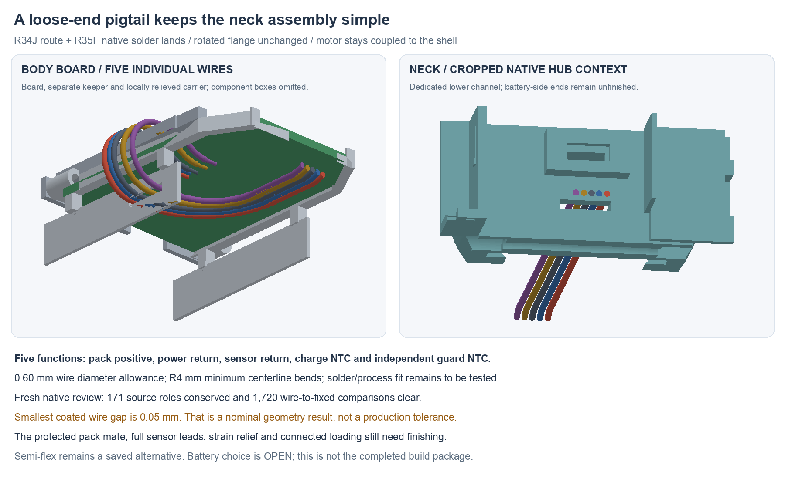

---
search:
  exclude: true
---

# Pack connection: wire and flex studies R34 / R35

The first-prototype direction is a five-wire soldered pack pigtail. Loose
flange-side ends avoid passing a populated connector or broad flex island
through the neck during loading. The existing 90° flange board, 90 mm flange,
15 mm neck and independently shell-clamped motor stay in place. Semi-flex
remains an allowed alternative; it is not needed to make this transit fit.

**This finishes a body/neck route study and its native PCB interface, not the
complete pack harness or prototype proposal.** Battery selection remains OPEN.
[R33F](flange-pack-r33.md) remains the pack-retention geometry checkpoint.
The human-owned BOM is unchanged. No purchase, fabrication or physical test
has occurred.

## Current editable sources

| Source | Purpose |
| --- | --- |
| `hardware/cad/pack-harness-r34/pigtail-j/PackPigtailTransitR34.FCStd` | Five swept wire allowances, bare tails, relieved carrier and channelled hubs |
| `hardware/pcb/pack-pigtail-r35/candidate-f/system-r35.kicad_sch` | Full native system hierarchy, with body and flange projects |
| `hardware/pcb/pack-pigtail-r35/candidate-f/body/body-r35.kicad_pcb` | Five solder lands replacing the former J2 header |
| `hardware/cad/pack-harness-r34/formed-f/FormedFlexSpaceR34.FCStd` | Preserved folded flex space claim |
| `hardware/cad/pack-harness-r34/unfold-h/PackFlexFlatSpaceR34.FCStd` | Corresponding exact developed flat outline; no copper/stackup |

The wire alternative is additional to the ten-wire
[R29 interboard connection](interboard-routing-r29.md). It does not silently
reuse that connection's ground return for the pack sensors.

## Electrical landing map

J2 now represents **copper lands**, not an unpopulated purchased connector.
Its schematic value is `PACK_PIGTAIL_4NET_5LAND`, excluded from the component
BOM. Four logical pins are preserved; the second physical pad 2 provides a
separate sensor return, tied to ground on the body board. There is no new net
or connection through the metal shell.

| Wire | Function | Logical J2 pin | Pad centre X,Y, mm |
| --- | --- | --- | --- |
| 1 | PACK_P | 1 | −1.985, 42.75 |
| 2 | GND_SENSE | 2 | −2.200, 41.90 |
| 3 | GND_POWER | 2 | −1.985, 41.25 |
| 4 | PACK_NTC | 3 | −1.985, 39.75 |
| 5 | PACK_GUARD | 4 | −1.985, 38.25 |

The four original electrical pad centres, dimensions and nets remain. Their
paste apertures and the old unnetted mechanical pads are removed. The new
sensor-return land is only 0.5 ×0.5 mm: hand-solder access and yield require
a real coupon/process check. It has a local solid ground-zone connection;
the original ground land retains its thermal relief. One 0.3 mm ground track
is added. All existing routed records survive, and no project rule is relaxed.

The native board checks report **0 violations, 0 unconnected items and
0 footprint errors**. Fresh full-system XML preserves 94 components and all
338 pin/net/function/type nodes; only J2's intended value/footprint changes.
Every other footprint's identity, value, pose and pad geometry/net is conserved.
The flange PCB is byte-identical to R28S; board/stackup, ERC and net rules match
the source. These are layout/circuit-conservation checks, not current, solder,
thermal or fabrication acceptance. Fresh GUI ERC and current CAM remain open.

`saved-circuit-review.json`, `body/native-drc.json`, the text DRC report and
three native XML exports record the results beside the sources.

## Mechanical transit

The wire candidate remains the Accu-Glass 100690 28 AWG reference from the
[maker catalogue](https://www.accuglassproducts.com/sites/default/files/catalog/kapton_insulated_uhv_wire.pdf).
The model uses 0.60 mm coated diameter as an engineering allowance, rather
than treating the nominal 0.508 mm as a maximum. R4 mm centreline bends reserve
3.7 mm at the inside surface. Received dimensions, actual stripping/soldering,
enclosed current and thermal suitability remain unqualified.

Each path uses exact tangent circular arcs and lines. Wires leave the body
lands, turn around the board's left edge, pass below it and enter the lower
neck channel. A local unused-tray relief clears the turn; the source PCB guide,
rear capture, tip receiver and supported-wire comb material is conserved.
The two capture hubs gain a 5.3 ×1.0 mm channel over Y[−14,−8], Z[−4.7,−3.7].
The hub changes are material removals with retained outer source material,
not a strength or flange-compliance result.

Fresh native recompute and material comparison conserve **171 fixed source
roles**, with the declared carrier replacement reviewed separately. All ten
coated/bare wire objects remain valid single solids; their paths retain the
reported lengths. **1,720 wire-to-fixed comparisons** have zero unexpected
intersections. Ten coated-wire pair checks are positive; their smallest
surface gap is **0.05 mm** between the two returns near the land fan-out.
This small nominal gap does not establish a production tolerance or fatigue
allowance. No connected assembly or dynamic flex result is implied.

The coated paths currently end at Y−18 mm. Their recorded lengths are transit
geometry, **not finished cut lengths**. Bare-tail cylinders are process space,
not finished solder joints. Do not build a pack adapter from these endpoints.

## Preserved flex alternative

The folded flex study clears the same installed context after its declared
carrier/hub reliefs. Its 0.25 mm thickness is a space claim, not a chosen
supplier stackup. Sixteen native flat/cylindrical regions develop to one flat
outline of 1,045.676446 mm²; flat area × thickness agrees with formed volume
within the recorded numerical residual. No traces, pads, coverlay, stiffeners,
loading process or repeated-flex qualification are provided by this study.

Allowing semi-flex does not make a bend-to-install shape a dynamic flange
hinge. Choose the actual stackup, conductor/current design, support and bend
process before adopting that alternative.

## Failures retained and next work

Straight transit A/B scans failed their recorded sets. Passage C opens the
lower hub channel. Formed flex D/E collided with current parts; F clears.
Unfold G failed the coplanar face-union method; H uses the accounted native
extrusion/union. Wire I clears a hypothetical landing; J binds the actual
R35F lands. R35 A–D retain their native findings; E retains its footprint
builder failure. Only F passes the saved native circuit review.

Finish the protected-pack mate/lead exits, both complete factory sensor leads,
return branching, insulated splices, solder geometry and restraints. Then check
the connected loose-end loading/closure order and service movement. Finish
flange load/compliance, seals/material/process and the consolidated fabrication
and first-build plan. Those design tasks precede claiming the proposal ready;
physical commissioning, runtime and wear results remain later work.
