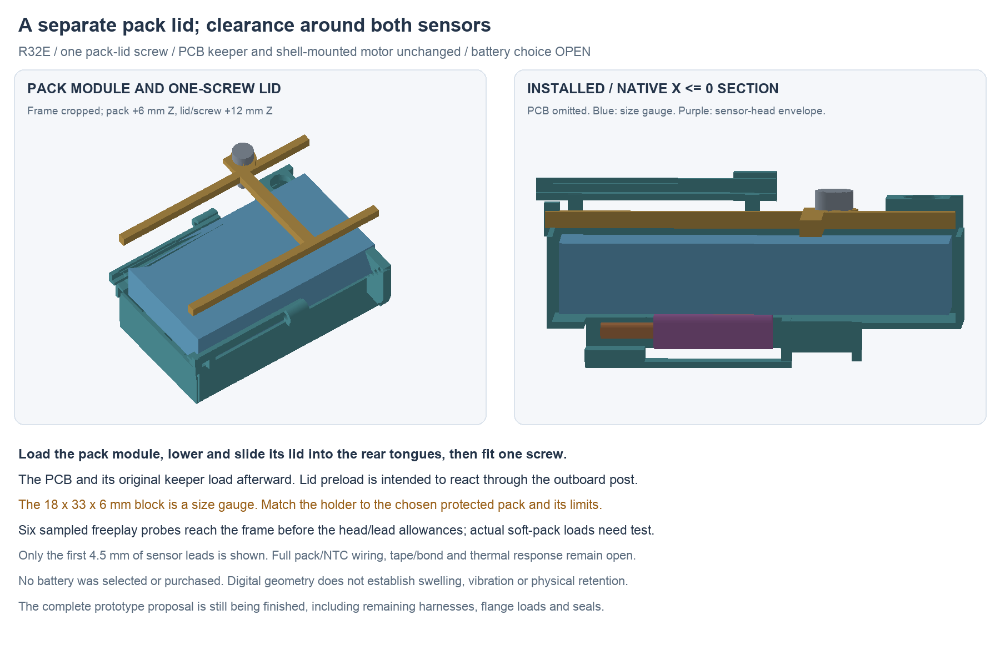

---
search:
  exclude: true
---

# Pack and dual-sensor retention R32

R32 adds a separate one-screw pack lid, two end stops and clearance guards for
the two battery-temperature sensors. The original PCB keeper and independent
metal motor mount remain unchanged. The pack module loads before the lid,
PCB and PCB keeper; the pouch is not used as a screw-preload reaction or PCB
support. The exterior, 15 mm neck, circuits and routed boards are preserved.

The current editable source is
`hardware/cad/pack-retention-r32/candidate-e/PackRetentionR32.FCStd`.
The adjacent `PackRetentionR32-review.FCStd` is a display copy with identical
non-GUI archive content. `geometry-report.json`, `saved-review.json`,
`assembly-screen.json` and `freeplay-review.json` define the current checks.
See `assembly-docs/pack-retention-r32.md` for the unperformed build sequence.

The fresh saved review covers 176 roles including three sizing/clearance
reservations, with 162 source roles conserved. The 1,998 new/changed physical
and 492 rigid/reservation comparisons have no unexpected intersections. Listed
loading, position and freeplay screens pass within their recorded scopes.

## Pack choice remains open

The blue 18 × 33 × 6 mm block is a **finished-pack size gauge**, not a selected
cell. The old `NarrowPackAllowance` remains an unchanged 19 × 34 × 7 mm sizing
reservation and is now explicitly classified as a reservation. It is not a
second physical battery. The physical gauge, attached sensor envelopes and
their clearance budgets are checked separately. Attached heads can occupy
the old sizing box without occupying the actual gauge; all stationary parts
must clear the combined reserved volumes.

The 0.5 mm sizing budget per side is not a supplier tolerance or swelling
allowance. Before using a real pack, match the insert to its finished maximum
dimensions, protection board, insulation, lead exit, connector, expansion and
retention requirements. A smaller pack needs its own matched retention detail;
the present lip opening does not retain every possible smaller pouch. Confirm
the combined electrical load, protection, charge current/voltage and temperature
limits against the existing circuit. Battery selection and the human BOM stay
open; no source pack has been adopted by this CAD work.

## Mechanical load paths and loading

The tray's side walls/floor and new end stops locate the gauge. The lid's
long side lips overlap its edges without nominal preload. Two rear tongues
enter clearance hoods; one M1.6×6 candidate screw seats the front tab on an
outboard carrier post. Its nominal pilot is Ø1.25 mm, lid clearance Ø1.8 mm
and head allowance Ø3.2 × 1.6 mm. These are candidate envelopes, not complete
supplier profiles, approved threads or torque values.

[Accu SSCF-M1.6-6-A2](https://www.accu.co.uk/api/product-datasheet?id=3783)
provides a dimensional reference: Ø3 mm maximum head, 1.6 mm maximum head
height, 0.35 mm pitch and 1.5 mm socket. CAD reserves Ø3.2 × 1.6 mm. Check
the actual neck/fillet, drive, clearances and tapping/locking process; no stock,
material/finish adoption or purchase follows from this reference.

Pack restraint goes through the lid/end stops/tray into the carrier, separately
from the PCB and sensor heads. Nominal static clearances do not establish the
strength of the narrow lips, rear hoods, post or remaining floor. Prototype
material, finish, creep, screw locking and load/deflection tests remain open.

The pack module drops into the open tray. The lid lowers 2 mm forward of its
installed position, then slides rearward into its hoods and receives one screw.
The PCB and original two-screw PCB keeper follow. The new lid is fitted before
the PCB; it cannot be installed by passing its lower lips through the board.
The native reports include finite poses for these stages, the rigid cartridge,
motor module and cap. Long harnesses remain waiting/unmodeled in the cartridge
test; the first sensor stubs are not a connected loading demonstration.

## Sensor attachment and actual lead length

The existing circuit uses two Vishay NTCLE413E2103F524A candidates. The current
[Vishay dimension drawing](https://www.vishay.com/docs/29078/ntcle413.pdf)
allows a maximum Ø3 × 10 mm head/entry envelope. R32 uses bounding cylinders,
with an additional attachment allowance and non-contact guards beneath the
pack. The 0.07 mm contact-film boxes reserve a possible compliant thermal
interface; they do not model a conforming adhesive pattern or establish contact
area, bond strength or thermal response.

The drawing's **L** spans the body tip to wire end. For the 52 ±5 mm order,
subtracting maximum 10 mm head/entry and 4 mm stripped end leaves at least
33 mm of insulated wire outside the coating. Earlier R0 wording called 52 mm
a lead length; do not use that as available insulated routing length. The
1 mm lead diameter and 2 mm pair width are informative dimensions; the CAD's
Ø1.2 mm leads and 1.3 mm pitch are engineering allowances, not supplier maxima.
Only the first 4.5 mm is modeled here. **Do not trim a real sensor to that stub.**

[Vishay's mounting instructions](https://www.vishay.com/doc?29222=) require
clearance rather than coating compression, lead support and no bending within
4 mm of the coating. Use the insulated-wire bend rule and actual received
dimensions when routing. Tape/glue attachment is a candidate; keep the heads
dry and avoid hard potting/overmolding. The E2 overall-tinned wire is intended
for a soldered adapter approach. Actual attachment, soldering, mechanical
stress and vibration compatibility need application-specific review and tests.
No supplier approval of this vibrating application is inferred.

## What the freeplay check establishes

The revised guards cover more travel than the nominal gauge's freeplay, so
they do not become its intended restraint. Six 0.05 mm translation sweeps compare
the gauge's first sampled frame encounter with a Ø3.2 mm head-plus-attachment
allowance and the lead stubs. The reports retain the distances and contacts.
Gauge-only ±1 mm probes separately identify frame blocking without counting
sensor contact as restraint. Common ±0.5 mm module poses are also checked.

These are rigid nominal checks. They do not prove continuous contact order,
rotation, pouch deformation, expansion, adhesion or vibration performance.
Use a matched inert pack surrogate for first-load tests; do not test those
loads by pushing or squeezing a live pouch.

Earlier candidates remain preserved: A's combined keeper clashes and blocked
PCB lowering; B's wall/screw overlaps; C's loading/freeplay failures; D's enlarged
guards crossing the body. E moves the sensors nearer the centre and revises the
hoods/lid approach while retaining the required sensor clearance.

The complete prototype proposal still needs full pack/NTC, motor and dock
harnesses; a feasible open battery-option screen; flange loads/compliance and
seal/material/process details; and the consolidated build/test package.
