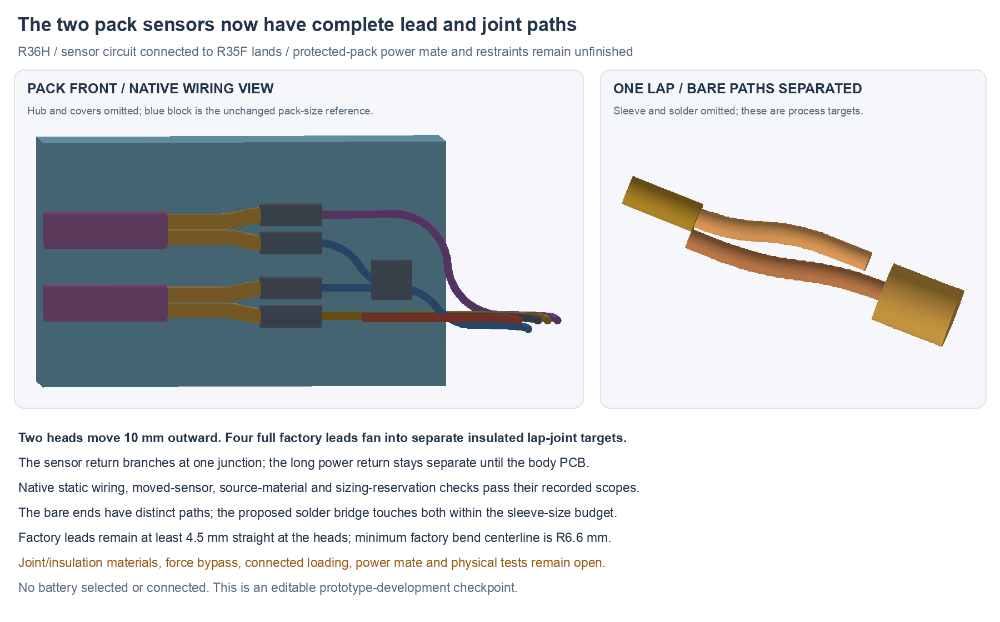

---
search:
  exclude: true
---

# Connected pack-sensor adapter R36

R36 connects the body-side sensor wires to both complete factory NTC leads,
including four insulated lap joints and one shared sensor-return junction.
Moving the heads 10 mm outward gives the factory leads room to fan out without
moving either PCB, the pack-size reference, exterior or independent motor mount.
The existing 15 mm neck and rotated flange remain.

The wiring checkpoint is **connected H**. **Access I** adds an upward service
opening for the return junction so it can be worked on with the covers waiting.
The protected-pack power mate, restraints and connected assembly still need
finishing. Battery selection and the human-owned BOM remain OPEN/unchanged.
This is not the completed prototype proposal or a fabrication release.

## Editable source pairing

| Source | Role |
| --- | --- |
| `hardware/cad/pack-sensor-r36/connected-h/ConnectedPackSensorsR36.FCStd` | Full installed sensor wiring and joint-process geometry |
| `hardware/cad/pack-sensor-r36/access-i/ServiceablePackSensorsR36.FCStd` | Same wiring with the declared service opening and generic tool probes |
| `hardware/pcb/pack-pigtail-r35/candidate-f/` | Unchanged native circuit/body/flange partner |
| `hardware/cables/pack-sensor-r36/pack-sensor-r36.yml` | WireViz fixture recipe and native-net-matched connections |

[R34/R35](pack-connection-r34.md) remains the preserved transit/landing source.
[R33](flange-pack-r33.md) remains the original tray/retention development;
its loading/freeplay results do not automatically transfer to this connected
harness and moved sensors.

## Sensor leads and joints

Both bounding heads now enter at X30 mm, with the same Y−14.43 and Z±3 mm,
and the same +X head axes. Their contact films, guards and clearance volumes
move with them; the pack-size reference stays X[7,40], Y[−24,−16], Z±10 mm.

Each factory lead keeps the first 4.5 mm straight, then fans 0.5 mm in Z
using R6.6 mm centreline bends. The coated route is about 8.246 mm before the
lap, well below the conservative 33 mm available outside the maximum coating
and original bare end. These are fixture geometry, not instructions to cut an
unmeasured sensor. The [R32 maker-source handling notes](pack-retention-r32.md#sensor-attachment-and-actual-lead-length)
still apply: support the leads, keep the heads dry and uncompressed, and
qualify the attachment against thermal error and vibration.

The four lap targets are Ø1.8 ×5 mm process budgets. Factory and adapter bare
ends take separate, tangent paths offset 0.45 mm to opposite sides; their
Ø0.4 mm core allowances have 0.05 mm minimum nominal gap and zero overlap.
A proposed solder bridge within Ø1.4 ×3 mm touches both cores, with the core
volumes subtracted from the bridge. It is a geometric process target, not
proof of alloy, wetting, final insulation thickness or a manufactured joint.

The two sensor returns meet at one insulated three-way junction. The recipe
allows three separately stripped ends rather than requiring midspan stripping
of the long wire. Its two short return legs are trimmed on the fixture.
The long motor/pack power return remains separate until the body-board ground
junction. Insulation is absent only within the declared junction process window.

The two power conductors are currently parked at X14 mm, Y−12.2/−13.0 mm,
Z−4.2 mm. They are not a connector selection or a completed battery adapter.

## Logical recipe and starting material

The WireViz recipe matches the current full R35F XML:

| Body land | Destination |
| --- | --- |
| 1 / PACK_P | Parked power-positive end |
| 2P / GND_POWER | Parked power-return end |
| 2S / GND_SENSE | Return junction → TH1 pin 2 and TH2 pin 2 |
| 3 / PACK_NTC | TH1 pin 1 |
| 4 / PACK_GUARD | TH2 pin 1 |

`2P` and `2S` identify the two physical lands on native logical J2 pin 2.
The NTCs are nonpolar; the recipe explicitly maps the CAD lead order to the
schematic pins. `logical-review.json` verifies the complete harness graph,
including junction loops, and proves that the power and sensor returns stay
separate outside the board. No signal/ground or sensor-channel short is hidden
by a shared net name.

Starting material is five 120 mm 28 AWG blanks plus two 30 mm return-leg blanks,
trimmed to the assembly fixture. The generated child BOM totals 0.66 m of that
candidate wire and two NTC candidates. Factory sensor leads are included with
the sensors and are not counted again. Five insulation/solder process sets
remain unspecified; the child BOM is not a purchase list. Finished cut/strip
dimensions, wire colour identification and force-bypass restraints need the
actual process fixture.

## Saved checks

Connected H's native builder records 4,011 installed wire/joint comparisons
with zero unexpected intersections. Declared interfaces are limited to own
core/coating, target solder/insulation volumes and the return junction.
Independent fresh native review:

- Conserves 162 unrelated source physical roles by exact material comparison.
- Checks 804 moved-head/film pairs and 543 sizing/head-reservation pairs with
  zero unexpected intersections.
- Confirms all four bare laps are separate and inside their sleeve budgets,
  and that each proposed solder bridge touches both cores.
- Preserves the body/flange board poses, pack reference, carrier/keeper,
  exterior and independent shell motor mount. No PCB change follows from R36.

The full factory lead paths and body-side extensions use explicit tangent
arcs/lines. Original body-land/neck paths are bound to R35F's saved native
landing map. These are nominal geometry and topology checks, not production
tolerances, formed insulation, strength, current, thermal or physical results.

## Assembly access I

The return junction would otherwise lie inside the right hub's tie material.
Access I cuts an upward service column at X[9.8,13.8], Y[−15.33,−11.93],
Z[−2.95,19.2] mm. The right hub remains one solid. Removed material is confined
to that column; the stated upper-nut bearing witness through X9.6 is retained.
Strength and flange-compliance acceptance remain open.

The saved access review preserves all 202 H source object geometries using
BRep/placement identity or exact native material comparison. The installed
right-hub replacement equals the source minus only the declared service column;
the new opening adds no material or wire-pose change.

With all three covers waiting, five generic tool profiles clear at five listed
approach offsets each: the return joint from +Z and four laps from +Y. Each
profile reserves a last 8 mm of Ø1.2 mm tip and a following 14 mm of Ø3 mm shaft.
This does not choose or qualify a real iron, holder or hand position. The
closest nominal return-shaft gaps are only 0.13 mm to the upper bolt and about
0.313 mm to its nut; check the actual tool profile and assembly tolerances.
There is no continuous-motion proof or completed connected loading sequence.

## Preserved attempts and remaining design

Factory A retains an arc-construction failure; B/C are earlier full-lead
studies. Connected D retains a null-shape proof error; E is the earlier
coincident-bare process comparison. F's bare cores touched; G separated them
but crossed the pack sizing reservation by 0.045586 mm³. H moves the guard
turn 0.1 mm forward and clears the reserve. Those attempts remain preserved.

Finish the protected-pack power mate/lead exits, positive strain relief and
joint retention, actual solder/insulation/attachment process and connected
loading/service sequence. Then complete the remaining motor/dock harnesses,
flange load/compliance and seal/material work and consolidate the fabrication
and first-build test package. Physical commissioning remains later work;
unperformed tests must not be reported as design evidence.
