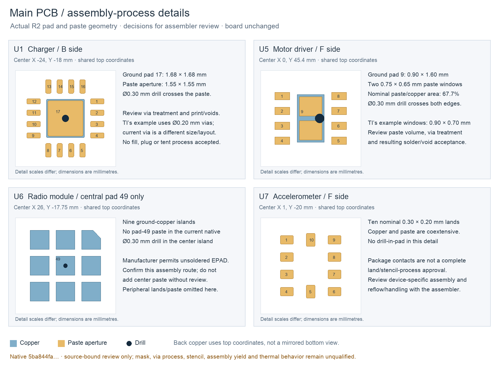

---
search:
  exclude: true
---

# PCB assembly-process review

31 October 2026. This package marks the current R2 main board's specific
assembly questions for a fabricator and assembler. The board remains unchanged
at `5ba844fa…`, with its existing native, independent and reproduction checks.
No process, supplier, order or fabrication release is approved here.

The editable SVG and image-source record are beside this figure. Native pad
polygons and layer membership come from a read-only KiCad extract at
`hardware/pcb/prototype-r2/assembly-review/native-pad-details.json`; every
plotted paste pad has zero effective paste margin. Curves use KiCad's review
polygon approximation. This is not a Gerber, mask/fill model or stencil release.
All panels use mechanical top coordinates; the B-side detail is not mirrored
into a bottom view.

## Three drill locations

| Location | Mechanical X/Y, mm | KiCad X/Y, mm | Current process question |
| --- | --- | --- | --- |
| U1, B side, ground pad 17 | −24 / −18 | 76 / 148 | One Ø0.30 mm drill passes through the 1.55 mm square paste aperture on a 1.68 mm square copper land. |
| U5, F side, ground pad 9 | 0.30 / 45.40 | 100.30 / 84.60 | One Ø0.30 mm drill overlaps both edges of the two paste windows. |
| U6, F side, center ground pad 49 | 26 / −17.75 | 126 / 147.75 | A Ø0.30 mm drill lies in the center island; the current native has no pad-49 paste. |

The existing complete inventory examines 149 vias against 320 SMD copper
shapes. It distinguishes these three drill overlaps from thirteen additional
annulus-only overlap pairs. A copper overlap alone does not imply a hole
under paste. Use that source-bound inventory for all locations, rather than
treating this four-part illustration as a new all-board check.

## Decisions for the assembler

U1's current paste dimensions follow the TI example, but its single Ø0.30 mm
via differs from the example's Ø0.20 mm layout. TI recommends treatment for
vias beneath paste. Agree the actual treatment, planarity, stencil/printing
and solder/void inspection criteria with both fabricator and assembler.
[BQ24074, RGT0016C 4222419/E, pages 53–54](https://www.ti.com/lit/ds/symlink/bq24074.pdf#page=53).

U5 uses two 0.75 × 0.65 mm paste apertures over a 0.90 × 1.60 mm land: 67.7%
nominal aperture-to-copper area before hole subtraction or transfer effects.
TI's different example has 0.90 × 0.70 mm apertures and states 87% coverage.
Resolve the current smaller print and intersecting hole together; neither
area ratio establishes deposited paste volume or assembly yield.
[DRV8212, DSG0008A 4218900/E, pages 46–47](https://www.ti.com/lit/ds/symlink/drv8212.pdf#page=46).

U6's nine center islands have no paste in the source. Espressif permits leaving
the EPAD unsoldered and cautions against excess center paste. Confirm the
current omission route and inspect peripheral joints/standoff. Adding center
paste would be a source/process change. The assembled module still needs
thermal and RF measurements.
[ESP32-C3-MINI-1 v2.2, page 34](https://www.espressif.com/sites/default/files/documentation/esp32-c3-mini-1_datasheet_en.pdf#page=34).

U7's ten nominal 0.30 × 0.20 mm copper/paste lands match package-contact
dimensions. That is not complete land-pattern or stencil approval. Accept the
device-specific pattern, paste, placement and handling/reflow process. The
datasheet's reflow classification peak is not an assembled-board recipe.
[MC3635 v1.10, pages 7 and 15](https://www.memsic.com/Public/Uploads/uploadfile/files/20220119/MC3635Datasheet.pdf#page=7).

## Before board fabrication and installation

Review exports are saved at
`hardware/pcb/prototype-r2/fabrication-review-r1/` and
`hardware/pcb/tip-r1/fabrication-review-r1/`. Each includes exact source/library
copies, current copper/mask/silkscreen/outline, drills/maps and placement CSV.
Paste is kept in a separately labeled unapproved review folder. Native export,
parsed CAM/outline/drill and CSV checks, visual inspection and read-only peer
audits retain their exact source/rounding/convention limits. The main CSV omits
JP1 under its source flags; tip J101 is a manual wire-pad site, not a connector
to place. These packets do not supply an accepted stencil, panelization,
machine-rotation library, fabrication process or actual parts list.

Record the accepted finished 1.00 mm stackup including mask, actual USB
impedance design, RNM15 shared lands/mask/stencil, small mask webs and all
location-specific via decisions. The native 0 / 0 / 0 routing result does not
establish those process capabilities. Review the separate TipR1 source and
its TMP117/direct-wire process independently.

The machine-readable questions, primary PDF hashes/pages and native bindings
are in `hardware/design/pcb-assembly-process-r1.json`. After actual parts and
processes are confirmed, inspect received boards/components and document the
build. Keep JP1 open and firmware motor output locked for first bring-up.
The human-owned BOM remains header-only. No supplier message has been sent.
