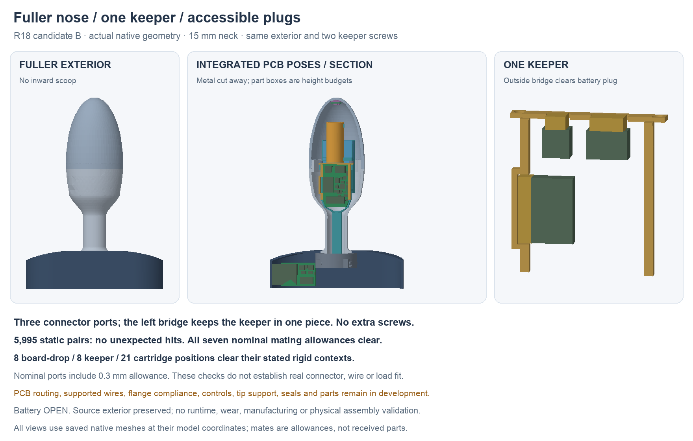

---
search:
  exclude: true
---

# Fuller exterior and accessible PCB plugs R18

1 November 2026. **Candidate B** is the checked18mm checkpoint, with the
R17AD pull-up relocation. It keeps Lucy's fuller nose, 15 mm neck,
one-piece metal body and large threaded front cap. It integrates the actual
R17AD body/flange component positions and opens the carrier around their plugs.
Assembly still uses one keeper and the same two screws. The complete build
proposal remains unfinished.

B retains117saved roles/88actual part envelopes and the same5995static
pairs, seven nominal mates and8/8/21 listed loading positions. Fresh forced
history review passes with no external document links. The earlier A source,
figure and tight-bound correction evidence remain preserved.
The20mm [R19 body board](body-routing-r19.md) needs its separately revised
carrier; B's18mm loading result does not transfer to it.

## Three openings, one keeper

The previous R13 carrier/keeper obstructed the R16/R17 battery, motor and tip
plug allowances. R18 cuts three local openings, each with 0.3 mm around the
nominal mating box. These are allowance studies; controlled installed plug,
wire-exit and tolerance dimensions still need checking.

Cutting through the left keeper rail alone would leave its forward section
loose. An outside bridge and two short ties connect it around the battery
plug. The keeper remains one valid solid with the original two screw locations.
The carrier also remains one valid solid. Geometric continuity does not establish
retention strength, stiffness, screw life or a suitable fabrication process.

The body PCB still drops from above on the bench; the keeper follows. Connect
the plugs with the cap off, then front-load the cartridge. The native design
retains the [R13 fuller cap](simple-assembly-r13.md), body, central hub and cover
shapes. Maximum body diameter remains 37.338 mm and neck-to-tip length 98 mm.

## Saved geometry checks

There are 110 primary roles and seven separate nominal mating allowances.
All 5,995 primary static pairs have no unexpected intersections. Two inherited
screw-shaft/pilot interfaces remain named and unqualified. All seven nominal
mate allowances clear the checked primary geometry, resolving the four
carrier/keeper intersections in the R16/R17 context screen.

Eight board-drop positions, eight keeper-lowering positions and 21 cartridge
front-loading positions clear their stated rigid contexts. Plugs and wires wait
during board and keeper installation. The cartridge screen includes the four
nominal body plugs, but does not represent actual flexible wires or handling.
These finite checks do not prove a continuous loading path or physical fit.

The native PCB input is R17 candidate N's saved Fab/height and substrate
geometry: 65 body parts and 24 flange parts, with the pad-only JP1 omitted
from physical boxes. R17's later routing can change copper without changing
these positions; its current layout inspection owns that comparison.
Native component boxes use candidate height budgets, not controlled maximum
manufacturer models.

The first saved-history review caught an inconsistency in generic spline
bounding boxes after reload. The original report and failed review are retained.
Report bounds now use native tight bounding boxes consistently; volumes,
solid counts and the native CAD file were unchanged by that metadata correction.
The saved-file review checks history recomputation, retained R13 material,
actual component bounds and absence of cross-document links.

Native source, geometry reports, original findings and source-bound meshes live
in `hardware/cad/pcb-integration-r18/`. Open `candidate-a/PCBIntegrationR18.FCStd`
for the editable feature history. The PNG uses its saved native meshes without
display translations.

## Remaining work

Finish and review the [R17 body routing](body-routing-r17.md), then define actual
wire construction, supported bends and strain relief through the neck. The
flange island needs retention and a deliberate compliance region; local button
actuation, stationary tip support/thermal interface, pack retention, seals and
material/process choices remain open. The tip support retained from R13 is
context geometry, not a completed thermal or mechanical interface.

Battery selection remains OPEN and the human-owned BOM is unchanged. The
18 × 33 × 6 mm finished pack remains only a conditional envelope. Runtime and
wear duration are unvalidated. This checkpoint is not a fabrication or assembly
release; the next review package must include the remaining interfaces and a
practical complete first-build plan.
