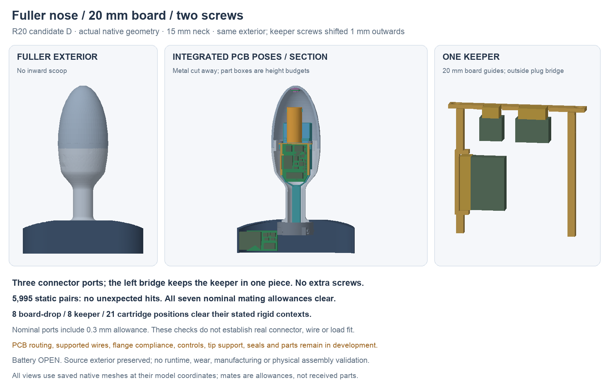

---
search:
  exclude: true
---

# Fuller profile and 20 mm board supports R20

1 November 2026. **Candidate D** is the current saved mechanical checkpoint.
The nose has a smooth, fuller profile without the inward scoop. The 15 mm
neck, one-piece metal body, threaded front cap, central hub and covers retain
their R13F geometry. The board guides and one-piece keeper now fit the R19
20 mm body-board outline. Assembly still uses two keeper screws.

## What changed

The wide part of each guide moves 1 mm outward; the rear taper remains.
The board stays 1 mm thick, Y26–54 mm, widening from 14 to 20 mm. Side risers,
rail joins and keeper screw positions move outward to match. The end plate
is rebuilt with native primitives at 25.3 mm width; its two holes are centered
at X±11.4 mm. The screws remain simplified M1.6×4 geometry budgets, with no
selected head/drive, material, torque or formed-thread acceptance.

The three battery/motor/tip connector ports retain 0.3 mm nominal margins.
The outside battery-plug bridge keeps the keeper in one piece. The earlier
end plate and screws were frozen source snapshots; they remain in native
history while the new plate and translated screw budgets define this study.
The width sheet records the study dimension; it does not drive every feature.

Maximum body diameter remains 37.338 mm and neck-to-tip length 98 mm. These
are study dimensions; only the slimmer 15 mm neck was explicitly selected.
The native material comparison preserves the source exterior, cap, hub and
covers. Battery selection stays OPEN.

## Saved-file checks

- 110 primary roles plus seven nominal mating allowances; both carrier and
  keeper are single valid solids.
- 5,995 static primary pairs: zero unexpected intersections. Two inherited
  screw-shaft/pilot interfaces remain named and unqualified.
- All seven nominal mating allowances clear the checked primary geometry.
- Eight board-drop, eight keeper-lowering and 21 cartridge positions, from
  100 mm outside to seated, clear their stated rigid contexts.
- Fresh forced native-history recompute checks all 117 saved roles and 88
  actual PCB Fab/height envelopes; saved bounds/volumes match, with no external
  document links. GUI visibility configuration preserves all geometry entries.
- R19D's inspected outlines, thickness, Fab/height, courtyard, pad poses and
  mate allowances match the R19A input used by this model. Copper and via
  holes are outside the envelope model's scope.

The cartridge check tests each moving role against the shell rather than a
large whole-compound Boolean. This preserves the stated finite poses while
avoiding the very slow calculation encountered in C. A/B failed before save
on absent inherited primitive/sheet objects. C passed its static screen but
was stopped during loading calculations; no complete C result is claimed.
All attempts and their executed helpers/logs remain preserved.

These checks establish nominal saved geometry and listed rigid positions.
They do not establish continuous motion, flexible-wire fit, received-part
fit, structural loads, thread life, sealing, materials or manufacturing process.
The earlier R18B model remains the preserved 18 mm checkpoint.

## Assembly work still required

The nominal motor and tip mate boxes finish only 0.525 mm before the motor
reservation. That is a geometry measurement, not space accepted for real
wire exits or bends. Define actual mating parts, wire construction, routes,
slack, terminations and strain relief before accepting this assembly sequence.
The SH housing screen at `hardware/design/interboard-link-r20/`
also distinguishes the 11 mm housing without protrusions from the 13 mm
variant; neither is selected or qualified for neck transport.

The open lower motor saddles do not provide completed positive motor retention.
Pack retention and its two cell sensors, flange attachment/compliance and
stop load path, working local controls, stationary tip support/thermal interface,
seals and candidate parts/materials/process still need design work.
[Body routing](body-routing-r19.md) remains incomplete. The full prototype
proposal is not ready for a live build; no purchase or physical validation
has occurred.

Native source: `hardware/cad/pcb-integration-r20/candidate-d/PCBIntegrationR20.FCStd`.
Use `geometry-report.json`, `saved-review.json` and the source-bound preview
record for exact hashes and scope. Review meshes are not approved print files.
