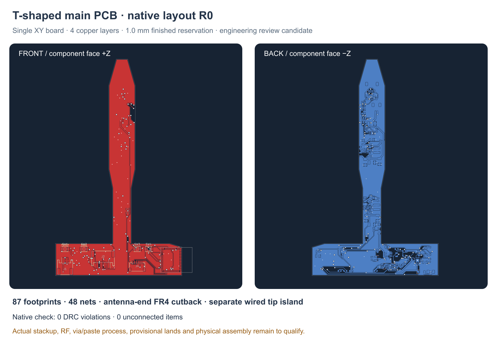

---
search:
  exclude: true
---

# R0 main PCB layout

30 October 2026. The native source is `hardware/pcb/prototype-r0/buttplug-r0.kicad_pcb`.
It contains the main circuit, with actual net names and schematic symbol paths.
This is a layout under review, not a board approved for fabrication or assembly.
R2's substantially slimmer neck supersedes this board's mechanical placement:
the populated waist and Z offset must be repacked. The R0 native board and its
checks below remain an unchanged electrical baseline; they do not qualify a
revised outline, component placement or routing.
The separate [TMP117 tip board](tip-pcb-r1.md) carries U101, C101 and its termination;
the two pack thermistors remain external to this main board.

The routed candidate has 87 main-board components and 48 nets. Native KiCad
reports zero DRC violations, zero unconnected items and zero footprint errors.
All 310 electrical pad entries agree with the current circuit manifest. The
earlier two-layer trial remains under `hardware/pcb/prototype-r0/reviews/`,
including its 28 unconnected items and native report. These are digital design
results; assembly, process and electrical qualification remain open.



## Shape and assembly space

The single 1.0 mm, four-layer T board follows the selected XY topology. Its
crossbar is clipped at X = 31.6 mm to remove FR4 from beneath the antenna,
retaining a narrow tongue toward the tip. The current outline has 15 vertices,
recorded in the placement register; the earlier uncut board is historical
evidence. Mechanical +Y points to the tip;
KiCad coordinates are X = 100 + mechanical X and Y = 130 − mechanical Y.
The board occupies mechanical Z = −6.5 to −5.5 mm. The placement register,
`hardware/pcb/prototype-r0/placement-report-r0.json`, records component body
projections and published candidate heights. These boxes exclude tolerances,
solder, plug housings and wire bends.

The battery projection on the positive-Z side of the tongue is clear from
Y = 21 mm onward. Most stem parts face negative Z. The two 0.55 mm feedback
resistors at X = 3 mm, Y = 7 and 9 mm are above the board, outside that battery
projection. The tallest capacitors on the underside are provisionally 2.7 mm.
The historical R1 carrier slide catches C21 before seating. R2 uses side-loaded
shells; the revised carrier loading, populated board, mated harnesses and
insulation require a new assembly check.

J3 uses a low SH two-pin motor header rather than the earlier PH candidate that
could not pass the neck. J3 and J5 open toward mechanical +Y. Their nominal mated
length is 6.25 mm; their provisional far ends are Y = 66.575 and 77.575 mm,
respectively. Their R0 assembly study premates both plugs outside the shell;
R2 must demonstrate its own loading and cap-closure order. A JST
catalog envelope is not a complete wire-bend or assembly-tolerance model.

## Physical part candidates

`hardware/pcb/prototype-r0/layout-candidates-r0.json` records the proposed MPN,
local footprint, height, source and limitations for each reference. It is a
candidate register, separate from the human-owned product BOM.

| Group | Physical candidate | Relevant boundary |
| --- | --- | --- |
| Resistors | Vishay TNPW e3, 0603 or 0805, 0.1%, 25 ppm/K | Values above the 0603 family range use 0805; actual stock and lots are unverified. |
| Capacitors | Murata GRM ceramics; C33 TDK C1608X7R1E105K080AB; C51–54 TDK C1608X5R1A106K080AC | Effective capacitance at bias, temperature, tolerance and age remains to be checked. |
| L1, L2 | Coilcraft XFL4020-152MEC, 1.5 µH | Saturation headline does not establish circuit current or enclosed temperature. |
| F1 | Littelfuse 1206L050YR | 0.5 A hold at 20 °C; temperature derating and fault coordination remain open. |
| D1 | Diodes B140HW-7 | Custom pad numbering is A1/K2 to match the schematic. |
| SW1–4 | Omron B3U-1000P | Silicone actuator travel, force and sealing remain open. |
| J1, J2 | JST PH two-pin dock and four-pin pack adapter | J1 is an internal harness header; exposed magnetic contacts are separate. |
| J3–5 | JST SH two-, six- and four-pin headers | Motor current, crimps, harness polarity and mating clearance remain open. |
| JP1 | Open PCB solder jumper | Charge permit is open by default. |

The [footprint review](pcb-footprints-r0.md) covers the IC packages. U7's MC3635
copper and paste lands now match the nominal 0.30 × 0.20 mm package contacts,
consistent with an older generic mCube table. Device-specific stencil/process
acceptance remains outstanding. The interrupt trace now passes outside U7 on
In2; no In2 signal copper or via annulus intersects its nominal body box.
Neither the board nor its machine checks resolve the process acceptance gap.

Primary references: [Vishay TNPW family](https://www.vishay.com/docs/28758/tnpw_e3.pdf),
[Vishay land dimensions](https://www.vishay.com/doc?28950),
[Murata GRM reference and land ranges](https://search.murata.co.jp/Ceramy/image/img/A01X/G101/ENG/GRM188R71C104KA01-01.pdf),
[TDK C33](https://product.tdk.com/en/search/capacitor/ceramic/mlcc/info?part_no=C1608X7R1E105K080AB),
[Coilcraft XFL4020](https://www.coilcraft.com/pdfs/xfl4020.pdf),
[Littelfuse 1206L](https://www.littelfuse.com/assetdocs/resettable-ptcs-1206l-datasheet?assetguid=2b6a1515-d4ee-4c83-8bd4-152b4901b8f5),
[Diodes B140HW](https://www.diodes.com/datasheet/download/B140HW.pdf),
[Omron switches](https://omronfs.omron.com/en_US/ecb/products/pdf/en-b3u.pdf),
[JST PH](https://www.jst-mfg.com/product/pdf/eng/ePH.pdf) and
[JST SH](https://www.jst-mfg.com/product/pdf/eng/eSH.pdf).

## Layout and electrical review

The ESP32-C3 module at (26, −17.75) mm points its antenna toward the outward +X
end of the polymer flange. Its copper keepout is native on all four copper
layers; the antenna overhangs the board edge by about 5.4 mm. Its native antenna
box is X = 31.6–37.0 mm, Y = −24.35 to −11.15 mm and Z = −5.5 to −2.95 mm.
After the cutback, the two outer corner lands end at X = 31.3 mm and pass the
current 0.30 mm copper-to-edge rule. The module also moved 0.25 mm away from the
sloped flange edge. This nominal rule pass is not a fabrication-tolerance
signoff. Metal-shell clearance, nearby battery/wires,
ground geometry and final RF performance require review in the assembled toy.
A polymer flange alone does not establish radio performance.

The converter switch nodes, local input/output capacitors, feedback escapes,
bridge bypass and module bypass have explicit short routes. The rest combines
automatic routing with reviewed local repairs. Return paths, power-loop area,
neck widths, thermal behavior and interference need electrical review and bench
measurement. A geometric DRC pass does not establish those properties.

The service header carries self-powered native USB signals without VBUS. D+/D−
use a manually paired, via-free F.Cu path over the reserved In1 ground plane,
with 0.20 mm traces and roughly 0.30 mm gap through the common channel. Native
lengths are 23.613961 mm for D− and 23.589697 mm for D+, a 0.024264 mm
difference. In1 has one continuous filled outline and no signal tracks. Each
USB trace was sampled at intervals no greater than 0.1 mm, at its center and
both copper edges; all 1,458 samples have In1 ground beneath them. This verifies
the saved reference geometry, while 90 Ω impedance, ESD and the harness/fixture
remain unqualified.

The independent charging guard uses U8 TPS3700, U9 TPS3808 and Q1 AO3400A.
R46 is 11 kΩ from VBUS_CHG to CHARGE_TEMP_OK, following the current circuit.
JP1 stays open until the complete pack-temperature chain has been checked on a
bench. Its two external thermistors must both couple to the actual cell.

Provisional routing rules are 0.10 mm clearance, 0.15 mm minimum track,
0.20 mm default signal track, 0.60/0.30 mm via/drill and 0.30 mm copper-to-edge.
Power-class routes use 0.60 mm where practical, with narrower device escapes.
These are development rules, requiring fabricator and assembler agreement.
The proposed four-layer stackup uses 0.035 mm outer copper per face, 0.0175 mm
inner copper per layer, two 0.10 mm prepregs, a 0.675 mm core and 0.01 mm mask
per face, totaling 1.0 mm. In1.Cu is reserved as the continuous GND reference;
In2.Cu adds routing space. Finish, actual dielectric properties and fabricator
acceptance are not selected.

Before release, inspect every high-current loop and footprint, resolve land and
stencil questions, select an approved stackup and finish, and verify harness fit
and insulation with the mechanical assembly.
No board was fabricated, no parts were purchased and no physical assembly,
thermal, RF, endurance or wear-duration result is implied.

R1's proposed carrier overlaps only the board-edge strips at X = 4.7–5.0 mm
and X = −5.0 to −4.7 mm, at Y = 2–3 and 14–15 mm, with a proposed 0.2 mm gap
above and below. Keep these small areas free of component bodies; retention
preload and physical insertion are still untested.

The independent process inventory examines all 139 through vias against 320
native SMD copper shapes. Its three drill-in-pad locations are U1.17, U5.9 and
U6.49. Four additional contacts overlap only the copper annulus: C15.1, C44.2,
J1.2 and U6.3. R11 and C11 no longer have drilled-hole overlap.

U1 and U5 have separate paste-only apertures that overlap the drill regions;
U6's central pad 49 has no central paste opening. Agree fill/cap, tenting,
flatness and stencil treatment for each location with the assembler. These
geometric classes do not establish a solder defect or an accepted process.
USB reference continuity passes the saved geometry checks, while fabricator
impedance remains open. Neither impedance nor RF shell qualification is
established by generic connectivity checks.

The native STEP exporter excludes solder mask: this proposed stackup produces
0.98 mm of copper plus core, with a 1.0 mm finished-thickness reservation once
the two mask layers are included. That distinction must remain visible in CAD.

## Saved validation and reproduction

`hardware/pcb/prototype-r0/drc-main-r0.txt` is the native report.
`hardware/pcb/prototype-r0/layout-validation-r0.json` records the board, project,
manifest and report hashes, exact counts, pad-net parity and USB reference check.
The routed board at this milestone has SHA256
`12761321b7cd5f08918e6d36e5567a54701b3eada3c59ac0086185c2883e83c0`.

The separate electrical review checked this exact board and 31 source hashes.
Its fresh native report also passes 0/0/0, with clean pad parity and no inner
signal/via overlap beneath U7. The review and complete process inventory are
saved under `hardware/pcb/prototype-r0/reviews/` as
`independent-electronics-review-r0.json`, `independent-electronics-drc-r0.rpt`
and `independent-via-process-inventory-r0.json`. This is an independent digital
review, with fabrication and physical qualification still open.

The project saves the rules used for the check: 0.10 mm clearance, 0.15 mm track
minimum, 0.60/0.30 mm through via/drill, 0.30 mm copper-to-edge and 0.25 mm hole
clearance/hole-to-hole. No DRC exclusions are used. Missing courtyard and
footprint-type rules retain the project defaults, so this check is not a
substitute for the footprint and assembly process review.

`routing-session-r0.ses` preserves the selected four-layer automatic route.
`route-refinements-r0.json` preserves local copper additions; the generator
records the small deterministic cleanup before applying them. The inner plane
is excluded from signal routing. The editable native PCB remains the primary
review artifact. To regenerate with KiCad's bundled Python:

```sh
"/Applications/KiCad/KiCad.app/Contents/Frameworks/Python.framework/Versions/Current/bin/python3" \
  tools/pcb_r0_layout.py --build \
  --import-ses hardware/pcb/prototype-r0/routing-session-r0.ses \
  --complete-routes \
  --drc hardware/pcb/prototype-r0/drc-main-r0.txt --report \
  --audit hardware/pcb/prototype-r0/drc-main-r0.txt
```

The generator's placement, manual power routes and route session belong
together. A circuit or placement change requires renewed routing and native
validation. Regeneration creates new native object identifiers; compare geometry
and nets as well as file hashes. No Gerbers or fabrication package is released.
The fresh-build comparison is recorded in `reviews/reproduction-r0.json` and
`reviews/reproduction-native-drc.txt`: all 1,298 track/via geometry and net
records match the saved main board, and the reproduced board also passes 0/0/0.
