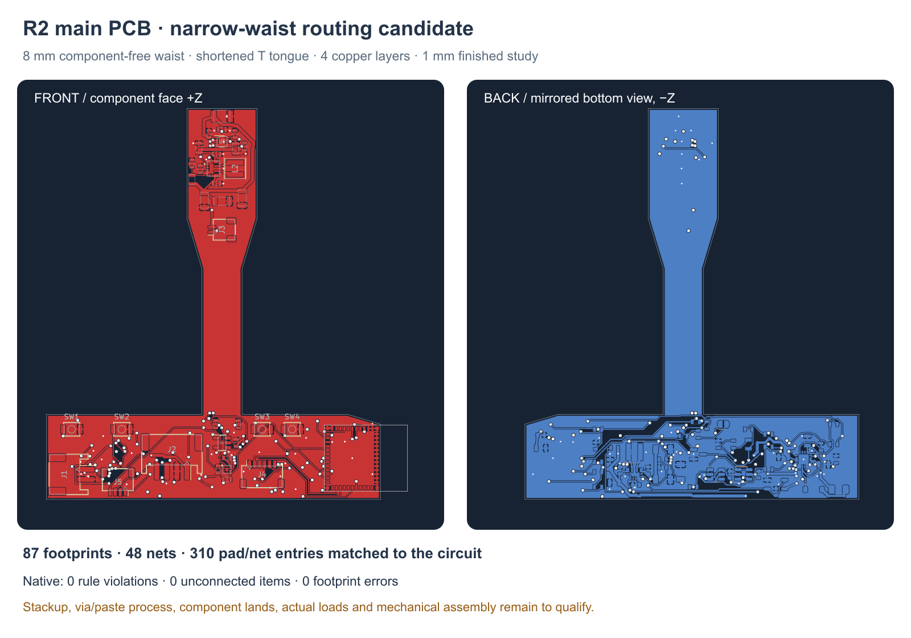

---
search:
  exclude: true
---

# R2 narrow-waist main PCB

The routed R2 candidate passes native KiCad checks with **0 DRC violations, 0 unconnected items and 0 footprint errors**. It retains all 87 main-board components and 48 nets from the checked R0 circuit. All 310 numbered electrical pad entries and all component pin sets match the circuit manifest. These are digital routing checks; mechanical assembly and electrical bench acceptance remain open.



The checked board is `hardware/pcb/prototype-r2/buttplug-r2.kicad_pcb`, SHA256 `5ba844fad77f58a8a5dfcb67f50e9070cf021048c29ed45a2751a9b8067f0bd4`. Its matching project is SHA256 `b0fcb9a05279c3f259b27659a75274c39afe2a35170d57e78e3d39fbbb46e03b`. `drc-main-r2.txt` and `layout-validation-r2.json` record the native result and exact pin/net comparison. The front/back figure has its own source record, `main-pcb-r2-source.json` beside the image.

The board follows the selected 15 mm neck as a single rigid T. It is centered at Z −0.5…+0.5 mm, has an 8 mm component-free waist over Y 0…20 mm, widens to 14 mm in the body and ends at Y 52 mm. The four-layer reservation is 1.00 mm finished, including 0.02 mm total solder mask. A STEP substrate export excludes the masks and should measure 0.98 mm. Supplier stackup approval remains open.

The immutable placement source is `placement-source-r2.kicad_pcb`, SHA256 `79ea0fc60ab08195628891154b3b43a7c88df467c6af6f78fb26cc2b9a41b1f9`, with its matching project. `placement-report-r2.json` and `placement-audit-r2.json` describe that unrouted input. Its generator must not replay over the routed board. The checked R0 sources also remain unchanged.

Three bounded pose changes are recorded separately in `routing-source-r2.json`, `routed-placement-delta-r2.json` and the current `routed-placement-report-r2.json`:

| Part | Current routed pose | Reason |
| --- | --- | --- |
| C14 | B side, X 0.5375 / Y −20.5 mm | Moves its terminals outside the motion sensor’s under-body routing restriction while clearing adjacent courtyards. |
| J3 | F side, X 0 / Y 27.8 mm, mouth +X | Clears the motor wire’s original +Y exit obstruction at C24. |
| J1 | F side, X −30 / Y −21 mm, mouth −X | Gives the dock wire a screened side exit; the old −Y mate left only 0.05 mm before the cover. |

J5 stays in the handle with its plug facing +Y. Connector directions follow actual native pad positions. The current pose report includes all component boxes and the three separate PH2/SH2/SH4 mated-plug envelopes. CAD must consume this report rather than the frozen placement report.

The 3.3 V converter, feedback divider, motion sensor and motor gate occupy the handle. The motor converter and driver are on the positive Z face of the shortened tongue. Short converter and bypass paths are explicit manual routing sources; local guard/supply connections and ground stitches complete the imported general routing. Fine-pitch escapes and local power constrictions have smaller widths than the wider supply trunks. Neither their geometry nor the native checks establish a current or thermal rating. C52’s nearest GND stitch is 2.858 mm away, compared with 0.725 mm for the other converter HF bypasses. Two independent geometry screens found no useful closer off-pad stitch under the service-header/USB constraints. This longer return remains a quantified layout and bench-review limitation; it is not treated as a datasheet numeric violation or a qualified power loop.

F.Cu, In2.Cu and B.Cu carry signals and power. In1.Cu has no signal tracks and provides the GND reference. The manual USB pair remains on F.Cu, uses 0.20 mm tracks and has no vias. DM and DP lengths are 23.613961 and 23.589697 mm, a 0.024264 mm difference. All 1,458 center/edge reference samples in the routing audit lie on filled In1 GND. Via-only rule strips protect that corridor; these checks do not establish 90 Ω impedance, USB compliance or ESD performance.

A nominal 1.6 × 1.6 mm rule area below U7 excludes In2/B tracks and through vias while preserving In1 GND and necessary F terminal escapes. The nominal contact-sized MC3635 lands remain an engineering candidate: package-specific land, paste and assembly-process acceptance is open. The [independent electrical review](../assets/prototype-r2/independent-electronics-review-r2.txt) separately confirms a fresh 0 / 0 / 0 native result, exact library/pad/source parity and 5,703 USB reference samples on GND. Its complete process inventory checks 149 vias against 320 SMD copper shapes. The authoritative review, native report and via inventory remain in `hardware/pcb/prototype-r2/reviews/`; the linked text is an exact mirror of the compact review, not a fabrication or assembly signoff.

The completed independent review is retained in `reviews/independent-electronics-review-r2.md` and `.json`. Its process inventory covers 149 vias and 320 SMD copper shapes: three drill-in-pad locations and thirteen further annulus-only overlap pairs need location-specific review. The [assembly-process package](pcb-assembly-process-r1.md) shows the actual U1/U5 under-paste holes, U6's omitted center paste and U7's provisional lands with manufacturer references. No fill/cap/tenting or stencil process is accepted by these checks.

Routing is reproduced by `tools/pcb_r2_route.py` from the frozen placement, `manual-routing-r2.json`, `routing-session-r2.ses` and `route-refinements-r2.json`. A fresh isolated build/import/refinement reproduces all **2,377 copper geometry records and 349 physical pad records**, with matching native design settings and a fresh **0 / 0 / 0** native result. `reviews/reproduction-r2.json` records the exact source hashes and comparison; `reviews/reproduction-native-drc-r2.txt` is the reconstructed board’s report. Generated object UUIDs and file paths are excluded from the geometry comparison.

For a disposable reconstruction, copy the matching project, local footprint library and `fp-lib-table` into the output directory, then run with KiCad 7’s bundled Python:

```sh
python3 tools/pcb_r2_route.py \
  --board /absolute/path/to/disposable-copy/buttplug-r2.kicad_pcb \
  --build \
  --import-ses hardware/pcb/prototype-r2/routing-session-r2.ses \
  --refine hardware/pcb/prototype-r2/route-refinements-r2.json \
  --drc /absolute/path/to/disposable-copy/drc-r2.txt
```

`reviews/cad-pose-lineage-r2.json` independently confirms that all 87 component boxes, the three mated connectors, the 13 outline vertices and board Z exactly match the archived full-01 CAD input. Later copper changes do not change those reservations. That archived full-01 retains eight harness conflicts, two disconnected carrier groups and failed pack/cap samples. Later [mechanical candidates](mechanical-prototype-r2.md) have separate corrected source evidence; do not transfer either the old failures or later passes without checking the exact revision. A component-box screen does not establish a completed assembly. The 20 × 33 × 6 mm battery bay is unselected, and actual wires, solder, pack dimensions and tolerances remain unresolved.

Fabricator stackup/impedance, via-in-pad/stencil decisions, package-specific assembly acceptance, RF behavior, current/thermal performance, battery endurance and actual-part assembly require separate validation. This candidate is not released for fabrication or body-contact use.
