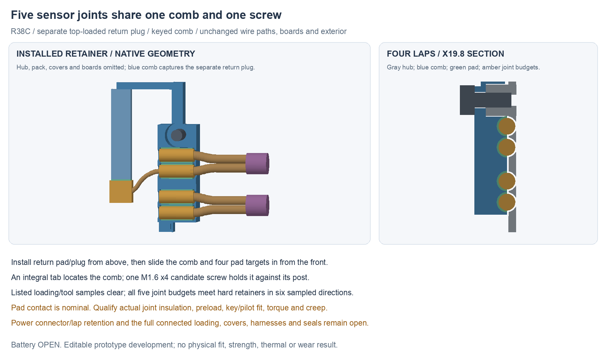

---
search:
  exclude: true
---

# Shared sensor-joint retention R38

R38 gives the four pack-sensor lap joints and the sensor-return junction a
shared removable retainer. One screw holds a keyed comb; its upper bridge
captures a separate drop-in return plug. The right hub gains an integral
screw post, comb pocket and locating slot. The existing wires, sensor heads,
boards, motor mount, 15 mm neck and exterior remain unchanged.

The current checkpoint is **sensor C**, based on the integrated R37F native
assembly. Battery selection remains **OPEN** and the human-owned BOM is
unchanged. Power-side connector/lap retention and the complete prototype
proposal remain unfinished.

## Editable sources

| Source | Role |
| --- | --- |
| `hardware/cad/joint-retention-r38/sensor-c/RetainedSensorJointsR38.FCStd` | Integrated native assembly with keyed comb, separate plug and hub changes |
| `geometry-report.json` in that folder | Installed checks, declared interfaces and five pad contacts |
| `loading-review.json` in that folder | Fresh saved-source/material review, listed assembly/tool poses and hard-blocker samples |
| `hardware/cables/pack-adapter-r37/` | Unchanged native-net-matched wiring/starting-material recipe |
| `hardware/pcb/pack-pigtail-r35/candidate-f/` | Unchanged full native circuit/body/flange source |

The `sensor-c/exchange/` folder contains separate STEP development exports
for the hub, comb and return plug. Readback checks cover valid single solids,
volume/bounds and bidirectional vertex/edge-midpoint surface samples. Direct
Boolean subtraction is inconsistent on the nearly coincident hub round trip;
its exact material equivalence is therefore not claimed. The exchange report
retains that result separately. Use the native source as authoritative and
review supplier CAM/geometry before manufacture.

R37F remains the source of the body-wire anchor and conditional pack power
route. No PCB, wiring topology, cut-length recipe or battery choice changes
follow from R38.

## Two removable pieces, one screw

The comb has four half-round lap seats with 0.20 mm radial compliant-pad
targets. Their inner surfaces touch the existing Ø1.8 ×5 mm insulated-joint
budgets. Larger middle channels allow the sleeve budgets; smaller Ø1.6 mm
wire throats at the ends provide nominal axial stops with 0.05 mm clearance
to each sleeve end. These are geometric targets for an eventual insulated
joint, not controlled heat-shrink or solder dimensions.

An integral tab enters a matching hub slot, with 0.10 mm nominal lateral
clearance. It supplies a geometric rotation stop rather than requiring the
screw friction to locate the comb. A round post provides the screw seat.
The modeled M1.6 ×4 candidate uses Ø1.6 mm shank/Ø3.2 ×1.6 mm head allowances,
a Ø1.8 mm comb clearance hole and Ø1.25 mm hub pilot. Match an actual screw
profile, printed/machined material, pilot and torque before making the part;
the simplified cylinders are not a qualified thread or fastener specification.

The return-junction plug is separate so it can enter the service column from
above. Its bottom pad nominally touches the junction's top, while the comb's
bridge captures its top. Keeping this plug separate allows the four-lap comb
to slide in from the front without dragging a long tongue through the hub.
There is no nominal pad compression/preload in the current model. Select pad,
adhesive or mechanical attachment and actual joint insulation, then establish
safe preload, slip and creep on coupons.

The comb is one removable plastic piece, the plug another; five compliant
pad targets and one additional screw complete this retention study. It is not
five separately fastened clips. The motor remains independently clamped to
the metal body.

## Hub material and source conservation

The new hub is the R37F right hub minus a declared comb pocket, fused to an
integral post, then cut by the pilot and locating slot. The native result
stays one solid. Fresh review checks exact material equality to that declared
construction, preserves all 217 R37F source object shapes in the native
document, and checks the
source capture region, upper/lower bolt end seats and both pack-lid posts.
Those named regions retain all source material. The installed right hub is the declared replacement; its
local cuts remove 26.596 mm³ and its post adds 20.023 mm³ relative to R37F.
This is not whole-hub strength
or flange-compliance acceptance; the local cuts/additions remain subject to
material, load and fabrication review.

The initial A overlaps the old hub tie. B adds the local pocket and separate
plug; C adds the locating tab/slot. Preserve A/B and their exact builders/logs.
Use C for current retention development.

## Saved digital checks

The installed builder records 1,980 new-part comparisons with zero unexpected
intersections. Existing pack-lid screw/pilot interfaces are retained only
after proving no added hub material enters them. The new screw/pilot overlap
is explicitly identified as a candidate thread-forming interface.

Fresh saved-file review checks these assembly stages with all three outer
covers waiting:

1. Return pad/plug move together down the open service column. Ten listed Z
   offsets run from the installed position to 16 mm above it; comb, four lap
   pads and new screw wait.
2. The comb and its four pad targets move together from the front. Eight
   listed Y offsets run from installed to 4 mm outward; return plug/pad and
   existing hardware are in place, new screw waits.
3. Five listed axial poses of a generic tool clear the installed geometry:
   Ø1.4 ×2 mm tip plus Ø3 ×10 mm shaft. This is a bounded probe, not a selected
   actual screwdriver/handle or a continuous tool-motion proof.

For each of the five joint budgets, independent ±X/±Y/±Z translation samples
meet hard hub/comb/plug geometry within the tested 2 mm range: at most 0.25 mm for each lap and 0.85 mm for
the return-junction budget. Compliant pads
are excluded from those hard-blocker claims. The tab is also sampled rotating
both ways about the screw axis and first meets the hub at ±0.5 degrees
in 0.1-degree samples. These
checks establish nominal geometric capture, not resistance to joint pull,
torque, vibration, soft insulation deformation or creep.

The source-bound figure uses actual installed native meshes and a thin
X19.8 section. Context omits hub, pack, covers and boards; the section restores
the hub around the four lap seats. No display offsets simulate assembly.

## Remaining prototype work

Finish retention for the conditional pack power mate and its two laps, then
check the complete loose-end body/hub loading, flange termination and cover
sequence. Finish motor/dock harnesses, flange load/compliance and seals, and
consolidate the first-build/test package. Actual pack/mate receiving inputs,
materials/processes, tolerances and electrical/thermal commissioning stay
explicit first-build conditions. No physical assembly, purchase, battery
selection or energized test has occurred.
