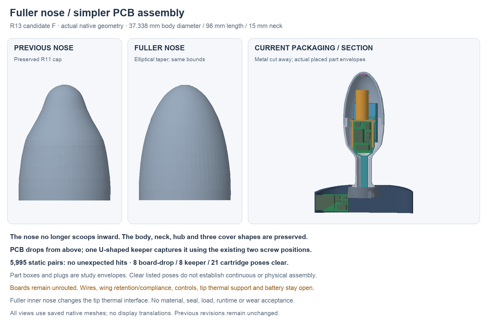

---
search:
  exclude: true
---

# Fuller nose and drop-in assembly R13

1 November 2026. Lucy clarified that the inward scoop on the nose side is
not required. **R13 candidate F** changes that taper and simplifies installing
the actual [R12 body PCB](split-pcb-r12.md). This is a saved native design
checkpoint, not a completed build proposal.

## Fuller nose

The new cap uses a rounded elliptical taper beyond the maximum body station,
replacing the previous inflected profile. The nominal maximum body diameter
remains 37.338 mm and neck-to-tip length 98 mm. The one-piece metal body and
15 mm neck are unchanged. The covered collar, central hub and three flange
cover shapes are also preserved.

The outer ellipse has radial/axial axes 18.669/43.12 mm about Y54.88. The inner
nose is also fuller, using 17.169/41.62 mm. These are editable native meridian
sketches/revolutions. The cap's original R10 thread/pilot void tools are reused
below Y57. Its outer rear and the new nose overlap by 0.02 mm before hollowing;
the earlier face-touching hollow-shell union was unreliable in Boolean
sections and is not the current cap construction.

The new inner surface changes the thermal shoe/bond gap. The stationary tip
support and thermal path must be redesigned against this surface. Enlarging
the nose does not establish better fit, thermal response or wear comfort.
Thread tolerances, material, finish, wall acceptance and seals remain open.

## One keeper, same screw positions

R12's actual board could fit statically but could not slide past the carrier's
fixed motor saddles. Its preserved R11 loading record contains that failure.
R13 removes the old upper guide lips from the carrier. The board drops into
the lower/side guides from above on the bench, with motor, keeper and plugs
waiting. The conditional pack allowance is already in place in that check.

One U-shaped keeper then lowers onto the board. It uses the existing front
plate and two screw positions; no extra fasteners are added. Its two 1.5 mm
high rails capture the wide PCB section over Y31–54.2. The first 5 mm of the
tapered board retains bottom/side support and its rear stop, without the old
upper lips. Actual PCB support, deformation, screw/formed-thread profiles,
material and handling must be qualified. These dimensions are a study, not a
retention force or printed-part acceptance.

After keeper fitting, install and retain the motor and connect the plugs on
the bench. The nominal connector mouths face inward, avoiding carrier cuts.
Feed the supported tail and front-load the cartridge with the nose cap off.
The target order is recorded in `assembly-docs/r13-drop-in.md`; complete wire
handling, motor/pack retention and the flange/tip steps are still unfinished.

## Saved-file checks

The saved native contains 110 reported primary roles plus seven separate
nominal mate probes. All 5,995 primary static pairs have no unexpected
intersections. Two inherited screw-shaft/pilot interfaces remain named and
unqualified. Nominal plug probes clear the checked context and components.

Eight listed board-drop positions, eight keeper-lowering positions and 21
front-loading cartridge positions clear their stated contexts. The cartridge
includes the actual R12 body substrate/part envelopes and four nominal mates;
the flange board stays outside this moving group. These are finite rigid
poses, not a continuous path or a flexible-wire assembly result.

Fresh read-only saved-history review checks all 117 roles, native ellipse
axes and absence of cross-document links. Seventeen retained R11 source roles
are compared through source material/volume checks; raw BRep differences after
recompute remain recorded. Positive/negative cap partitions must contain
material and conserve full cap volume within the stated 0.01 mm³ screen.
This specifically rejects the earlier cap's empty cutaway result. The native
source and frozen geometry/mesh/report hashes are indexed under
`hardware/cad/simple-assembly-r13/`.

## Remaining prototype work

The two main boards remain unrouted, with 165/81 missing connections and no
revised native board schematics. The interboard cable still needs actual
wire/contact construction, current/fault review, supported bends and strain
relief. The flange PCB island needs mechanical retention and a deliberate
compliance region that preserves the stop and removal load path. Local button
actuation must be rebuilt around the new board positions. The tip needs a
stationary support and insulated thermal interface to the fuller nose.

Battery selection stays OPEN; 18 × 33 × 6 mm finished pack remains only a
conditional budget. Exact parts, material/process choices, sealing and a
practical complete first-build plan are still needed for Lucy's review. The
human-owned BOM remains header-only. No purchase, fabrication, physical fit,
operation, runtime or wear validation is claimed.
