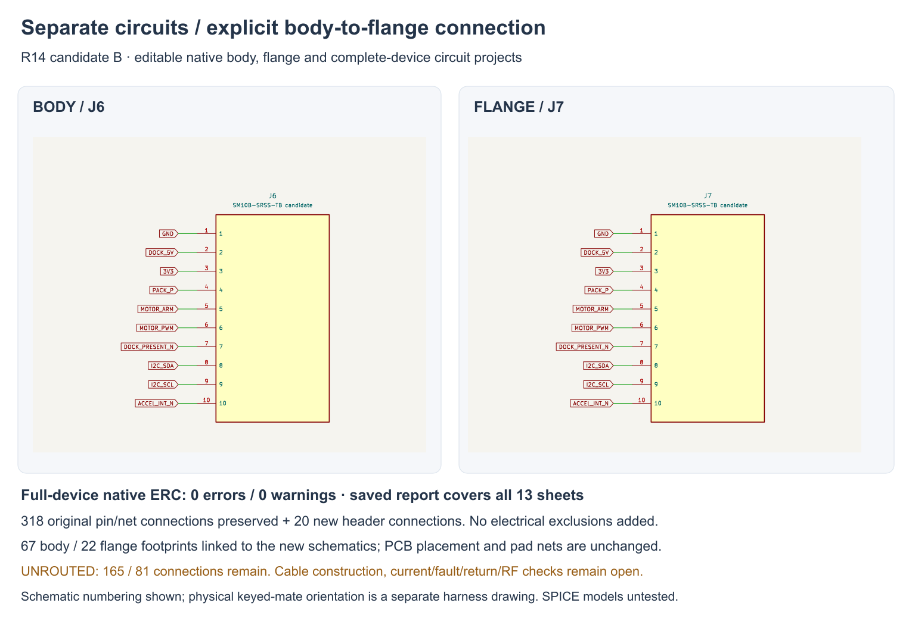

---
search:
  exclude: true
---

# Split native circuits R14

1 November 2026. **Candidate B** provides native body and flange circuit
projects and a full-device hierarchy. Both PCBs retain the R12-I placement
used in the R13-F mechanical study. Routing remains unfinished.

## Editable sources

The package is `hardware/pcb/split-r14/candidate-b/`:

| Project | Purpose |
| --- | --- |
| `system-r14.kicad_sch` / `.kicad_pro` | Thirteen-sheet complete-device circuit, both main boards, explicit J6/J7, remote tip and two cell thermistors |
| `body/body-r14.kicad_sch` / `.kicad_pro` / `.kicad_pcb` | 66 original body footprints plus J6; power, motor, motion, charge guard and interfaces |
| `flange/flange-r14.kicad_sch` / `.kicad_pro` / `.kicad_pcb` | 21 original flange footprints plus J7; dock, radio, local controls and service |
| `system-native.pdf` / `native-svg/` | Native review plots of all thirteen sheets |

The preserved R0 native symbols, values, footprint fields, pin identities/types
and wires are partitioned directly. Lucy/Gaby's screenshot remains reference
evidence. Each board has local symbol and footprint libraries. The remote tip
remains a third rigid PCB.

## Circuit checks

J6/J7 use the ten numeric assignments defined in [R12](split-pcb-r12.md), with
passive symbol pins. The full-device hierarchy joins those named nets and
retains the external sensors. It assumes the intended 1:1 cable connection;
it does not simulate reversal, disconnection, intermittent ground or faults.
Physical keyed-mate orientation, conductors and current/return review remain open.

Fresh native XML export preserves **318 original pin/net nodes** and adds
20 header nodes, for 338 total. All original component values, footprint fields
and symbol pin identities/types match. Its 94 exported component records
comprise 89 main-board records and five original external-circuit records.
Power-flag annotations are not in that component count. Board-only exports
contain 67/22 components and 215/107 pin/net nodes, each matching its full-device
subset. The source-bound record is `native-netlist-parity.json`.

The actual saved native GUI ERC report covers all thirteen sheets and reports
**zero errors and zero warnings**. No electrical exclusions or extra driver
flags were added. The default ignored category is **SPICE model issue**; no
simulation or analog behavior is claimed. `native-erc.json` binds
`system-native-erc.rpt` to the current source hashes. This is the full-device
connected-circuit result; a board opened alone lacks the other board's drivers.

Save was disabled in the workspace panel. Selecting a fresh local
`/private/tmp` folder enabled Save and produced the complete native report,
which was independently verified and copied into the package. The subsequent
UI observation timed out; the actual file proves the export completed.

## Linked boards

All 89 saved footprint paths match the board-specific native schematic
instances. After removing only instance-path lines, each complete PCB file is
**byte-identical** to its R12-I source, including cached footprint graphics,
pads, nets, drills, outline, keepouts and stackup. A separate native geometry
signature also agrees. R13's physical placement is preserved.

Fresh native DRC reports zero placement-rule violations and footprint errors.
**165 body and 81 flange connections remain unconnected.** No routed copper
or ground pours exist. These findings are not waived. An Update-PCB GUI import
was not used, and no import-roundtrip result is claimed.

The first linking guard compared C++ library-ID proxy display strings, which
include process addresses. Its diagnostic shows only those differences. The
corrected guard uses real library identifiers plus complete path-neutral native
text. It verifies the saved files without rewriting them. Candidate A retains
the earlier page ordering; B orders and uniquely numbers the sheets logically.

## Remaining work

Route the switching-power loops, local bypass/feedback, motor returns,
radio/service interface and remaining nets against these sources. Old T-board
routes are not transferred to this placement. Define the actual supported
interboard link together with flange retention/compliance and its stop/removal
load path. Working controls, stationary tip support/thermal bond, battery,
materials, seals, process choices and the complete build plan remain unfinished.

JP1 stays open and default firmware motor output locked. Battery selection
remains OPEN; the human-owned BOM is header-only. No purchases, fabrication,
physical operation, endurance or wear validation follows.
