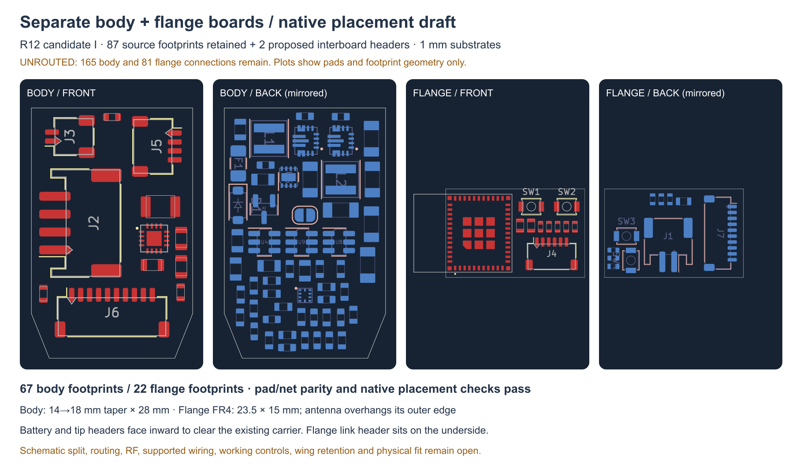

---
search:
  exclude: true
---

# Separate board placement R12

1 November 2026. The current native placement candidate is **I** under
`hardware/pcb/split-r12/candidate-i/`. It gives the one-piece/front-loaded
architecture actual component placement on two main boards. It is **unrouted**;
the complete prototype proposal remains unfinished.

## Circuit conservation and space

The preserved R2 circuit's 87 main-board footprints occur exactly once:
66 on the body, 21 on the flange. Two proposed interboard headers bring the
counts to **67 body / 22 flange**. The separate routed tip island is unchanged,
so the proposal still has three rigid boards total. All original numbered
pad/net assignments match the circuit manifest.

The 1 mm body substrate is 28 mm long, tapering from 14 to 18 mm width.
The flange FR4 is 23.5 × 15 mm, cropped before the radio antenna; the module
overhangs the FR4. This preserves the outboard antenna space within the R11
flange budget. Native copper keepout and installed RF performance still need
review during routing; a clear outline is not radio qualification.

The two regulator groups remain on the back. Their 2.7 mm candidate capacitors
require a **2.75 mm back-component allowance**, increasing R10's old 2.5 mm
budget. The pack allowance remains fixed; the resulting nominal gap is only
0.3 mm. This does not select or qualify a battery. The input fuse and series
diode use the back; charger capacitors remain on the front. Placement packing
does not establish suitable power loops, heat spreading or return paths.

Battery header J2 and tip header J5 face inward. This clears their nominal
mates without cutting the existing carrier. J6 faces toward the neck; J7 is
on the flange board's underside and faces inward. The new header study uses
3.2 mm height, explicitly an allowance rather than a controlled part maximum.
The two user button centres are now 6 mm apart at Y−14; the old actuator
mechanism cannot be transferred to these positions.

## Proposed connection

J6/J7 use the stock KiCad footprint for JST SH `SM10B-SRSS-TB`, with proposed
`SHR-10V-S-B` housings and `SSH-003T-P0.2-H` contacts. These are review
candidates. The [manufacturer's SH drawing](https://www.jst-mfg.com/product/pdf/eng/eSH.pdf)
was consulted; wire selection, current/temperature limits, actual mates,
termination and a supported bend route remain open. No harness is ready to order.

| Pin on J6 and J7 | Net |
| --- | --- |
| 1 | GND |
| 2 | DOCK_5V |
| 3 | 3V3 |
| 4 | PACK_P |
| 5 | MOTOR_ARM |
| 6 | MOTOR_PWM |
| 7 | DOCK_PRESENT_N |
| 8 | I2C_SDA |
| 9 | I2C_SCL |
| 10 | ACCEL_INT_N |

The numeric mapping is defined at each header, not inferred from cable
colour or apparent left/right orientation. These headers are not yet
integrated into revised native schematics. The old system schematic remains
the preserved electrical reference. Separate board schematics, fault/current
review and actual cable drawings are required before routing is complete.

## Checks and assembly finding

Fresh native KiCad checks report zero placement-rule violations, zero
footprint errors and zero same-face courtyard-box overlaps on both boards.
**165 body and 81 flange connections remain unconnected.** Those counts are
not zero-error electrical or fabrication acceptance.

Source-bound native Edge.Cuts, Fab bounding boxes and candidate heights give
90 substrate/component envelopes. Their 1,800 comparisons against the
20 retained R11 roles have no intersections. All seven nominal plug probes
also clear that context and the placed part envelopes. JP1 is a zero-height
solder jumper; its electrical pads remain present. These boxes omit solder,
tolerances, real terminal geometry, wires and strain relief.

Actual board loading exposes a separate failure: the populated PCB cannot
slide through the carrier's fixed motor saddles. Seventeen of the 19 listed
axial poses collide. Dropping it from above also meets the upper guide lips
at three listed poses. These failures are retained in `board-loading-r11.json`;
static fit did not establish assembly. The next mechanical revision moves
the upper capture to the existing keeper to permit top loading.

## Candidate history

The folder README indexes all retained attempts. A had placement conflicts
and a same-process KiCad library error; B–D established native checks before
mate space was included. E could not place two resistors. F placed every
part and reserved mates but two mates hit the carrier. G/H tested inward
placement/orientation and retained their packing failures. I changes the
header directions and power-part face allocation, clearing that static
context without carrier clearance cuts. No prior attempt is overwritten.

Next work includes the keeper/loading revision, native schematic split and
routing, an actual supported interconnect, flange-island retention/compliance,
working local controls and the new tip support/thermal path. Battery selection
stays OPEN; the human-owned BOM remains header-only. No purchases, physical
build, operating, endurance or wear validation follows.
