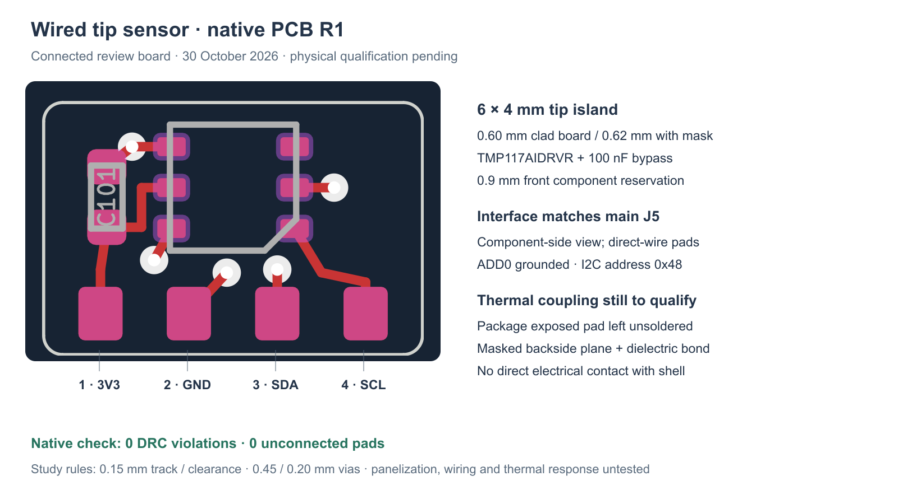

---
search:
  exclude: true
---

# Wired tip PCB R1

30 October 2026. The separate tip island is a connected, routed native KiCad
review board. Its three footprints have zero native DRC violations and zero
unconnected pads. It is not a fabrication release or an installed temperature
qualification.

## Native source and circuit

Open `hardware/pcb/tip-r1/buttplug-tip-r1.kicad_pcb` with its adjacent project
and local footprint library. The main schematic's `REMOTE_TIP` domain is its
circuit source; it contains U101, C101 and J101. Remote components are excluded
from the main T-board layout. The circuit and this board use the same four nets.

| J101 pad | Net | TMP117 electrical pin |
| --- | --- | --- |
| 1 | 3V3 | 5 V+; C101.1 |
| 2 | GND | 2 GND and 4 ADD0; C101.2 |
| 3 | I2C_SDA | 6 SDA |
| 4 | I2C_SCL | 1 SCL |

Pin 3 ALERT is unused. ADD0 to GND selects address 0x48. The current exact sensor
candidate is **TMP117AIDRVR**, replacing the unresolved MAX31875 package study.
The [TI datasheet](https://www.ti.com/lit/ds/symlink/tmp117.pdf), DRV0006B land
drawing 4223922/A, defines six 0.45×0.30mm lands, 0.65mm pitch and 1.95mm row spacing.
This local footprint follows that drawing with 0.07mm solder-mask expansion.
The six electrical pins are not a seven-net symbol.

TI recommends leaving the exposed thermal pad unsoldered on a rigid PCB to
reduce stress-related error. There is no central copper or paste land. The
backside ground plane remains mask covered and must be isolated from the metal
shell by a qualified dielectric thermal bond. Solder mask alone is not that
qualification. The current rounded-board curved-shell bond reservation is approximately 0.68–1.7mm;
installed response and offset must be measured with the actual material.

C101 is a Murata GRM155R71C104KA88D candidate: 100 nF, 16 V, X7R, 0402.
Its [manufacturer data](https://www.murata.com/en-global/api/pdfdownloadapi?cate=luCeramicCapacitorsSMD&partno=GRM155R71C104KA88%23)
defines the body envelope; acceptance of the generic KiCad land pattern, actual
lot and procurement remains open. The product BOM is unchanged.

## Mechanical and process study

The board is 6×4 mm with 0.3 mm corner radii and an explicit two-layer stackup:
0.60 mm clad board, 0.62 mm including the two nominal 0.01 mm mask layers.
The board-only STEP excludes mask and reports 0.60 mm. Its component-face envelope
reserves 0.9 mm for the sensor. R1 CAD orients the board across XZ near the nose,
with the component face toward the base. Check the adjacent mechanical record
for the current complete carrier and wire reservations.

Routing uses 0.15 mm clearance/track width, 0.45 mm vias with 0.20 mm drills and 0.20 mm
copper-edge clearance. These are study rules, not an accepted supplier process.
The 0.125 mm stencil example is TI's package reference; actual paste, stencil,
panelization, reflow and inspection require assembler review. Direct-wire pads
have no paste openings. All vias need agreed tenting and insulation; the final
board finish, handling and strain relief remain open.

The native DRC report is `hardware/pcb/tip-r1/drc-tip-r1.rpt`; hashes, pad nets,
tracks and height reservations are in `validation-tip-r1.json`. The board-only
STEP is review geometry. Regenerate using KiCad7's bundled Python with
`tools/tip_pcb_r1.py`. Host DRC does not prove solderability, thermal accuracy,
electrical isolation, physical fit or I2C performance beside the running motor.

The [firmware record](../firmware.md) documents ID/configuration
verification, the 1/128 °C data format, Data_Ready handling and the bounded sample
cache. No hardware has been flashed or measured.

An independent electronics review reloaded the saved native board and project,
matched all 12 pads to the current main XML, and compared native pad geometry
with all three local footprint libraries. Its fresh native DRC reports zero
violations, unconnected pads or footprint errors. The front central exposed-pad
region is free of copper, paste and vias in the bounded geometry screen.
Current hashes and process limits are retained in
[`independent-electronics-review-r1.json`](https://github.com/researchanddesire/buttplug/blob/main/hardware/pcb/tip-r1/reviews/independent-electronics-review-r1.json)
and the adjacent `independent-electronics-drc-r1.rpt`. These checks do not
qualify soldering, tenting, insulation, harness fit or installed thermal response.
