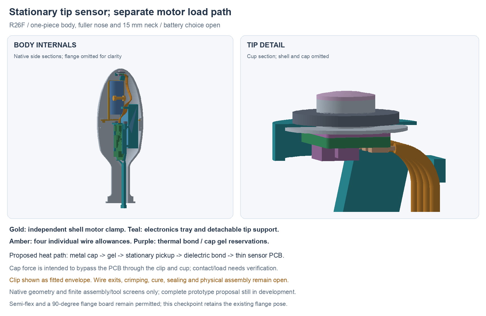

---
search:
  exclude: true
---

# Stationary tip support and individual wires R26

R26F adds a detachable, stationary sensor support and four individually routed
wire allowances to the [R25D independent motor mount](motor-shell-mount-r25.md).
The metal motor clamp, body, cap, fuller nose, 15 mm neck and main-board poses
are preserved. The tip board moves 0.77 mm rearward; its native circuit and
local geometry are unchanged. Battery selection remains **open**.

This is a conditional CAD and assembly checkpoint. The complete functional
prototype proposal is still being prepared. Native geometry and finite stage
screens do not establish received-part fit, thermal response, sealing or load.

## Separate functions and assembly order

The motor stays in its metal clamp on the body rim, captured by the cap seat.
Its intended vibration path is into the metal shell. The electronics tray and
PCB-only keeper remain separate from that mount.

A narrow beam on the motor's left side supports the tip cup. Its tongue slides
into a new receiver on the electronics tray and uses one candidate M1.6 × 6
screw. It is detachable so the motor can enter before the tip cup is installed.
The cup, pickup and sensor stay stationary while the nose cap turns.

The proposed thermal path is metal cap → thin gel interface → metal pickup →
0.25 mm dielectric thermal bond → thin sensor PCB. The pickup's flange/groove,
fitted clip and cup intend to carry cap force into the support instead of the
PCB or solder joints. This is a load-path proposal, not a verified contact,
preload, clip strength or installed sensor-accuracy result.

For assembly, load the electronics first. Keep the tip wire ends free, feed
them through the motor mount's central opening, then seat the motor module.
Fit and wire the detachable tip support afterwards. The large rigid loading
offsets are **not** a claim that a connected, trimmed harness can stretch through
those stages. See `assembly-docs/tip-support-r26.md` for the assembly target.

## Nominal interfaces

| Interface | R26 proposal | Limit of the model |
| --- | --- | --- |
| Tip board | Same 6 × 4 × 0.62 mm TipR1; component face Y93.41, back Y94.03 mm | Native circuit unchanged; actual assembly tolerance pending |
| Pickup | Ø3.5 mm probe, Ø7.4 mm rear flange, Ø2.3 mm groove | Custom part; material, finish and groove tolerance unselected |
| Clip | Accu HETC-2.3-A2 candidate; CAD Ø6.4 × 0.64 mm fitted allowance | Annular envelope, **not** true E-profile or installation deflection |
| Dielectric bond | 0.25 mm; DOWSIL SE4485L process candidate | Fixture, confined cure, stress, adhesion and isolation need review |
| Cap interface | Approximately 0.217 mm minimum nominal cap/pickup separation; GEL37 candidate | Sliding contact, dosage, compatibility and pump-out unqualified |
| Support fastener | SSCF-M1.6-6-A2 candidate; Ø3.2 mm head allowance, 1.5 mm hex reference | Ø1.25 mm polymer pilot; tap, torque and strength unqualified |
| Motor-ring passage | New receiver limited to R15.1; wire comb R15.0; ring ID R15.5 mm | 0.4 / 0.5 mm nominal radial transport budgets, no tolerance stack |
| Wire guides | Four swept R0.45 mm channels | OD0.60 mm wire allowances; guide edge finish/restraint pending |

The thin PCB/backside interface follows [TI's TMP117 solid-temperature layout
guidance](https://www.ti.com/lit/ds/symlink/tmp117.pdf). The existing unsoldered
exposed-pad choice remains. This does not make the assembled system accurate
to the bare IC specification.

[DOWSIL SE4485L](https://www.dow.com/documents/11/11-3070-01-dowsil-se-4485-l-adhesive.pdf?iframe=true)
has typical conductivity 2.2 W/mK. It is moisture cured: tack-free time does
not demonstrate cure inside this bond. Use a controlled bond-thickness fixture
and representative cure coupons before installation. The L variant is the
reference; do not substitute the different non-L data.

[Parker's GEL37 document](https://www.parker.com/content/dam/Parker-com/Literature/Chomerics/Catalogs/Parker-Chomerics-THERM-A-GAP-GEL-37.pdf)
describes a fully cured, dispensable material and 3.7 W/mK typical conductivity.
Its property-table header names GEL25NS despite the GEL37 title; cross-labelled
table properties are not adopted. No body-contact material approval follows
from either thermal-material reference.

## Four individual wires

The mapping remains J5.1–4 → J101.1–4: 3V3, GND, SDA and SCL. The native TipR1
rotation reverses local X in the global assembly; the planner uses the numbered
pads rather than a visual left-to-right guess.

The [Accu-Glass 113094 candidate](https://www.accuglassproducts.com/wire-and-cable/kapton-insulated/stranded-wires/32-awg)
is 32 AWG stranded wire with nominal catalogue OD0.4953 mm. CAD uses insulated
OD0.60 and bare OD0.26 mm allowances, not guaranteed maker maxima. Its current
listed long-term bend reference is 1.778 mm; the design uses a 2.5 mm centreline
target with its radius-basis and production tolerance still to confirm.

Four quintic paths first spread outward and stagger in height, then merge
below the motor into separate Ø0.60 mm sweeps. Exact R2.5 quarter-circle bends
turn up into the tip's direct-wire pads. Polynomial joins are C2; the circle
joins are tangent continuous (C1) with a curvature step, not globally C2.

| Pin | Native insulated path (mm) | Guarded polynomial radius lower bound (mm) |
| --- | --- | --- |
| 1 | 51.20745 | 2.76449 |
| 2 | 50.73912 | 2.74652 |
| 3 | 50.47625 | 2.69565 |
| 4 | 50.43837 | 2.61987 |

The circular bends are R2.5 exactly. Polynomial bounds use subdivided Bernstein
derivative hulls with a numerical guard; they are not directed-rounding formal
proof or physical bend qualification. Minimum nominal insulation separation is
0.0840 mm. This narrow allowance needs actual wire/guide tolerance review.
The 1.1 mm bare tails and solder volumes are process reservations. Same-net
tail/solder overlaps are intentional; inter-net overlaps are absent in the model.

Use the **without-flange SHR-04V-S** housing candidate, with SSH-003T-P0.2-H
contacts. [JST's catalogue](https://www.jst.com/wp-content/uploads/2021/01/eSH-new.pdf)
shows a 5 mm four-position width; the earlier B-suffix flanged candidate is
7 mm and is not interchangeable with this envelope. The modeled J5 wire exit
at Y54.975/Z2.1 mm is an assumption, not a controlled mated datum. Actual
housing/crimp/egress can require a route revision.

The editable WireViz recipe, `hardware/cables/tip-r26/tip-sensor-r26.yml`,
uses four **80 mm starting blanks**, trimmed on a routing fixture. The installed
path lengths above are not finished cut lengths and do not include a qualified
housing-internal termination. Removed excess is not stored service slack.
All four candidate jackets are brown/amber; function colours only identify pins.

## Saved evidence and scope

Current source:
`hardware/cad/tip-support-r26/candidate-f/StationaryTipR26.FCStd`.
Its `geometry-report.json` binds the E support build, wire plan and swept
geometry. `saved-review.json` records a fresh forced recompute, source
conservation, stored wire poles/circle comparison and explicitly staged
assembly/tool screens. `artifact-index.json` binds the review package and
external source inputs; native CAD remains authoritative.

The source E support checks 118 primary roles / 6,903 static pairs with no
unexpected intersections, plus three named unqualified screw/pilot interfaces.
F preserves all E roles and adds 12 wire/tail/solder roles, checking another
1,482 pairs with no unexpected hits: 130 primary roles / 8,385 total pairs.
There are no new nominal-mate or conditional motor-flare hits. Seven mate
allowances and two process allowances bring the saved-role review to 139.
The inferred motor lead flare is still not a controlled manufacturer maximum.

The new receiver/guide is checked at 21 electronics/body positions and 12
motor-module positions with free wire ends and the tip waiting. Twenty cap
positions cover the installed tip and four wires. A separate +7 mm supported
tip position and bounded generic solder-tool approaches assess access before
final seating. These finite poses and generic tools do not prove continuous
assembly motion, actual hand/tool access or connected-harness service travel.

A preserves the original support/receiver roof clash. C preserves three wire
overlaps from the flat escape array. D clears those but lacks E's motor-ring
transport allowance, wider solder window and actual wire comb. These are
antecedents, not alternate build choices. Wire plans A/B remain as evidence.

Next work includes actual motor/interboard wiring, pack/NTC retention, working
flange controls and removal-load/compliance, seals and supplier-reviewed parts
and processes. Semi-flex and a 90° flange-board rotation remain allowed; R26
retains the current flange pose. No parts have been ordered, fabricated or
physically tested, and the human-owned BOM is unchanged.
