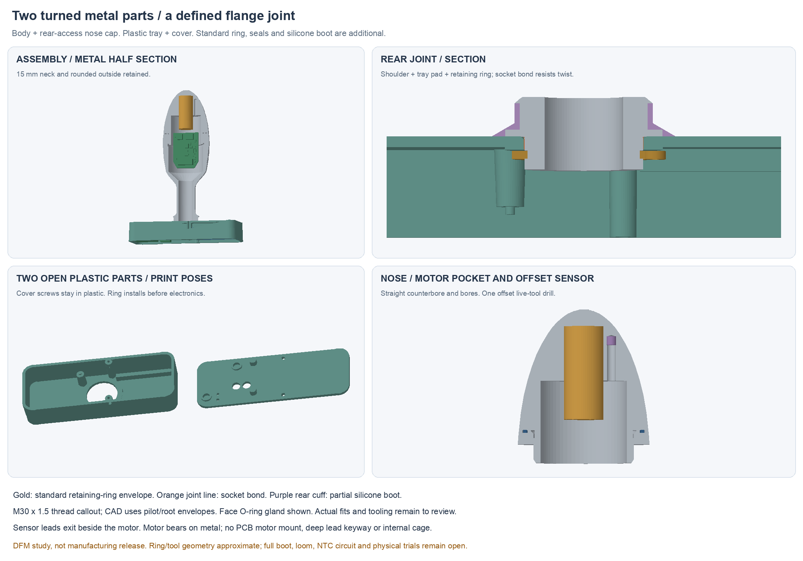
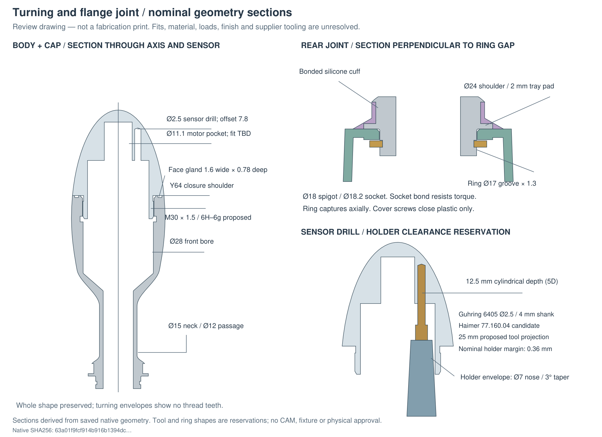

# Hardware

| Area | Source / status |
| --- | --- |
| Current mechanical study | `hardware/cad/manufacturing-layout/ManufacturingLayout.FCStd` |
| Part exchange | `MetalBody.step`, `MotorThermistorCap.step`, `FlangeTray.step`, `RearCover.step` in that folder |
| Plastic study prints | `FlangeTray.stl`, `RearCover.stl`; slicer/physical trial pending |
| Detailed DFM / evidence | Adjacent `README.md`, `DFM.md` and `review.json` |
| Rebuild / verify | `tools/build_manufacturing_layout.py`, `tools/verify_manufacturing_layout.py` |
| Prior electrical reference | `hardware/pcb/pack-pigtail-r35/candidate-f/system-r35.kicad_pro`; NTC/tabs not revised |
| Bench code | `firmware/`; former TMP117 interface |
| Product BOM | `hardware/bom.csv`, human-owned and header-only |

## Current interfaces

Two custom metal parts: turned body and cap. Body features include Ø15 neck,
Ø12 passage, straight Ø28 front bore and turned rear shoulder/spigot/ring groove.
Cap has rear-access bores, a metal motor stop and one offset sensor drill.
Motor pocket Ø11.1 is a nominal reference, with actual fit/force still open.

Nose joint: provisional M30×1.5 and a candidate 32×1 face O-ring. Thread teeth
are represented by pilot/root envelopes; supplier-reviewed callouts and
seal/closure tolerances must control machining.

Rear: Ø24 shoulder, Ø18 bonded spigot, Ø18.2 tray socket and DIN47118×1.2 ring
candidate. The ring retains axially; socket bond resists torque. Boot cuff
bonds to a recessed Ø19.5 land and finishes at the Ø21 upper shoulder.
The full boot/rear service closure is unfinished. Cover screws now engage
plastic only. Flange PCB tabs moved away from ring/tool space; CAD-only proposal.

Body PCB uses a sleeve/two foam pads, with no rigid cage. The 33×8×20 mm pack
remains an unselected size reference. Charging target axes remain X−32,
Z8/GND and Z12/DOCK_5V; the prior charger needs the revised magnet positions.

## Compatibility

The two-wire NTC needs a new analogue input, calibration and fault handling;
it does not connect to the former J5 I²C interface as-is. Cap/board loom turns
with flange tails disconnected. Actual retention, loom motion and service
need a trial. No physical assembly or seal result exists. Old P1 kits are historical.

The current source-backed DFM review covers Protolabs/Fictiv/HLH guidance,
Sandvik tooling, source-access limits, setup candidates and tolerance budgets.
Net metal volume is about32.8 cm³; material and total weight remain to decide.

