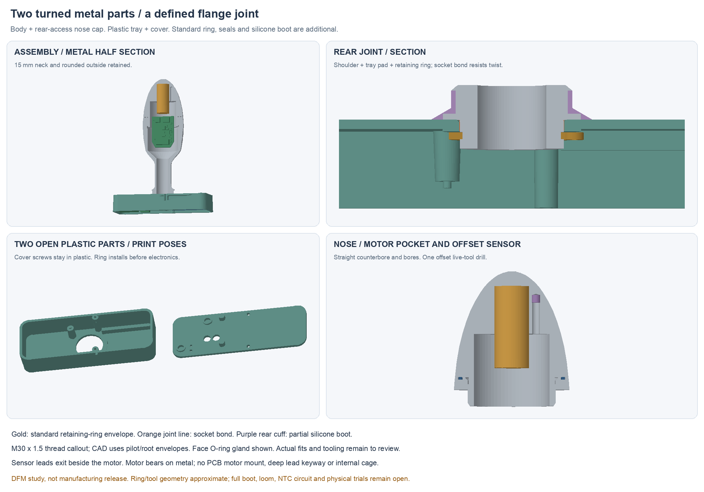

# Manufacturing design proposal

**Two custom CNC-turned metal parts:** hollow body and screw-on nose cap.
They join an open plastic flange tray and rear cover, with a silicone boot.
The 15 mm neck and rounded outside remain. This is a DFM study, **not a
manufacturing release**.

## Rear joint

**Discussion ahead of CAD:** Lucy identified axial play and wire-twist risks.
The next proposal is a keyed collar plus short rear thread/thin clamp nut, with
a keyed tab washer considered for positive locking. No separate compression
limiter is selected. Safety wire/rivets remain alternatives. These changes are
not modeled below; the saved study still uses the ring/bond joint.

The body has a turned Ø24 shoulder and Ø18 spigot. The tray's 2 mm root pad
fits between that shoulder and a standard retaining ring inside the tray.
The cover screws close plastic only; they no longer attach to the metal.

A bonded spigot/socket resists twisting. The ring supplies axial retention,
not antirotation. A recessed Ø19.5 metal land receives the silicone boot cuff,
which finishes flush against an Ø21 upper shoulder. The cuff covers the exposed
metal/flange junction; the complete boot and rear closure remain to design.

The dimensional ring candidate is DIN47118×1.2 / Rotor Clip DSH-18. CAD has an
approximate installed outline, not vendor geometry. Install it before the PCB
and pack; its lugs face the empty battery wing for tool access. Ring/groove
loads, plastic bearing/creep and wet-aged bond strength remain untested.

## Turning and cap

The body has a straight Ø28 front bore tapering to the Ø12 neck bore, with no
hidden bulb-shaped internal undercut. Its rear attachment is entirely turned.
The cap is shorter: the seam moves to Y64, without changing the rounded outside.
A rear counterbore exposes the motor pocket and separate sensor drill.

The motor still seats directly on metal. Its nominal Ø11.1 pocket is not an
approved press fit. The thermistor moves beside it into one straight Ø2.5 blind
hole near the nose flank. This needs **one offset live-tool drilling operation**;
there is no deep internal lead keyway. Motor load does not pass through the PCB
or sensor potting. Thermal response and motor bias need measurement.

Provisional nose joint: M30×1.5 thread and 32×1 face O-ring. CAD uses thread
pilot/root envelopes with a drawing callout, not helical teeth. Thread fit,
runouts, gland tolerances, tool access and closing torque need machinist review.
The modeled joint reserves6 mm of full male thread and explicit lead/runout spaces.
See the current [hardware source](hardware.md) for the detailed DFM notes.

## Assembly and next gates

1. Stage the boot onto the neck, then bond/fixture the body into the tray and
   install the ring through the open rear. Cure before applying cap torque.
2. Pot the offset NTC, seat the motor, and prewire the insulated body PCB as a
   cap module. Foam pads extend into the cap counterbore. Feed free flange tails
   through the neck; turn the whole module and connect those tails last.
3. Install the flange board and selected pack; close the plastic cover, then
   finish the boot bond/closure. The root bond is a factory joint; battery
   service needs access through the boot's still-undesigned rear closure.
4. Review machining, actual motor/ring fits, root pull/bend/torsion, seal/bond
   aging and actual tool/loom access before fabricating a replacement fit kit.

NTC analogue circuit/firmware, proposed PCB mounting tabs, actual loom and
charger mate remain unintegrated. The simpler straight bore also changes metal
mass; material/weight must be reviewed for wear comfort. Battery/BOM remain open.
No machining, physical assembly, sealing or wear result is claimed.
